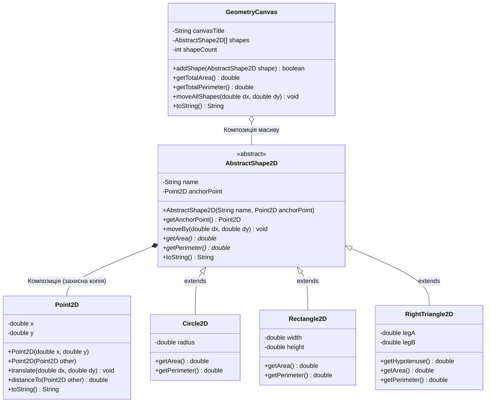
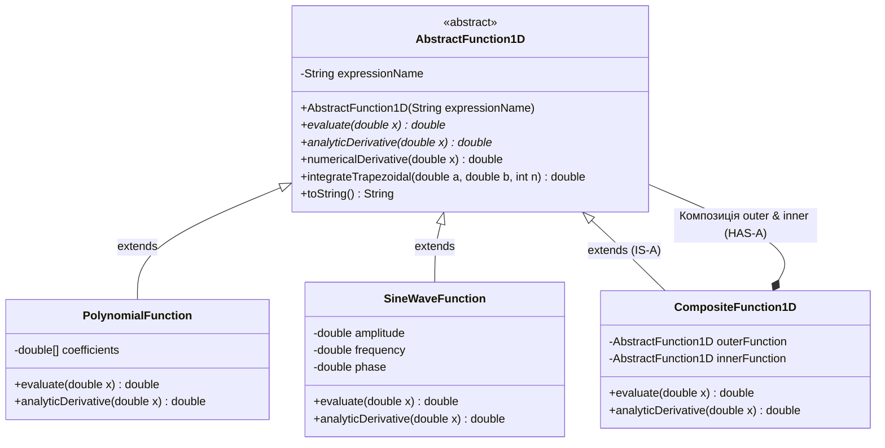
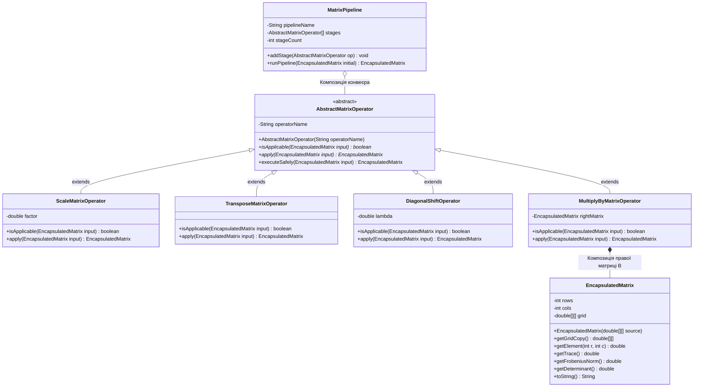
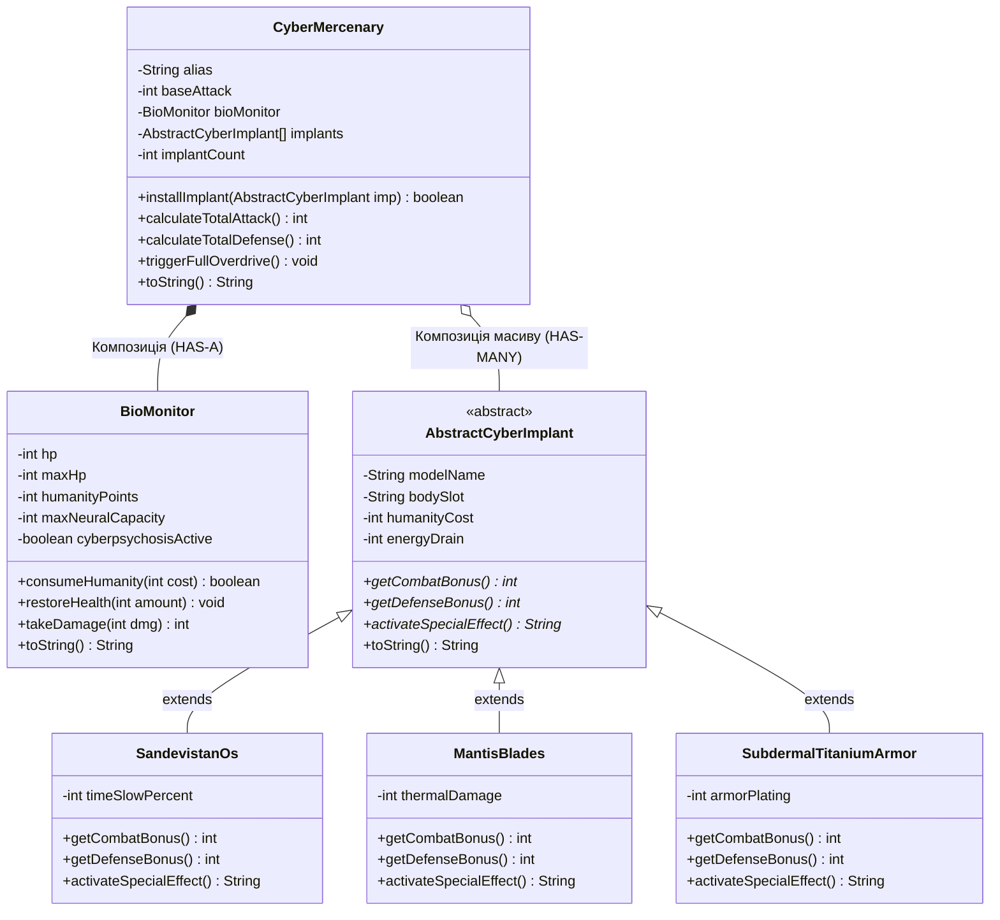

# Домашнє завдання до Практичної роботи №9
## Тема: Ключові концепції ООП (Частина 2): Поглиблена Інкапсуляція, Композиція (`HAS-A`) та Абстрактні класи (`abstract`)

---

## 📌 Загальна інформація та правила виконання

### 🎯 Мета завдання
Закріпити на інженерних, математичних та ігрових задачах ключові архітектурні механізми ООП:
- **Поглиблена інкапсуляція та захисне копіювання (*Defensive Copying*):** суворий захист внутрішнього стану (`private`, `final`), ізоляція внутрішніх масивів (`1D` та `2D`) і вкладених об'єктів від зовнішніх змін через посилання, відмова від небезпечних «відкритих сеттерів» на користь перевірених бізнес-методів.
- **Абстрактні класи та методи (`abstract class`, `abstract method`):** проєктування базових абстракцій, створення обов'язкових контрактів для класів-нащадків, виклик конструкторів абстрактного класу через `super(...)` та використання патерна **Шаблонний метод (*Template Method*)**.
- **Композиція та Агрегація (`HAS-A`):** побудова складних об'єктів-контейнерів, які містять усередині себе інші об'єкти або масиви абстрактних компонентів і делегують їм обчислення.
- **Професійне виведення стану (`@Override public String toString()`):** автоматичне форматування складних композитних структур у консоль.

---

### ⏰ Дедлайн та обов'язкова здача через GitHub-репозиторій

> [!IMPORTANT]
> - **Спосіб здачі:** Робота здається **виключно через ваш GitHub-репозиторій** (`git add`, `git commit`, `git push`).
> - **Кінцевий термін (Дедлайн):** **до наступного четверга (5 листопада 2026 року, до 23:59)**.
> - Переконайтеся, що всі файли ваших завдань закомічені, запушені на GitHub та компілюються без жодної помилки (`mvn clean test-compile`).

#### Покроковий алгоритм відправки ДЗ на GitHub:
1. Реалізуйте обрані завдання у пакеті `semester1.practice09.homework` (або `semester1.practice09`).
2. Запустіть метод `main` кожного виконаного завдання і перевірте коректність виведення у консоль.
3. Відкрийте термінал в IntelliJ IDEA (`Alt + F12` / `Option + F12`) та виконайте команди:
   ```bash
   git status
   git add src/main/java/semester1/practice09/
   git commit -m "feat(hw09): implement composition, encapsulation and abstract classes homework"
   git push origin main
   ```
4. Перевірте у браузері на GitHub, що ваші файли з'явилися у репозиторії, і надішліть посилання викладачу до настання дедлайну (четверга).

---

### ⚖️ Правила оцінювання та вибору завдань

1. **Максимальна оцінка за домашню роботу — 5 балів.**
2. **Обов'язковий мінімум:** виконати **хоча б 1 завдання** на власний вибір та завантажити його у свій GitHub-репозиторій до четверга.
3. **Гнучке сумування балів:**
   - Кожне завдання має свою фіксовану «вартість» у балах (від 2 до 5).
   - Якщо ви розв'язуєте декілька завдань, **бали сумуються** (максимальна підсумкова оцінка в журнал — **5 балів**).
4. **Варіанти стратегій виконання:**
   - 🥉 **Базовий рівень (оцінка 2–3):** тільки **Завдання 1** (2 бали) або тільки **Завдання 2** (3 бали).
   - 🥈 **Рівень «Добре» (оцінка 4):** тільки **Завдання 3** (4 бали).
   - 🥇 **Рівень «Відмінно» (оцінка 5):**
     - *Шлях 1 (Експертний):* розв'язати **Завдання 4** (5 балів, Матричні оператори та Конвеєр перетворень) **АБО** творче **Завдання 5** (5 балів, Cyberpunk 2077: Лабораторія Ріппердока).
     - *Шлях 2 (Комбінація базових):* **Завдання 1 + Завдання 2** ($2 + 3 = 5$ балів).
     - *Шлях 3 (Комбінація з запасом):* **Завдання 1 + Завдання 3** ($2 + 4 = 6 \to 5$ балів) або **Завдання 2 + Завдання 3** ($3 + 4 = 7 \to 5$ балів).

---

### 📂 Організація класів та пакетів

- **Пакет:** розміщуйте класи у пакеті `semester1.practice09.homework` (або `semester1.practice09`).
- **Окремий клас запуску для кожного завдання:** створіть `.java` файл із назвою з таблиці нижче та власним методом `public static void main(String[] args)`. Допоміжні та абстрактні класи можна розміщувати у тому самому файлі поруч із класом запуску (без модифікатора `public`) або в окремих `.java` файлах пакету.

**Закріплені назви класів для завдань:**
| Завдання | Вартість | Назва класу | Напрямок | Короткий зміст |
|:---:|:---:|:---|:---|:---|
| **Завдання 1** | **2 бали** | `Task1CompositeShapesCanvas` | 📐 Математичний 1 | Абстрактна фігура `AbstractShape2D` (компонує `Point2D`) + креслярське полотно `GeometryCanvas` |
| **Завдання 2** | **3 бали** | `Task2WorkstationConfigurator` | ⚙️ Технічний (Інженерія ПК) | Композиція ПК (`WorkstationPC`: `Motherboard` + `PowerSupplyUnit` + масив `AbstractHardwareComponent[]`) |
| **Завдання 3** | **4 бали** | `Task3NumericalCalculusEngine` | 📐 Математичний 2 (Аналіз) | `AbstractFunction1D` (метод трапецій, похідна), захисний многочлен та Суперпозиція $f(g(x))$ через композицію |
| **Завдання 4** | **5 балів** | `Task4MatrixOperatorPipeline` | 📐 Математично-технічний 3 | Захищена матриця `EncapsulatedMatrix`, `AbstractMatrixOperator` та конвеєр `MatrixPipeline` |
| **Завдання 5** | **5 балів** | `Task5CyberpunkRipperdocSim` | 🎮 **Творче (Cyberpunk 2077)** | Симулятор Ріппердока: Кіборг компонує `BioMonitor` та масив `AbstractCyberImplant[]` (контроль Кіберпсихозу) |

---

## 🧠 5 домашніх завдань на вибір (4 технічні/математичні + 1 творче)

---

### Рівень 1: Базовий (2 бали) — Математично-геометричний напрям
#### 📝 Завдання 1: Геометричне полотно: Абстрактні 2D-фігури та Композиція координат

- **Клас для виконання:** `Task1CompositeShapesCanvas` (файл `Task1CompositeShapesCanvas.java`)
- **Рекомендований пакет:** `semester1.practice09.homework` (або `semester1.practice09`)
- **Бали за завдання:** **2 бали**
- **Ключові теми:** інкапсуляція та захисне копіювання об'єкта `Point2D`, абстрактний клас `AbstractShape2D`, абстрактні методи `getArea()` та `getPerimeter()`, композиція об'єкта в фігурі (`HAS-A Point2D`) та композиція масиву фігур у полотні (`GeometryCanvas`).

**Контекст:** У реальних системах автоматизованого проєктування (CAD) фігура НЕ успадковує точку (`Circle extends Point` — це помилка проєктування!). Натомість кожна фігура є спадкоємцем абстрактного класу **`AbstractShape2D`** (`IS-A`) і **має у своєму складі (`HAS-A` — Композиція)** інкапсульовану опорну точку центра `Point2D`. А креслярське полотно **`GeometryCanvas`** компонує масив таких різнорідних фігур!



**Що необхідно зробити:**
1. **Створіть інкапсульований клас `Point2D`:**
   - Приватні поля: `private double x`, `private double y`.
   - Конструктор `public Point2D(double x, double y)` та **конструктор копіювання** `public Point2D(Point2D other)` (для захисного копіювання!).
   - Геттери `getX()`, `getY()`, метод зсуву `public void translate(double dx, double dy)` та відстані `public double distanceTo(Point2D other)`.
   - Метод `@Override public String toString()` $\to$ `String.format("(%.2f; %.2f)", x, y)`.
2. **Створіть абстрактний клас `AbstractShape2D`:**
   - Приватні поля: `private final String name`, `private final Point2D anchorPoint` (опорна точка центра).
   - У конструкторі `public AbstractShape2D(String name, Point2D anchorPoint)` збережіть **захисну копію** точки:
     `this.anchorPoint = (anchorPoint != null) ? new Point2D(anchorPoint) : new Point2D(0, 0);`.
   - У геттері `public Point2D getAnchorPoint()` також повертайте захисну копію `new Point2D(anchorPoint)`.
   - Метод `public void moveBy(double dx, double dy)` — делегує зміщення внутрішній точці `anchorPoint.translate(dx, dy)`.
   - Оголосіть **два абстрактні методи**:
     - `public abstract double getArea();`
     - `public abstract double getPerimeter();`
   - Перевизначте `@Override public String toString()` так, щоб він виводив назву, координати центра `anchorPoint`, площу та периметр.
3. **Створіть 3 конкретні класи-нащадки `AbstractShape2D` (із валідацією параметрів $> 0$):**
   - `Circle2D`: поле `private double radius`. Площа $\pi r^2$, периметр $2 \pi r$.
   - `Rectangle2D`: поля `private double width`, `private double height`. Площа $w \cdot h$, периметр $2(w + h)$.
   - `RightTriangle2D` (Прямокутний трикутник): катети `private double legA`, `private double legB`. Метод `public double getHypotenuse()` ($\sqrt{a^2 + b^2}$), площа $\frac{1}{2} a b$, периметр $a + b + \sqrt{a^2 + b^2}$.
4. **Створіть клас-композицію полотна `GeometryCanvas`:**
   - Поля: `private final String title`, `private final AbstractShape2D[] shapes`, `private int count`.
   - Методи:
     - `public boolean addShape(AbstractShape2D shape)` — додає фігуру в масив (перевірка на `null` та переповнення);
     - `public double getTotalArea()` та `public double getTotalPerimeter()` — сумарна площа і периметр усіх доданих фігур;
     - `public AbstractShape2D findLargestShape()` — повертає фігуру з максимальною площею;
     - `public void moveAllShapes(double dx, double dy)` — синхронно зсуває всі фігури на полотні;
     - `@Override public String toString()` — формує охайний звіт по всіх фігурах на полотні.
5. У `Task1CompositeShapesCanvas.main` додайте на полотно коло, прямокутник і прямокутний трикутник, перевірте захисне копіювання `Point2D`, зсуньте всі фігури та виведіть стан полотна.

**Очікуваний результат у консолі:**
```text
================ ГЕОМЕТРИЧНЕ ПОЛОТНО (КОМПОЗИЦІЯ + ABSTRACT) ================
Полотно: 'Інженерне креслення №1' (Фігур: 3/5)
  1. Circle2D[name='Коло-А', center=(0.00; 0.00), r=5.00 | S=78.54, P=31.42]
  2. Rectangle2D[name='Плита-Б', center=(10.00; 5.00), 4.00x6.00 | S=24.00, P=20.00]
  3. RightTriangle2D[name='Клин-В', center=(-3.00; 2.00), a=3.00, b=4.00, c=5.00 | S=6.00, P=12.00]
-----------------------------------------------------------------------------
Сумарна площа креслення:    108.54 кв.од.
Сумарний периметр:          63.42 од.
Найбільша фігура:           Коло-А (S = 78.54)
-> Переміщуємо всі фігури полотна на вектор (+5.0; -2.0)...
Новий центр 'Коло-А': (5.00; -2.00)
=============================================================================
```

---

### Рівень 2: Середній (3 бали) — Технічно-інженерний напрям
#### 📝 Завдання 2: Конфігуратор серверної станції: Інкапсуляція, Композиція вузлів та Абстрактні комплектуючі

- **Клас для виконання:** `Task2WorkstationConfigurator` (файл `Task2WorkstationConfigurator.java`)
- **Рекомендований пакет:** `semester1.practice09.homework` (або `semester1.practice09`)
- **Бали за завдання:** **3 бали**
- **Ключові теми:** сувора інкапсуляція технічних параметрів, захисне копіювання масиву температур/частот, композиція (`WorkstationPC` містить `Motherboard`, `PowerSupplyUnit` та масив `AbstractHardwareComponent[]`), абстрактні методи розрахунку енергоспоживання (Вт) та індексу продуктивності.

**Контекст:** Розробимо інженерний симулятор складання високопродуктивної робочої станції (`WorkstationPC`). Станція не є «нащадком» процесора чи блока живлення — вона **складається з них (Композиція `HAS-A`)**. При цьому всі встановлювані плати розширення (процесор, відеоприскорювач, NVMe-накопичувач) походять від єдиного абстрактного класу **`AbstractHardwareComponent`** (`IS-A`).

**Що необхідно зробити:**
1. **Створіть два інкапсульовані класи базової інфраструктури ПК:**
   - Клас **`Motherboard`** (Материнська плата):
     - Поля: `private final String model`, `private final String socketType` (наприклад, `"AM5"` або `"LGA1700"`), `private final int maxExpansionSlots` ($1..8$).
     - Метод `public boolean isSocketCompatible(String cpuSocket)` (порівнює сокети через `equalsIgnoreCase`).
   - Клас **`PowerSupplyUnit`** (Блок живлення — БЖ):
     - Поля: `private final String model`, `private final int maxOutputWatts` (наприклад, `850`), `private final double efficiencyCoefficient` (ККД в межах $[0.80; 0.96]$).
     - Метод `public int getSafeContinuousWatts()`: повертає безпечну тривалу потужність з урахуванням $15\%$ запасу міцності (`(int)(maxOutputWatts * 0.85)`).
     - Метод `public double calculateWallPowerDraw(int internalLoadWatts)`: скільки ват станція реально тягне з розетки з урахуванням ККД (`internalLoadWatts / efficiencyCoefficient`).
2. **Створіть абстрактний клас комплектуючої `AbstractHardwareComponent`:**
   - Приватні поля: `private final String modelName`, `private final double priceUah`.
   - Конструктор із валідацією (`priceUah >= 0`).
   - **Три абстрактні методи:**
     - `public abstract int getPowerWatts();` — енергоспоживання компонента під повним навантаженням (Вт);
     - `public abstract double getBenchmarkScore();` — розрахунковий індекс продуктивності;
     - `public abstract String getCategory();` — назва категорії (`"CPU"`, `"GPU"`, `"NVMe SSD"`).
   - Перевизначте `@Override public String toString()`.
3. **Створіть 3 конкретні класи-нащадки `AbstractHardwareComponent`:**
   - **`ProcessorUnit`**: поля `private final String socket`, `private final int cores`, `private final double boostClockGhz`, `private final int tdpWatts`.
     - `getPowerWatts()` $\to$ `tdpWatts`;
     - `getBenchmarkScore()` $\to$ `cores * boostClockGhz * 120.0`.
   - **`GraphicsAccelerator`**: поля `private final int vramGb`, `private final int tensorCores`, `private final int boardPowerWatts`.
     - `getPowerWatts()` $\to$ `boardPowerWatts`;
     - `getBenchmarkScore()` $\to$ `vramGb * 250.0 + tensorCores * 1.5`.
   - **`NvmeSsdDrive`**: поля `private final int capacityGb`, `private final int readSpeedMbSec`, та інкапсульований масив результатів тестів швидкості `private final int[] speedSamples` (**із захисним копіюванням у конструкторі та геттері!**).
     - `getPowerWatts()` $\to$ `12` Вт;
     - `getBenchmarkScore()` $\to$ `readSpeedMbSec * 0.25`.
4. **Створіть головний клас-композицію `WorkstationPC`:**
   - Приватні поля: `private final String buildName`, `private final Motherboard motherboard`, `private final PowerSupplyUnit psu`, `private final AbstractHardwareComponent[] components`, `private int componentCount`.
   - Метод `public boolean installComponent(AbstractHardwareComponent comp)`:
     - Перевіряє, чи є вільний слот (`componentCount < motherboard.getMaxExpansionSlots()`).
     - Якщо встановлюється `ProcessorUnit` (перевірте через `comp.getCategory().equals("CPU")` або окремий метод `installCpu(ProcessorUnit cpu)`), обов'язково перевірте сумісність сокета через `motherboard.isSocketCompatible(...)`! Якщо сокет не підходить — виведіть помилку інженера і поверніть `false`.
     - Перевірте, чи сумарне енергоспоживання після додавання деталі не перевищить `psu.getSafeContinuousWatts()`. Якщо перевищує — заблокуйте встановлення через ризик перевантаження БЖ!
   - Методи `getTotalPowerWatts()`, `getTotalSystemScore()`, `getTotalBuildPrice()` та детальний інженерний `@Override public String toString()`.
5. У `Task2WorkstationConfigurator.main` продемонструйте збірку станції, спробу встановити несумісний процесор або занадто потужну відеокарту понад ліміт БЖ, а також захисне копіювання в `NvmeSsdDrive`.

**Очікуваний результат у консолі:**
```text
================ КОНФІГУРАТОР РОБОЧОЇ СТАНЦІЇ (КОМПОЗИЦІЯ) ================
[ПЕРЕВІРКА СУМІСНОСТІ]:
❌ Відмова: Процесор Intel Core i9 (LGA1700) несумісний із платою ASUS ROG B650 (Сокет AM5)!
✅ Встановлено: [CPU] AMD Ryzen 9 7950X (170 Вт | Score: 10944.0)
✅ Встановлено: [GPU] NVIDIA RTX 4080 Super (320 Вт | Score: 4828.0)
✅ Встановлено: [NVMe SSD] Samsung 990 Pro 2TB (12 Вт | Score: 1862.5)

[ПАСПОРТ ЗБІРКИ 'DeepLearning-Rig']:
  Материнська плата: ASUS ROG B650 (Socket: AM5, Слотів: 3/4)
  Блок живлення:     Seasonics 750W Gold (Безпечний ліміт 85%: 637 Вт, ККД: 90%)
  Внутрішнє споживання: 502 Вт (З розетки з урахуванням ККД: 557.78 Вт) -> СТАБІЛЬНО!
  Сумарний індекс продуктивності: 17634.50 балів
  Загальна вартість конфігурації: 78900.00 грн
===========================================================================
```

---

### Рівень 3: Поглиблений (4 бали) — Вища математика та Чисельні методи
#### 📝 Завдання 3: Лабораторія чисельного аналізу: Абстрактні функції, Метод трапецій та Композиція функцій $f(g(x))$

- **Клас для виконання:** `Task3NumericalCalculusEngine` (файл `Task3NumericalCalculusEngine.java`)
- **Рекомендований пакет:** `semester1.practice09.homework` (або `semester1.practice09`)
- **Бали за завдання:** **4 бали**
- **Ключові теми:** абстрактний клас `AbstractFunction1D`, патерн Шаблонний метод (*Template Method*) для чисельного диференціювання та інтегрування методом трапецій, захисне копіювання масиву коефіцієнтів многочлена, **математична суперпозиція функцій $F(x) = f(g(x))$ через ООП-Композицію** та правило похідної складеної функції (*Chain Rule*).

**Контекст:** У математичному аналізі будь-яка неперервна функція однієї змінної $y = f(x)$ має дві фундаментальні операції:
1. **Похідна $f'(x)$** — швидкість зміни функції в точці $x$. Її можна знайти точно за формулою (*аналітично*) або наближено через кінцеву різницю:
   $$f'_{\text{чис}}(x) \approx \frac{f(x + h) - f(x - h)}{2h}, \quad h = 10^{-5}$$
2. **Визначений інтеграл $\int_a^b f(x)\,dx$** — площа криволінійної трапеції під графіком на відрізку $[a; b]$. За **формулою трапецій** (при розбитті відрізка на $N$ рівних частин кроком $\Delta x = \frac{b - a}{N}$):
   $$\int_a^b f(x)\,dx \approx \Delta x \cdot \left( \frac{f(a) + f(b)}{2} + \sum_{i=1}^{N-1} f(a + i \cdot \Delta x) \right)$$
3. А найкрасивіший приклад **Композиції в математиці та ООП** — це **складена функція (суперпозиція)** $H(x) = f(g(x))$, яка містить усередині себе дві функції `outer` ($f$) та `inner` ($g$), а її похідна за правилом ланцюга дорівнює:
   $$H'(x) = f'(g(x)) \cdot g'(x)$$



**Що необхідно зробити:**
1. **Створіть абстрактний клас `AbstractFunction1D`:**
   - Приватне поле: `private final String expressionName`.
   - **Два абстрактні методи:**
     - `public abstract double evaluate(double x);` - обчислення значення $f(x)$;
     - `public abstract double analyticDerivative(double x);` - точна аналітична похідна $f'(x)$.
   - **Три фінальні шаблонні методи (реалізовані прямо в `AbstractFunction1D` через виклик `evaluate(x)`):**
     - `public final double numericalDerivative(double x)`: обчислює $\frac{evaluate(x + h) - evaluate(x - h)}{2h}$ при $h = 10^{-5}$.
     - `public final double getDerivativeError(double x)`: повертає модуль різниці `Math.abs(analyticDerivative(x) - numericalDerivative(x))`.
     - `public final double integrateTrapezoidal(double a, double b, int intervals)`: обчислює визначений інтеграл $\int_a^b f(x)\,dx$ методом трапецій (якщо `intervals <= 0`, використати `1000`).
2. **Створіть конкретні класи елементарних функцій:**
   - **`PolynomialFunction extends AbstractFunction1D`**:
     - Приватне поле: `private final double[] coeffs` ($c_0 + c_1 x + c_2 x^2 + \dots$).
     - Обов'язково виконайте **захисне копіювання** масиву в конструкторі та в методі `getCoefficients()`!
     - `evaluate(double x)`: обчислює $\sum_{i=0}^{k} c_i x^i$.
     - `analyticDerivative(double x)`: обчислює $\sum_{i=1}^{k} i \cdot c_i x^{i-1}$.
   - **`SineWaveFunction extends AbstractFunction1D`**:
     - Поля: `private final double amplitude` ($A$), `private final double omega` ($\omega$), `private final double phase` ($\varphi$).
     - `evaluate(double x)` $\to$ $A \cdot \sin(\omega x + \varphi)$.
     - `analyticDerivative(double x)` $\to$ $A \cdot \omega \cdot \cos(\omega x + \varphi)$.
3. **Створіть клас суперпозиції функцій `CompositeFunction1D extends AbstractFunction1D` (Синергія Наслідування та Композиції!):**
   - Приватні поля: `private final AbstractFunction1D outer` ($f$) та `private final AbstractFunction1D inner` ($g$).
   - Конструктор `public CompositeFunction1D(AbstractFunction1D outer, AbstractFunction1D inner)` формує назву `"(" + outer.getExpressionName() + " ∘ " + inner.getExpressionName() + ")"`.
   - `evaluate(double x)`: повертає `outer.evaluate(inner.evaluate(x))`!
   - `analyticDerivative(double x)`: за правилом ланцюга повертає `outer.analyticDerivative(inner.evaluate(x)) * inner.analyticDerivative(x)`!
4. У `Task3NumericalCalculusEngine.main`:
   - Створіть параболу $g(x) = x^2 + 1$ (інтеграл на $[0; 3]$ має дорівнювати $\int_0^3 (x^2 + 1)\,dx = \left[\frac{x^3}{3} + x\right]_0^3 = 9 + 3 = 12.00$).
   - Створіть тригонометричну функцію $f(u) = 2 \sin(u)$.
   - Створіть їхню композицію $H(x) = f(g(x)) = 2 \sin(x^2 + 1)$ та порівняйте її аналітичну і чисельну похідні в точці $x = 1.5$ (похибка має бути меншою за $10^{-9}$!).

**Очікуваний результат у консолі:**
```text
================ ЛАБОРАТОРІЯ ЧИСЕЛЬНОГО АНАЛІЗУ ================
1. Многочлен g(x) = 1.00 + 0.00*x + 1.00*x^2
   Значення g(2.0) = 5.00
   Аналітична похідна g'(2.0) = 4.000000 | Чисельна = 4.000000 (Похибка: 0.00e+00)
   Інтеграл на [0.00; 3.00] (метод трапецій, N=1000): 12.0000 (Точне значення: 12.0)

2. Гармонічна функція f(x) = 2.00*sin(1.00*x + 0.00)
   Інтеграл на [0.00; 3.1416] (N=1000): 4.0000

3. Суперпозиція (Композиція об'єктів) H(x) = f(g(x)) = 2*sin(x^2 + 1):
   Точка x = 1.50:
   -> H(1.50) = 2 * sin(3.25) = -0.216390
   -> Аналітична похідна H'(1.50) за правилом ланцюга: -5.982445
   -> Чисельна похідна H'(1.50) через кінцеву різницю: -5.982445
   -> Розбіжність між формулами: 1.99e-10 (ІДЕАЛЬНИЙ ЗБІГ!)
================================================================
```

---

### Рівень 4: Високий / Експертний (5 балів) — Лінійна алгебра та Архітектура конвеєрів
#### 📝 Завдання 4: Конвеєр матричних операторів: Інкапсульована Матриця, Абстрактні Оператори та Композиція

- **Клас для виконання:** `Task4MatrixOperatorPipeline` (файл `Task4MatrixOperatorPipeline.java`)
- **Рекомендований пакет:** `semester1.practice09.homework` (або `semester1.practice09`)
- **Бали за завдання:** **5 балів**
- **Ключові теми:** глибоке захисне копіювання 2D-масиву `double[][]` (незмінний об'єкт `EncapsulatedMatrix`), абстрактний клас `AbstractMatrixOperator`, множення матриць, транспонування, лінійне збурення діагоналі $A + \lambda I$, норма Фробеніуса, визначник, композиція конвеєра `MatrixPipeline`.

**Контекст:** У сучасних бібліотеках машинного навчання та комп'ютерної графіки (TensorFlow, PyTorch, OpenGL) матриці передаються крізь **конвеєр операторів (*Pipeline*)**. При цьому сама матриця є **незмінною та суворо інкапсульованою (`EncapsulatedMatrix`)**: жоден оператор не псує початкову матрицю, а створює і повертає нову матрицю після перетворення!



**Що необхідно зробити:**
1. **Створіть суворо інкапсульований незмінний клас `EncapsulatedMatrix`:**
   - Поля: `private final int rows`, `private final int cols`, `private final double[][] grid`.
   - У конструкторі `public EncapsulatedMatrix(double[][] source)` виконайте **глибоке захисне копіювання** кожного рядка двовимірного масиву!
   - Метод `public double[][] getGridCopy()` також повертає повну глибоку копію 2D-масиву.
   - Додайте математичні методи:
     - `public double getElement(int r, int c)` (з перевіркою індексів);
     - `public boolean isSquare()` (`rows == cols`);
     - `public double getTrace()` — сума головної діагоналі $\sum a_{ii}$ (для квадратних матриць);
     - `public double getFrobeniusNorm()` — евклідова норма матриці $\|A\|_F = \sqrt{\sum_{i}\sum_{j} a_{ij}^2}$;
     - `public double getDeterminant()` — визначник $\det(A)$ для матриць $2 \times 2$ та $3 \times 3$ (за правилом Саррюса).
   - Перевизначте `@Override public String toString()`, який форматує матрицю у вигляді красивої таблиці та підписує її розмір, норму Фробеніуса і визначник (якщо матриця квадратна).
2. **Створіть абстрактний клас оператора `AbstractMatrixOperator`:**
   - Поле: `private final String operatorName`.
   - Абстрактний метод перевірки сумісності: `public abstract boolean isApplicable(EncapsulatedMatrix input);`.
   - Абстрактний метод перетворення: `public abstract EncapsulatedMatrix apply(EncapsulatedMatrix input);`.
   - Шаблонний метод `public final EncapsulatedMatrix executeSafely(EncapsulatedMatrix input)`: перевіряє `input != null && isApplicable(input)`, і якщо все коректно — викликає `apply(input)`, інакше виводить попередження і повертає вхідну матрицю без змін.
3. **Створіть 4 конкретні класи-нащадки `AbstractMatrixOperator`:**
   - **`ScaleMatrixOperator`**: множить кожен елемент матриці на скаляр `private final double scaleFactor` (застосовний до будь-якої матриці).
   - **`TransposeMatrixOperator`**: транспонує матрицю розміру $M \times N$ у нову матрицю розміру $N \times M$ ($T_{j,i} = A_{i,j}$).
   - **`DiagonalShiftOperator`**: додає число `private final double lambda` до елементів головної діагоналі ($A + \lambda I$). Метод `isApplicable` повертає `true` **тільки для квадратних матриць** (`input.isSquare()`)!
   - **`MultiplyByMatrixOperator`** (Композиція всередині оператора!): містить приватне поле `private final EncapsulatedMatrix rightMatrix` ($B$).
     - `isApplicable(input)` повертає `true`, якщо кількість стовпчиків `input.getCols()` дорівнює кількості рядків `rightMatrix.getRows()`.
     - `apply(input)` виконує класичне матричне множення $C = A \times B$, де $C_{i,j} = \sum_{k} A_{i,k} \cdot B_{k,j}$.
4. **Створіть клас-конвеєр `MatrixPipeline` (Композиція):**
   - Поля: `private final String pipelineName`, `private final AbstractMatrixOperator[] stages`, `private int stageCount`.
   - Метод `public void addStage(AbstractMatrixOperator op)`.
   - Метод `public EncapsulatedMatrix runPipeline(EncapsulatedMatrix initial)`: послідовно пропускає матрицю крізь усі додані оператори, друкуючи стан матриці після кожного етапу конвеєра!
5. У `Task4MatrixOperatorPipeline.main` створіть матрицю $2 \times 2$ або $3 \times 3$, перевірте, що зміна зовнішнього масиву не впливає на `EncapsulatedMatrix`, і пропустіть матрицю крізь конвеєр із 4 операторів.

**Очікуваний результат у консолі:**
```text
================ КОНВЕЄР МАТРИЧНИХ ОПЕРАТОРІВ ================
[ВХІДНА МАТРИЦЯ X0 (2x2 | Норма Фробеніуса: 5.48 | Слід: 5.00 | det: -2.00)]:
  [   1.00    2.00 ]
  [   3.00    4.00 ]

---> Етап 1: Оператор 'Scale(x2.0)' виконано успішно:
Матриця (2x2 | Норма Фробеніуса: 10.95 | Слід: 10.00 | det: -8.00):
  [   2.00    4.00 ]
  [   6.00    8.00 ]

---> Етап 2: Оператор 'Transpose(A^T)' виконано успішно:
Матриця (2x2 | Норма Фробеніуса: 10.95 | Слід: 10.00 | det: -8.00):
  [   2.00    6.00 ]
  [   4.00    8.00 ]

---> Етап 3: Оператор 'DiagonalShift(+3.0*I)' виконано успішно:
Матриця (2x2 | Норма Фробеніуса: 14.07 | Слід: 16.00 | det: 31.00):
  [   5.00    6.00 ]
  [   4.00   11.00 ]
==============================================================
```

---

### Рівень 5: Творчий (5 балів) — На ваш вибір!
#### 🎮 Завдання 5: «Cyberpunk 2077: Лабораторія Ріппердока, Кібер-Імпланти та Межа Кіберпсихозу»

- **Клас для виконання:** `Task5CyberpunkRipperdocSim` (файл `Task5CyberpunkRipperdocSim.java`)
- **Рекомендований пакет:** `semester1.practice09.homework` (або `semester1.practice09`)
- **Бали за завдання:** **5 балів**
- **Ключові теми:** сувора інкапсуляція стану здоров'я та нейро-стабільності, абстрактний клас `AbstractCyberImplant` із поліморфними/абстрактними бойовими ефектами, багатошарова **Композиція** (`CyberMercenary` МАЄ інкапсульований `BioMonitor` та масив слотів `AbstractCyberImplant[]`), симуляція рейду проти Адама Смешера.

> [!TIP]
> **Повна творча свобода сетингу:**
> За замовчуванням завдання оформлене у стилі **Cyberpunk 2077 / Cyberpunk: Edgerunners (Девід Мартінес / Ві у клініці Віктора Вектора)**.
> За власним бажанням ви можете адаптувати назви класів та лор під будь-який інший улюблений всесвіт, зберігши архітектуру **«Головний носій (Композиція) + Внутрішнє ядро стабільності + Масив Абстрактних Модулів»**:
> - 🦾 **Marvel / Залізна Людина:** Броня `IronManSuit` + Дуговий Реактор `ArcReactor` + Абстрактні модулі озброєння `AbstractSuitModule[]`;
> - ☢️ **S.T.A.L.K.E.R. 2:** Сталкер у Екзоскелеті + Дозиметр/Псі-блокатор + Пояс із Абстрактними Артефактами Зони `AbstractArtifact[]`;
> - ⚔️ **Warhammer 40,000 / Dota 2 / Наруто / Бліч:** Герой + Духовне Ядро + Слоти Абстрактних Реліквій або Здібностей.



**Що необхідно зробити:**
1. **Створіть інкапсульований компонент життєзабезпечення `BioMonitor` (Композиція всередині найманця):**
   - Приватні поля: `private int hp`, `private final int maxHp`, `private int humanity` (очки людяності, початково `100`), `private boolean cyberpsychosis` (стан кіберпсихозу, початково `false`).
   - Жодних відкритих сеттерів! Тільки контрольовані бізнес-методи:
     - `public void reduceHumanity(int cost)`: зменшує `humanity` на `cost` (не нижче `0`). Якщо `humanity < 20`, автоматично вмикається `cyberpsychosis = true`!
     - `public void injectImmunoblockers(int restoreAmount)`: підвищує `humanity`, і якщо `humanity >= 20`, знімає стан `cyberpsychosis = false`.
     - `public int applyDamage(int rawDamage, int totalArmor)`: зменшує `hp` на `Math.max(5, rawDamage - totalArmor)`.
   - Метод `@Override public String toString()` із ASCII-шкалою HP `[████████░░]` та шкалою Людяності (`Humanity`).
2. **Створіть абстрактний клас кібер-імпланта `AbstractCyberImplant`:**
   - Приватні поля: `private final String name`, `private final String slot` (`"Нейро-ОС"`, `"Руки"`, `"Підшкірна броня"`, `"Оптика"`), `private final int humanityCost` (скільки людяності забирає встановлення).
   - **Три абстрактні методи (контракт для кожного імпланта):**
     - `public abstract int getAttackBonus();` — бонус до атаки;
     - `public abstract int getArmorBonus();` — бонус до захисту;
     - `public abstract String activateSpecialAbility();` — опис унікального бойового ефекту при активації.
   - Перевизначте `@Override public String toString()`.
3. **Створіть щонайменше 3 конкретні класи імплантів (`extends AbstractCyberImplant`):**
   - **`SandevistanOs`** (*«Військовий Сандевістан Militech Apogee»*): слот `"Нейро-ОС"`, забирає `35` людяності, дає `+90` до атаки, `+20` до ухилення/броні; спец-ефект: `"⚡ САНДЕВІСТАН АКТИВОВАНО: Час сповільнено на 85%! Вороги завмерли на місці!"`.
   - **`MantisBlades`** (*«Термальні Клинки Богомола»*): слот `"Руки"`, забирає `25` людяності, дає `+110` до атаки, `+5` до броні; спец-ефект: `"🔥 Вихор розпечених клинків Богомола розтинає броню ворога!"`.
   - **`SubdermalTitaniumArmor`** (*«Підшкірна Титанова Броня»*): слот `"Шкіра"`, забирає `20` людяності, дає `+10` до атаки та `+65` до броні; спец-ефект: `"🛡️ Нано-пластини поглинають кінетичний удар!"`.
4. **Створіть головний клас-композицію `CyberMercenary` (Кібер-найманець):**
   - Приватні поля: `private final String nickname`, `private final int baseAttack`, `private final BioMonitor bioMonitor` (створюється всередині конструктора!), `private final AbstractCyberImplant[] implants` (масив на 4 слоти), `private int implantCount`.
   - Метод Ріппердока `public boolean installImplant(AbstractCyberImplant implant)`:
     - Перевіряє, чи не зайнятий вже цей самий `slot` іншим імплантом у масиві (не можна поставити дві `"Нейро-ОС"` одночасно!).
     - Додає імплант у масив і делегує зменшення людяності: `bioMonitor.reduceHumanity(implant.getHumanityCost())`.
   - Методи `public int getTotalAttack()` та `public int getTotalArmor()`:
     - Сумують базові показники та бонуси всіх встановлених імплантів із масиву.
     - *Особлива механіка Кіберпсихозу:* якщо `bioMonitor.isCyberpsychosis() == true`, загальна атака найманця **зростає на $+50\%$**, але наприкінці кожного ходу він втрачає $10\%$ власного HP через перевантаження нервової системи!
   - Перевизначте `@Override public String toString()`, що виводить повну кібер-деку персонажа, показники `BioMonitor` та список усіх імплантів.
5. У `Task5CyberpunkRipperdocSim.main` проведіть візит у клініку Ріппердока (встановіть імпланти, покажіть блокування дублюючого слота, доведіть персонажа до межі Кіберпсихозу, введіть імуноблокатор) та проведіть 3–4 раунди видовищного бою проти легенди Арасаки — кіборга Адама Смешера!

**Приклад роботи програми в консолі:**
```text
================ 🦾 CYBERPUNK 2077: КЛІНІКА РІППЕРДОКА 🦾 ================
Пацієнт: Девід Мартінес | BioMonitor: HP [██████████] 1000/1000 | Людяність: 100/100 (Стабільний)

[ХІРУРГІЧНЕ ВСТАНОВЛЕННЯ ІМПЛАНТІВ]:
🔧 Встановлено [Нейро-ОС]: Militech Sandevistan Apogee (-35 Людяності -> залишок: 65)
🔧 Встановлено [Руки]: Термальні Клинки Богомола (-25 Людяності -> залишок: 40)
❌ Помилка слота: Слот [Нейро-ОС] вже зайнятий імплантом 'Militech Sandevistan Apogee'!
🔧 Встановлено [Шкіра]: Підшкірна Титанова Броня (-25 Людяності -> залишок: 15)
⚠️ [КРИТИЧНЕ ПОПЕРЕДЖЕННЯ BIO-MONITOR]: Людяність впала до 15/100! Стан: КІБЕРПСИХОЗ (Атака x1.5, саморуйнування!)

[ДОСЬЄ НАЙМАНЦЯ ПЕРЕД БОЄМ]:
CyberMercenary{nick='Девід Мартінес', TotalATK=495 (База: 120 + Імпланти: 210, лють x1.5), TotalDEF=90}
  ├─ BioMonitor: HP [██████████] 1000/1000 | Humanity: 15/100 [🔥 CYBERPSYCHOSIS]
  └─ Встановлений Хром (3/4):
       1. [Нейро-ОС] Militech Sandevistan Apogee (+90 ATK, +20 DEF, -35 Hum)
       2. [Руки] Термальні Клинки Богомола (+110 ATK, +5 DEF, -25 Hum)
       3. [Шкіра] Підшкірна Титанова Броня (+10 ATK, +65 DEF, -25 Hum)

--- ⚔️ БІЙ НА ВЕРШИНІ ARASAKA TOWER ПРОТИ АДАМА СМЕШЕРА ⚔️ ---
⚡ САНДЕВІСТАН АКТИВОВАНО: Час сповільнено на 85%! Вороги завмерли на місці!
🔥 Вихор розпечених клинків Богомола розтинає броню ворога!
💥 Девід Мартінес завдає 495 шкоди! Адам Смешер втрачає 415 HP!
💉 Введено Імуноблокатор (+30 Людяності -> 45/100). Нейро-стабільність відновлено!
===========================================================================
```
