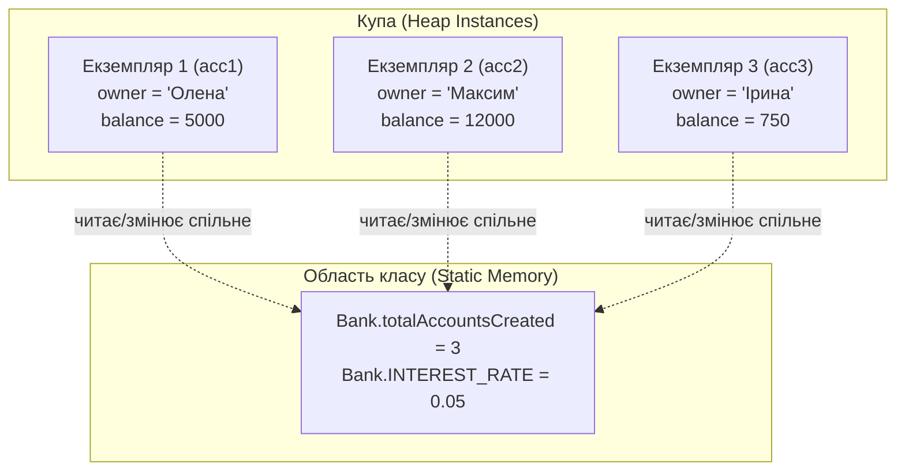

# Практична робота №7: Класи та об'єкти (Частина 2): Конструктори, Ключове слово this/this(), Перевантаження, Статичні члени та Взаємодія об'єктів

## 🎯 Мета роботи
- **Поглибити розуміння життєвого циклу об'єкта в Java:** опанувати створення та правильну ініціалізацію стану об'єктів за допомогою конструкторів замість ручного заповнення полів.
- **Розкрити сутність конструкторів:**
  - Зрозуміти різницю між неявним конструктором за замовчуванням (*default constructor*) та параметризованими конструкторами (*parameterized constructors*).
  - Засвоїти наслідок: щойно оголошено хоча б один власний конструктор з параметрами, компілятор перестає автоматично генерувати дефолтний конструктор без аргументів.
- **Досконало опанувати ключове слово `this`:**
  - Зрозуміти фізичну суть `this` як неявного посилання на поточний екземпляр об'єкта в динамічній пам'яті (*Heap*).
  - Використовувати `this.fieldName` для вирішення колізій імен (затінення полів локальними змінними та параметрами — *variable shadowing*).
  - Використовувати повернення `return this;` для побудови ланцюжкових викликів методів (*Method Chaining / Fluent API*).
  - Передавати `this` як аргумент в інші методи та об'єкти.
- **Опанувати виклик `this(...)` у конструкторах (Constructor Chaining / Делегування):**
  - Засвоїти концепцію ланцюжків конструкторів для дотримання принципу **DRY** (*Don't Repeat Yourself*).
  - Вивчити суворе правило мови Java: виклик `this(...)` **обов'язково має бути найпершою інструкцією** в тілі конструктора.
  - Навчитися реалізовувати патерн «телескопічних конструкторів» для надання дефолтних значень полям.
  - Розуміти неприпустимість циклічного виклику конструкторів (*Recursive constructor invocation*).
- **Вивчити перевантаження методів (Method Overloading):**
  - Зрозуміти поняття **сигнатури методу** (ім'я + типи, кількість та порядок параметрів).
  - З'ясувати, чому зміна лише типу повернення або модифікатора доступу **не є** перевантаженням і призводить до помилки компіляції.
  - Навчитися створювати гнучкі інтерфейси класу з методами, що приймають різні набори аргументів.
- **Опанувати роботу зі статичними членами класу (`static`):**
  - Зрозуміти різницю між полями екземпляра (*instance variables*) та статичними полями класу (*class variables* / спільний стан у пам'яті).
  - Створювати незмінні статичні константи (`public static final`).
  - Опанувати статичні методи (`static methods`) та утилітарні класи із закритим приватним конструктором.
  - Чітко розуміти фундаментальне обмеження: чому в статичному контексті не існує посилання `this` і не можна напряму звертатися до нестатичних полів та методів.
- **Опанувати моделювання взаємодії між об'єктами (Object Collaboration without Inheritance):**
  - Передача одного або кількох об'єктів у методи іншого об'єкта як параметрів (наприклад, переказ коштів між двома рахунками, дуель героїв).
  - Повернення нових або модифікованих об'єктів як результату виконання методу.
  - Реалізація композиції та агрегації (наявність посилань на інші об'єкти як внутрішніх полів класу — наприклад, двигун в авто або масив книг у бібліотеці).
  - Коректне порівняння екземплярів за значеннями полів замість порівняння адрес посилань (`==`).
- **Розв'язати 40 практичних завдань:** закріпити отримані знання написанням модульного, безпечного та чистого об'єктного коду без використання наслідування, інтерфейсів чи поліморфізму.

---

## 📚 1. Теоретичні відомості

### 1.1. Життєвий цикл об'єкта та призначення конструкторів

У Практичній роботі №6 ми створювали об'єкти оператором `new`, після чого вручну заповнювали їхні поля через сеттери або прямий доступ:

```java
// Неефективний та небезпечний підхід:
Car car = new Car(); 
// У цей момент поля car.brand == null, car.year == 0! 
// Об'єкт існує в «напівмертвому» або недоініціалізованому стані.
car.setBrand("Audi");
car.setYear(2023);
```

Такий спосіб має серйозні недоліки:
1. **Ризик отримати зламаний об'єкт:** Якщо програміст забуде викликати сеттер, об'єкт залишиться з нульовими дефолтними значеннями (`null`, `0`, `false`), що пізніше спричинить `NullPointerException` або некоректні розрахунки.
2. **Багатослівність:** Для ініціалізації кожного поля потрібен окремий рядок виклику методу.

Для вирішення цієї проблеми в об'єктно-орієнтованому програмуванні існують **конструктори**.

> **Конструктор (Constructor)** — це спеціальний блок інструкцій у класі, призначений для ініціалізації щойно створеного екземпляра об'єкта в динамічній пам'яті (Heap). Конструктор викликається **автоматично** під час виконання оператора `new`.

#### Особливості синтаксису конструктора:
1. Його назва **точно збігається** з назвою класу (з урахуванням регістру літер).
2. Він **не має типу повернення** (навіть слова `void`). Якщо перед назвою написати `void`, компілятор Java сприйме це як звичайний метод, а не конструктор!
3. Може мати будь-який модифікатор доступу (`public`, `private`, `protected`, package-private).

```java
public class User {
    private String login;
    private int age;

    // Конструктор класу User
    public User(String login, int age) {
        this.login = login;
        this.age = age;
    }
}
```

Створення об'єкта тепер відбувається в один атомарний крок:
```java
User user = new User("admin_alex", 24); // Об'єкт одразу народжується повністю валідним!
```

---

### 1.2. Види конструкторів: За замовчуванням vs Параметризовані

#### 1. Конструктор за замовчуванням (Default Constructor):
Якщо у вашому класі **не написано жодного власного конструктора**, компілятор Java автоматично генерує порожній публічний конструктор без параметрів:
```java
public class EmptyStudent {
    // Жодного конструктора не оголошено явно
}

// Компілятор за лаштунками додає:
// public EmptyStudent() { }
```

#### 2. Зникнення дефолтного конструктора (Пастка початківців):
> [!WARNING]
> Щойно ви напишете в класі **хоча б один власний параметризований конструктор**, компілятор **припиняє генерувати конструктор за замовчуванням**!

```java
public class Laptop {
    private String model;

    public Laptop(String model) {
        this.model = model;
    }
}

// Спроба викликати порожній конструктор:
Laptop lap = new Laptop(); // ПОМИЛКА КОМПІЛЯЦІЇ: Constructor Laptop() is undefined!
```
Якщо вам потрібен і конструктор з параметрами, і конструктор без параметрів — ви **зобов'язані явно оголосити обидва**.

---

### 1.3. Ключове слово `this`: Посилання на поточний об'єкт

> **`this`** — це вбудована службова посилальна змінна в мові Java, яка містить адресу **поточного екземпляра об'єкта** в купі (*Heap*), для якого в даний момент викликається метод або конструктор.

```mermaid
flowchart LR
    subgraph Stack [Стек пам'яті (Stack)]
        direction TB
        ref1["car1 = 0xABC1"]
        ref2["car2 = 0xDEF2"]
        subgraph Frame ["Виклик car1.drive()"]
            thisPtr["this = 0xABC1 (вказує на car1)"]
        end
    end
    subgraph Heap [Купа пам'яті (Heap)]
        obj1["Об'єкт 0xABC1<br>brand: 'BMW'<br>speed: 120"]
        obj2["Об'єкт 0xDEF2<br>brand: 'Audi'<br>speed: 90"]
    end
    ref1 --> obj1
    ref2 --> obj2
    thisPtr --> obj1
```

#### Три головні сценарії використання слова `this`:

#### Сценарій 1: Розв'язання колізій імен (Variable Shadowing)
Коли параметри конструктора або методу мають такі ж назви, як і поля класу, локальний параметр перекриває (затінює) однойменне поле. `this.` чітко вказує компілятору, що мова йде про поле об'єкта:

```java
public class Dimension {
    private int width;
    private int height;

    public Dimension(int width, int height) {
        // width = width;       // ПОМИЛКА: присвоєння параметра самому собі! Поле залишиться 0!
        this.width = width;     // ПРАВИЛЬНО: this.width — це поле в Heap, width — аргумент у Stack
        this.height = height;
    }
}
```

#### Сценарій 2: Повернення `this` для ланцюжкового виклику методів (Method Chaining / Fluent API)
Якщо метод повертає посилання на той самий об'єкт (`return this;`), ми можемо викликати методи послідовно через крапку в одному виразі:

```java
public class OrderBuilder {
    private String item = "None";
    private int quantity = 1;
    private double discount = 0.0;

    public OrderBuilder setItem(String item) {
        this.item = item;
        return this; // повертаємо поточний об'єкт
    }

    public OrderBuilder setQuantity(int quantity) {
        this.quantity = quantity;
        return this;
    }

    public OrderBuilder setDiscount(double discount) {
        this.discount = discount;
        return this;
    }

    public void printSummary() {
        System.out.println("Товар: " + item + ", Кількість: " + quantity + ", Знижка: " + discount + "%");
    }
}

// Виклик ланцюжком (Fluent Interface):
OrderBuilder builder = new OrderBuilder();
builder.setItem("Ноутбук")
       .setQuantity(2)
       .setDiscount(10.0)
       .printSummary();
```

#### Сценарій 3: Передача `this` як аргументу в інший метод або об'єкт
Коли об'єкт хоче передати самого себе в зовнішній метод:
```java
public class Printer {
    public void printDocument(Document doc) {
        System.out.println("Друк документа: " + doc.getTitle());
    }
}

public class Document {
    private String title;

    public Document(String title) {
        this.title = title;
    }

    public String getTitle() {
        return this.title;
    }

    public void sendTo(Printer printer) {
        printer.printDocument(this); // передаємо поточний екземпляр Document
    }
}
```

---

### 1.4. Делегування конструкторів: Виклик `this(...)` (Constructor Chaining)

Дуже часто клас має кілька конструкторів: з повним набором параметрів, із частковим або без параметрів взагалі. 

#### Погана практика (Дублювання коду без `this(...)`):
```java
// ПОГАНО: Дублювання коду ініціалізації та валідації
public class Account {
    private String id;
    private String currency;
    private double balance;

    public Account(String id, String currency, double balance) {
        if (balance < 0) balance = 0;
        this.id = id;
        this.currency = currency;
        this.balance = balance;
    }

    public Account(String id) {
        // Знову пишемо ту саму ініціалізацію!
        this.id = id;
        this.currency = "UAH";
        this.balance = 0.0;
    }
}
```

#### Чисте рішення: Виклик `this(...)` (Constructor Chaining)
Конструктор може викликати інший конструктор **того самого класу**, використовуючи ключове слово `this(...)` із круглими дужками та списком аргументів:

```java
// ЧИСТИЙ КОД: Патерн телескопічного конструктора через this(...)
public class Account {
    private String id;
    private String currency;
    private double balance;

    // Головний (майстер) конструктор із повним набором полів та валідацією
    public Account(String id, String currency, double balance) {
        if (balance < 0) balance = 0;
        this.id = id;
        this.currency = currency;
        this.balance = balance;
    }

    // Скорочений конструктор: задає валюту та нульовий баланс за замовчуванням
    public Account(String id, String currency) {
        this(id, currency, 0.0); // Делегування до майстер-конструктора!
    }

    // Мінімальний конструктор: передає валюту "UAH" за замовчуванням
    public Account(String id) {
        this(id, "UAH"); // Делегування до другого конструктора!
    }

    // Дефолтний конструктор
    public Account() {
        this("ACC-" + System.currentTimeMillis()); // Делегування до третього!
    }
}
```

```mermaid
flowchart TD
    C0["Account()"] -->|this('ACC-xxx')| C1["Account(id)"]
    C1 -->|this(id, 'UAH')| C2["Account(id, currency)"]
    C2 -->|this(id, currency, 0.0)| C3["Account(id, currency, balance)<br><b>МАЙСТЕР-КОНСТРУКТОР</b><br>(Тут відбувається фактична ініціалізація полів)"]
```

#### ⚠️ Суворі правила використання `this(...)` в Java:

> [!IMPORTANT]
> 1. **Тільки перший рядок:** Виклик `this(...)` обов'язково має бути **найпершим виконуваним рядком** у тілі конструктора. Якщо перед `this(...)` написати хоча б `int x = 10;` або вивести рядок у консоль — код не скомпілюється!
> 2. **Заборона циклічних викликів:** Конструктор `A` не може викликати `B`, якщо `B` викликає `A` (або через ланцюжок повертається до `A`). Компілятор миттєво видасть помилку: *Recursive constructor invocation*.
> 3. **Не можна використовувати неініціалізовані поля:** В аргументи `this(...)` не можна передавати поля екземпляра через `this.field`, оскільки сам об'єкт ще не створено. Можна передавати лише літерали, вхідні аргументи або статичні константи/методи.

---

### 1.5. Перевантаження методів (Method Overloading)

> **Перевантаження методів (Method Overloading)** — це можливість створити в одному класі кілька методів з **однаковим ім'ям**, але з **різними списками вхідних параметрів**.

Компілятор визначає, яку саме версію методу викликати, аналізуючи типи, кількість та черговість фактично переданих аргументів у точці виклику.

#### Що таке сигнатура методу?
У мові Java метод однозначно ідентифікується своєю **сигнатурою**:
$$\text{Сигнатура} = \text{Ім'я методу} + \text{Типи параметрів (у фіксованому порядку)}$$

| Елемент заголовка | Чи входить до сигнатури? | Чи дозволяє перевантажити метод? |
| :--- | :---: | :---: |
| **Ім'я методу** | Так | — |
| **Кількість параметрів** | Так |  Так |
| **Типи параметрів** | Так |  Так |
| **Порядок типів параметрів** | Так |  Так (`int, double` $\neq$ `double, int`) |
| **Імена параметрів** | ❌ Ні | ❌ Ні (`add(int a, int b)` та `add(int x, int y)` — дублікати!) |
| **Тип повернення** (`void`, `int`, тощо) | ❌ Ні | ❌ Ні (зміна лише типу повернення викликає помилку компіляції) |
| **Модифікатор доступу** (`public`, `private`) | ❌ Ні | ❌ Ні |

#### Приклад коректного перевантаження:
```java
public class Calculator {
    // 1. Два цілі числа
    public int sum(int a, int b) {
        return a + b;
    }

    // 2. Три цілі числа (інша кількість)
    public int sum(int a, int b, int c) {
        return a + b + c;
    }

    // 3. Два дробові числа (інші типи)
    public double sum(double a, double b) {
        return a + b;
    }

    // 4. Рядок і число
    public String sum(String text, int count) {
        return text + ": " + count;
    }
}
```

#### Приклад помилкового коду (не скомпілюється):
```java
public class BadExample {
    public int compute(int x) { return x * 2; }
    
    // ПОМИЛКА КОМПІЛЯЦІЇ: 'compute(int)' is already defined
    // Зміна лише типу повернення з int на double не є перевантаженням!
    public double compute(int x) { return (double) x * 2; }
}
```

---

### 1.6. Статичні та нестатичні члени класу (`static` vs Instance)

Ключове слово `static` докорінно змінює спосіб збереження даних та виконання коду:

- **Нестатичні члени (Instance members):** належать кожному **окремому екземпляру** об'єкта. Скільки об'єктів створено через `new` — стільки копій полів буде існувати в пам'яті Heap.
- **Статичні члени (Class members / `static`):** належать **самому класу в цілому**. Пам'ять під них виділяється **один раз** при завантаженні класу JVM. Усі об'єкти цього класу мають спільний доступ до одного й того самого статичного поля!



#### 1. Статичні поля (Спільний стан та лічильники):
```java
public class Ticket {
    // Статичний лічильник, спільний для всіх створених квитків
    private static int counter = 1; 

    private int ticketNumber; // Індивідуальний номер конкретного квитка

    public Ticket() {
        this.ticketNumber = counter++; // Присвоюємо поточне значення і збільшуємо лічильник
    }

    public int getTicketNumber() {
        return this.ticketNumber;
    }

    public static int getTotalTicketsIssued() {
        return counter - 1;
    }
}
```

#### 2. Статичні константи (`public static final`):
Коли значення є загальновідомою незмінною величиною:
```java
public class Physics {
    public static final double GRAVITY = 9.80665;
    public static final double SPEED_OF_LIGHT = 299_792_458.0;
}
```

#### 3. Статичні методи та їхні суворі обмеження:
Статичний метод викликається через ім'я класу без створення об'єкта: `Math.sqrt(25);`, `Integer.parseInt("123");`.

> [!CAUTION]
> **Головне правило роботи зі `static`:**
> 1. Усередині статичного методу **НЕ ІСНУЄ** посилання `this`.
> 2. Статичний метод **НЕ МОЖЕ напряму звертатися** до нестатичних полів або викликати нестатичні методи свого класу!

```java
public class Example {
    private int score = 10; // нестатичне поле

    public static void printInfo() {
        // System.out.println(this.score); // ПОМИЛКА: 'this' cannot be referenced from a static context
        // System.out.println(score);      // ПОМИЛКА: Non-static field 'score' cannot be referenced!
    }
}
```
*Чому так?* Статичний метод може бути викликаний тоді, коли в пам'яті взагалі не створено жодного екземпляра класу. Якщо об'єкта немає, то до якого саме поля `score` мав би звернутися метод? Відповіді немає, тому Java забороняє таку операцію на рівні компілятора.

---

### 1.7. Взаємодія між об'єктами (Object Collaboration без спадкування)

Об'єкти стають по-справжньому корисними, коли вони починають спілкуватися та взаємодіяти один з одним. Ми працюємо виключно в межах **композиції, агрегації та передачі посилань**, без ускладнення спадкуванням.

#### 1. Об'єкт як параметр іншого методу:
Один об'єкт може приймати інший об'єкт у свій метод і виконувати дії над його станом:

```java
public class BankAccount {
    private String owner;
    private double balance;

    public BankAccount(String owner, double balance) {
        this.owner = owner;
        this.balance = balance;
    }

    public void transferMoney(BankAccount recipient, double amount) {
        if (recipient == null) {
            System.out.println("Помилка: отримувача не існує!");
            return;
        }
        if (amount > 0 && this.balance >= amount) {
            this.balance -= amount;           // списуємо з поточного рахунку (this)
            recipient.balance += amount;      // поповнюємо рахунок отримувача (recipient)
            System.out.println("Успішний переказ " + amount + " грн від " + this.owner + " до " + recipient.owner);
        } else {
            System.out.println("Недостатньо коштів на рахунку " + this.owner);
        }
    }
}
```

#### 2. Повернення нового об'єкта з методу:
Метод може обчислити результат і повернути абсолютно новий екземпляр класу:

```java
public class ComplexNumber {
    private final double real;
    private final double imag;

    public ComplexNumber(double real, double imag) {
        this.real = real;
        this.imag = imag;
    }

    // Додавання двох комплексних чисел повертає третє нове комплексне число
    public ComplexNumber plus(ComplexNumber other) {
        return new ComplexNumber(this.real + other.real, this.imag + other.imag);
    }
}
```

#### 3. Агрегація та композиція (Об'єкт як поле іншого об'єкта):
Реальні складні сутності складаються з простіших компонентів («має у своєму складі» / *HAS-A*):
- Комп'ютер **має** Процесор та Оперативну пам'ять.
- Автомобіль **має** Двигун.
- Замовлення **має** Клієнта та масив Товарів.

```java
public class Engine {
    private String type;
    private int horsePower;

    public Engine(String type, int horsePower) {
        this.type = type;
        this.horsePower = horsePower;
    }

    public void start() {
        System.out.println("Двигун " + type + " (" + horsePower + " к.с.) заведено!");
    }
}

public class Car {
    private String model;
    private Engine engine; // Об'єкт іншого класу в ролі поля!

    public Car(String model, Engine engine) {
        this.model = model;
        this.engine = engine;
    }

    public void ignite() {
        System.out.println("Водій тисне кнопку Start у " + model);
        this.engine.start(); // Взаємодія з внутрішнім об'єктом!
    }
}
```

#### 4. Порівняння об'єктів: `==` проти порівняння за станом:
```java
Point p1 = new Point(3, 4);
Point p2 = new Point(3, 4);

System.out.println(p1 == p2); // false! Вони мають різні адреси в купі Heap!
System.out.println(p1.equalsTo(p2)); // true, якщо реалізовано метод перевірки рівності координат
```

---

### 1.8. Поширені помилки та підводні камені

1. **Неправильний виклик `this(...)` не на першому рядку:**
   ```java
   public MyClass(int a) {
       System.out.println("Ініціалізація");
       this(a, 0); // ПОМИЛКА КОМПІЛЯЦІЇ: Call to 'this()' must be first statement in constructor
   }
   ```
2. **Забутий `this.` при однакових іменах полів і параметрів:**
   ```java
   public void setAge(int age) {
       age = age; // Присвоєння аргументу самому собі, поле об'єкта не змінилося!
   }
   ```
3. **Спроба використати `this` у статичному методі:**
   ```java
   public static void test() {
       this.doSomething(); // ПОМИЛКА: non-static variable this cannot be referenced from a static context
   }
   ```
4. **Рекурсивний виклик конструкторів:**
   ```java
   public Node() {
       this(10);
   }
   public Node(int val) {
       this(); // ПОМИЛКА: Recursive constructor invocation
   }
   ```
5. **Невідповідність сигнатури при перевантаженні (зміна лише типу повернення):**
   ```java
   public int getData() { return 1; }
   public double getData() { return 1.0; } // ПОМИЛКА: метод вже визначено
   ```

---

### 1.9. Q&A (Часті запитання на співбесідах)

#### Q1: Чи може конструктор викликати інший конструктор того ж класу? Який синтаксис для цього використовується?
**Відповідь:** Так, може. Для цього використовується синтаксис `this(аргументи)`. Такий виклик обов'язково повинен бути найпершою виконуваною інструкцією в тілі викликаючого конструктора.

#### Q2: Що буде, якщо клас містить конструктор із параметрами, а ми спробуємо викликати конструктор без параметрів `new MyClass()`?
**Відповідь:** Буде помилка компіляції. Компілятор автоматично створює конструктор за замовчуванням лише тоді, коли в класі немає **жодного** іншого явно визначеного конструктора. Якщо потрібен і конструктор без параметрів, його слід описати власноруч.

#### Q3: Чому статичний метод не може отримати доступ до нестатичного поля класу без створення екземпляра?
**Відповідь:** Статичний метод прив'язаний до самого класу і може виконуватися тоді, коли в пам'яті комп'ютера (Heap) не створено жодного екземпляра цього класу. Нестатичні поля існують лише всередині конкретних об'єктів. Оскільки в статичному методі відсутнє посилання `this`, компілятор не знає, до якого саме екземпляра звертатися.

#### Q4: Чи можна перевантажити метод, змінивши лише тип повернення з `int` на `double`?
**Відповідь:** Ні, не можна. Сигнатура методу в Java складається виключно з його назви та списку типів аргументів. Тип повернення не входить до сигнатури, оскільки при виклику методу (наприклад, `myMethod();` без збереження результату в змінну) компілятор не зміг би визначити, яку з версій слід виконати.

#### Q5: Чим відрізняється передача об'єкта як параметра від передачі примітивного типу?
**Відповідь:** Примітивні типи (`int`, `double`, `boolean`) передаються за значенням у вигляді повної копії бітів. Об'єкти також передаються за значенням, але цим значенням є **посилання (копія адреси в пам'яті)** на той самий об'єкт у купі. Тому зміни внутрішнього стану об'єкта через його методи у викликаному методі вплинуть на оригінальний об'єкт.

---

## 💻 2. Практичні завдання (40 завдань)

Усі завдання виконуються шляхом створення відповідних класів у пакеті `semester1.practice07` та їхнього тестування в методі `main` класу запуску `Practice07.java`.

Завдання розділено на 5 послідовних тематичних блоків по 8 завдань у кожному.

---

### Блок 1: Поля класу та базові конструктори (Завдання 1–8)

#### Завдання 1: Клас `Book` (Книга в бібліотеці)
1. Створіть клас `Book` із приватними полями: `String title`, `String author`, `int year`, `double price`.
2. Реалізуйте **конструктор за замовчуванням**, який задає значення: `"Невідомо"`, `"Невідомий"`, `2000`, `0.0`.
3. Реалізуйте **параметризований конструктор** `Book(String title, String author, int year, double price)` із валідацією: якщо рік $< 0$ або ціна $< 0.0$, встановити дефолтні $2000$ та $0.0$.
4. Реалізуйте метод `public void printInfo()`, який виводить інформацію про книгу в один рядок.
5. У `Practice07.main` створіть дві книги різними конструкторами та виведіть інформацію.

#### Завдання 2: Клас `Student` (Студент з перевіркою віку та оцінки)
1. Створіть клас `Student` із полями `private String name`, `private int age`, `private double gpa`.
2. Опишіть конструктор `Student(String name, int age, double gpa)`:
   - Якщо `age < 15` або `age > 80`, примусово встановити `age = 18`.
   - Якщо `gpa < 0.0` або `gpa > 5.0`, встановити `gpa = 0.0`.
3. Додайте методи:
   - `public boolean isHonorStudent()` — повертає `true`, якщо середній бал $\ge 4.5$;
   - `public void printStudent()` — красиво виводить дані та статус («Відмінник» / «Звичайний студент»).
4. Протестуйте створення об'єктів з валідними та некоректними даними.

#### Завдання 3: Клас `BankAccount` (Банківський рахунок з початковим балансом)
1. Створіть клас `BankAccount` із полями `private String accountNumber`, `private String ownerName`, `private double balance`.
2. Опишіть конструктор `BankAccount(String accountNumber, String ownerName, double initialBalance)`. Якщо `initialBalance < 0`, баланс встановити в `0.0`.
3. Додайте методи:
   - `public void deposit(double amount)` — поповнення, якщо `amount > 0`;
   - `public boolean withdraw(double amount)` — зняття коштів; якщо коштів не вистачає або сума $\le 0$, операцію відхилити і повернути `false`;
   - `public void printAccount()` — друкує номер, власника та поточний баланс.
4. Змоделюйте успішне поповнення та спробу зняття коштів понад ліміт.

#### Завдання 4: Клас `Point2D` (Точка на площині з розрахунком дистанцій)
1. Створіть клас `Point2D` із приватними полями координат `private double x` та `private double y`.
2. Реалізуйте два конструктори:
   - `Point2D()` — створює точку на початку координат $(0.0, 0.0)$;
   - `Point2D(double x, double y)` — ініціалізує точку заданими координатами.
3. Реалізуйте методи:
   - `public double distanceToOrigin()` — обчислює відстань до початку координат: $\sqrt{x^2 + y^2}$;
   - `public double distanceTo(double targetX, double targetY)` — обчислює відстань до вказаних координат;
   - `public void printPoint()` — виводить координати у вигляді `Point(x; y)`.
4. Створіть кілька точок та обчисліть відстані між ними в `main`.

#### Завдання 5: Клас `Product` (Товар складу з категорією)
1. Створіть клас `Product` із полями: `private String name`, `private double price`, `private int quantity`, `private String category`.
2. Реалізуйте конструктор із валідацією параметрів (ціна та кількість не можуть бути від'ємними).
3. Реалізуйте методи:
   - `public double getTotalValue()` — вартість усієї партії (`price * quantity`);
   - `public void applyDiscount(double percent)` — зменшує ціну на заданий відсоток (від $0\%$ до $100\%$);
   - `public void printProduct()` — виводить охайну картку товару.
4. Протестуйте застосування знижки $20\%$ та перевірте нову суму партії.

#### Завдання 6: Клас `Time` (Годинник з валідацією діапазону)
1. Створіть клас `Time` із полями: `private int hours`, `private int minutes`, `private int seconds`.
2. Реалізуйте конструктор `Time(int hours, int minutes, int seconds)`:
   - Якщо години не в межах $0..23$ — встановити $0$.
   - Якщо хвилини або секунди не в межах $0..59$ — встановити $0$.
3. Реалізуйте методи:
   - `public void tick()` — додає одну секунду з коректним переходом хвилин (при $59 \to 00$) та годин (при $23:59:59 \to 00:00:00$);
   - `public String toUniversalString()` — повертає час у форматі `HH:mm:ss` (з провідними нулями);
   - `public String toStandardString()` — повертає час у 12-годинному форматі `h:mm:ss AM/PM`.
4. Продемонструйте хід часу при виклику `tick()`.

#### Завдання 7: Клас `Rectangle` (Прямокутник та квадрат)
1. Створіть клас `Rectangle` із полями `private double width` та `private double height`.
2. Опишіть три конструктори:
   - `Rectangle()` — створює одиничний прямокутник $1.0 \times 1.0$;
   - `Rectangle(double size)` — створює квадрат зі стороною `size`;
   - `Rectangle(double width, double height)` — створює прямокутник довільних розмірів.
3. Додайте методи: `public double getArea()`, `public double getPerimeter()`, `public boolean isSquare()`.
4. Створіть прямокутник та квадрат, порівняйте їхні площі та периметри.

#### Завдання 8: Клас `Employee` (Картка співробітника)
1. Створіть клас `Employee` із приватними полями: `int id`, `String fullName`, `String position`, `double monthlySalary`.
2. Реалізуйте конструктор, який повністю ініціалізує всі поля.
3. Додайте методи:
   - `public void raiseSalary(double percent)` — підвищує заробітну плату на відсоток;
   - `public double getAnnualSalary()` — повертає річну зарплату ($12 \times \text{monthlySalary}$);
   - `public void printBadge()` — виводить бейдж працівника.
4. Протестуйте підвищення ставки на $15\%$ та виведіть новий річний дохід.

---

### Блок 2: Ключове слово `this` та виклик `this(...)` у конструкторах (Завдання 9–16)

#### Завдання 9: Клас `User` (Користувач системи з телескопічними конструкторами)
1. Створіть клас `User` із приватними полями: `String login`, `String email`, `String role`, `boolean isActive`.
2. Реалізуйте **майстер-конструктор**:
   `public User(String login, String email, String role, boolean isActive)` — ініціалізує всі 4 поля через `this.field = field`.
3. Реалізуйте скорочені конструктори за допомогою делегування `this(...)`:
   - `public User(String login, String email)` $\to$ викликає майстер-конструктор із роллю `"USER"` та статусом `true`;
   - `public User(String login)` $\to$ викликає конструктор з двома параметрами, підставляючи email `login + "@domain.com"`;
   - `public User()` $\to$ викликає конструктор з одним параметром, генеруючи дефолтний логін `"guest"`.
4. Додайте метод `public void printProfile()`.
5. У `Practice07.main` створіть 4 об'єкти різними конструкторами й переконайтеся, що всі вони коректно ініціалізуються через ланцюжок.

#### Завдання 10: Клас `Fraction` (Звичайний дріб з ланцюжком `this(...)`)
1. Створіть клас `Fraction` із полями `private int numerator` (чисельник) та `private int denominator` (знаменник).
2. Реалізуйте головний конструктор `Fraction(int numerator, int denominator)`:
   - Перевіряє, якщо `denominator == 0` — виводить помилку і встановлює знаменник у $1$;
   - Якщо знаменник від'ємний — переносить знак мінус до чисельника;
   - Скорочує дріб на НСД (найбільший спільний дільник).
3. Реалізуйте додаткові конструктори через `this(...)`:
   - `Fraction(int wholeNumber)` $\to$ викликає `this(wholeNumber, 1)`;
   - `Fraction()` $\to$ викликає `this(0, 1)`.
4. Додайте методи:
   - `public void print()` — виводить дріб у вигляді `num/den` (або просто `num`, якщо `den == 1`);
   - `public double toDouble()` — повертає десяткове значення.
5. Протестуйте роботу всіх трьох конструкторів.

#### Завдання 11: Клас `Car` (Автомобіль з обліком пробігу та делегуванням)
1. Створіть клас `Car` із полями: `String brand`, `String model`, `int year`, `double mileage`, `boolean engineStarted`.
2. Створіть повний конструктор `Car(String brand, String model, int year, double mileage)`.
3. Створіть конструктор для нового авто `Car(String brand, String model, int year)` $\to$ викликає повний конструктор через `this(...)`, передаючи пробіг $0.0$.
4. Створіть конструктор без параметрів `Car()` $\to$ викликає конструктор для нового авто із значеннями за замовчуванням (`"Unknown"`, `"Standard"`, $2024$).
5. Реалізуйте методи:
   - `public void startEngine()`, `public void stopEngine()`;
   - `public void drive(double distance)` — якщо двигун запущено, збільшує `mileage` на `distance`, інакше виводить попередження: `"Спершу заведіть двигун!"`.
6. Змоделюйте поїздку на 150 км для нового авто.

#### Завдання 12: Клас `SmartBulb` (Розумна лампочка з перемиканням режимів)
1. Створіть клас `SmartBulb` із приватними полями: `int brightness` ($0..100\%$), `int colorTemp` ($2700..6500\text{ K}$), `boolean isOn`.
2. Створіть майстер-конструктор `SmartBulb(int brightness, int colorTemp, boolean isOn)` із захистом від виходу параметрів за вказані межі.
3. Створіть скорочений конструктор `SmartBulb(int brightness)` $\to$ делегує виклик до майстер-конструктора з дефолтною температурою $4000\text{ K}$ та увімкненим станом (`true`).
4. Створіть дефолтний конструктор `SmartBulb()` $\to$ делегує виклик до `this(50)`.
5. Додайте метод `public void printStatus()`. Створіть лампочки кожним конструктором та надрукуйте стан.

#### Завдання 13: Клас `QueryBuilder` (Method Chaining через повернення `this`)
1. Створіть клас `QueryBuilder` для побудови SQL-запитів із полями: `private String table`, `private String fields = "*"`, `private String whereClause = ""`.
2. Опишіть конструктор `QueryBuilder(String table)`.
3. Реалізуйте методи з поверненням `return this;`:
   - `public QueryBuilder select(String fields)` — встановлює перелік полів і повертає `this`;
   - `public QueryBuilder where(String condition)` — встановлює умову фільтрації і повертає `this`;
4. Реалізуйте термінальний метод:
   - `public String build()` — збирає та повертає фінальний рядок SQL: `"SELECT " + fields + " FROM " + table + (whereClause.isEmpty() ? "" : " WHERE " + whereClause) + ";"`.
5. У `main` протестуйте ланцюжковий виклик:
   `String sql = new QueryBuilder("users").select("id, name, email").where("age >= 18").build();`

#### Завдання 14: Клас `CoffeeOrder` (Калькулятор кавового замовлення)
1. Створіть клас `CoffeeOrder` із полями: `String type` (Еспресо, Капучино, Лате), `String size` (Small, Medium, Large), `int sugarCount`, `boolean withSyrup`, `double finalPrice`.
2. Реалізуйте приватний допоміжний метод `private double calculatePrice()`, який рахує вартість:
   - Базова ціна: Еспресо — 40 грн, Капучино — 55 грн, Лате — 60 грн.
   - Коефіцієнт розміру: Small $\times 1.0$, Medium $\times 1.3$, Large $\times 1.6$.
   - Сироп додає 15 грн.
3. Реалізуйте повний конструктор `CoffeeOrder(String type, String size, int sugarCount, boolean withSyrup)`.
4. Реалізуйте скорочений конструктор `CoffeeOrder(String type, String size)` $\to$ делегує до повного без цукру і без сиропу через `this(...)`.
5. Реалізуйте базовий конструктор `CoffeeOrder(String type)` $\to$ делегує до версії з розміром `"Medium"`.
6. Додайте метод `public void printReceipt()`.

#### Завдання 15: Клас `Box` (Пакувальна коробка та конструктор копіювання)
1. Створіть клас `Box` із полями `private double width`, `private double height`, `private double depth`, `private String material`.
2. Реалізуйте головний конструктор із 4 параметрами.
3. Реалізуйте конструктор для кубічної коробки `Box(double size, String material)` $\to$ викликає `this(size, size, size, material)`.
4. Реалізуйте **конструктор копіювання**:
   `public Box(Box other)` $\to$ викликає `this(other.width, other.height, other.depth, other.material)`.
5. Додайте методи:
   - `public double getVolume()` ($w \cdot h \cdot d$);
   - `public double getSurfaceArea()` ($2 \cdot (w \cdot h + w \cdot d + h \cdot d)$);
   - `public void printBox()`.
6. Створіть кубічну коробку, зробіть її точну копію через конструктор копіювання та порівняйте їхні об'єми.

#### Завдання 16: Клас `FlightTicket` (Авіаквиток з реєстрацією)
1. Створіть клас `FlightTicket` із полями: `String ticketNumber`, `String passengerName`, `String flightNumber`, `String departureCity`, `String arrivalCity`, `String seatNumber`, `boolean hasBaggage`.
2. Реалізуйте майстер-конструктор із усіма 7 полями.
3. Реалізуйте конструктор з автовибором місця:
   `public FlightTicket(String ticketNumber, String passengerName, String flightNumber, String departureCity, String arrivalCity)` $\to$ викликає майстер-конструктор із місцем `"UNASSIGNED"` та `hasBaggage = false`.
4. Реалізуйте метод `public void assignSeat(String seat)` — оновлює місце посадки через `this.seatNumber = seat;`.
5. Додайте метод `public void printBoardingPass()`. Створіть квиток, призначте місце та виведіть талон.

---

### Блок 3: Перевантаження методів (Method Overloading) (Завдання 17–24)

#### Завдання 17: Клас `MathOperations` (Перевантаження операцій)
1. Створіть клас `MathOperations`.
2. Перевантажте метод `add`:
   - `public int add(int a, int b)` — сума двох цілих чисел;
   - `public double add(double a, double b)` — сума двох дійсних чисел;
   - `public int add(int a, int b, int c)` — сума трьох цілих чисел;
   - `public String add(String a, String b)` — склеювання двох рядків через пробіл.
3. Перевантажте метод `multiply`:
   - `public int multiply(int a, int b)`;
   - `public double multiply(double a, double b)`;
   - `public String multiply(String text, int times)` — повертає рядок, повторений `times` разів.
4. Протестуйте кожен перевантажений метод у `Practice07.main`.

#### Завдання 18: Клас `DocumentPrinter` (Універсальний друкар даних)
1. Створіть клас `DocumentPrinter`.
2. Реалізуйте перевантажені версії методу `print`:
   - `public void print(String message)` — друкує звичайний рядок;
   - `public void print(int number)` — друкує число у форматі: `[INT]: 123`;
   - `public void print(double number, int decimals)` — форматує дійсне число із заданою кількістю знаків після коми (за допомогою `String.format()`);
   - `public void print(String[] lines)` — друкує масив рядків, нумеруючи кожен рядок з 1;
   - `public void print(String message, boolean uppercase)` — якщо `true`, виводить повідомлення великими літерами.
3. Продемонструйте виклики кожної версії.

#### Завдання 19: Клас `AreaCalculator` (Обчислення площ різних геофігур)
1. Створіть клас `AreaCalculator`.
2. Перевантажте метод `calculateArea`:
   - `public double calculateArea(double side)` — площа квадрата ($s^2$);
   - `public double calculateArea(double width, double height)` — площа прямокутника ($w \cdot h$);
   - `public double calculateArea(double radius, boolean isCircle)` — площа круга ($\pi r^2$);
   - `public double calculateArea(double a, double b, double c)` — площа трикутника за формулою Герона;
   - `public double calculateArea(double base1, double base2, double height)` — площа трапеції ($\frac{a + b}{2} \cdot h$).
3. Обчисліть та виведіть площі квадрата, кола, прямокутника та трапеції.

#### Завдання 20: Клас `Logger` (Система логування подій)
1. Створіть клас `Logger`.
2. Реалізуйте перевантажені методи логування:
   - `public void log(String message)` — виводить `[INFO] message`;
   - `public void log(String level, String message)` — виводить `[level] message`;
   - `public void log(String level, int errorCode, String message)` — виводить `[level] (Code: errorCode): message`;
   - `public void log(String tag, String message, boolean timestamp)` — якщо `timestamp == true`, додає до повідомлення поточний час у мілісекундах `System.currentTimeMillis()`.
3. Залогуйте 4 різні події програми.

#### Завдання 21: Клас `ArraySearcher` (Перевантажений пошук у масивах)
1. Створіть клас `ArraySearcher`.
2. Реалізуйте методи пошуку:
   - `public int find(int[] arr, int target)` — повертає перший індекс знайденого числа або `-1`;
   - `public int find(int[] arr, int target, int startIndex)` — пошук починаючи з указаного індексу;
   - `public int find(String[] arr, String target)` — пошук рядка за точним збігом;
   - `public int find(String[] arr, String target, boolean ignoreCase)` — пошук рядка з можливістю ігнорування регістру букв.
3. Протестуйте пошук у масиві чисел та масиві слів із різними параметрами.

#### Завдання 22: Клас `DateService` (Зсув дати з перевантаженням)
1. Створіть клас `DateService` із полями `int day`, `int month`, `int year`.
2. Опишіть конструктор `DateService(int day, int month, int year)`.
3. Реалізуйте перевантажений метод `add`:
   - `public void add(int days)` — додає лише кількість днів (з урахуванням спрощеного правила: у кожному місяці 30 днів);
   - `public void add(int days, int months)` — додає дні та місяці;
   - `public void add(int days, int months, int years)` — додає дні, місяці та роки.
4. Додайте метод `public void printDate()`. Додайте до дати `15.03.2024` спершу 20 днів, а потім 3 місяці.

#### Завдання 23: Клас `SalaryCalculator` (Нарахування зарплати з різними бонусами)
1. Створіть клас `SalaryCalculator`.
2. Реалізуйте перевантажені методи розрахунку:
   - `public double calculate(double baseRate)` — лише базова ставка;
   - `public double calculate(double baseRate, double fixedBonus)` — ставка + фіксована премія;
   - `public double calculate(double baseRate, double bonusPercent, boolean isTaxDeducted)` — ставка з відсотковим бонусом та відніманням $19.5\%$ податку (якщо `isTaxDeducted == true`);
   - `public double calculate(double baseRate, int overtimeHours, double overtimeHourlyRate)` — ставка + оплата понаднормових годин.
3. Продемонструйте кожен розрахунок на конкретних числах.

#### Завдання 24: Клас `ArrayFilter` (Фільтрація масиву за умовами)
1. Створіть клас `ArrayFilter`.
2. Реалізуйте методи фільтрації, які повертають новий масив знайдених елементів:
   - `public int[] filter(int[] arr, int threshold)` — повертає всі елементи, строго більші за `threshold`;
   - `public int[] filter(int[] arr, int min, int max)` — повертає елементи з діапазону $[min; max]$;
   - `public int[] filter(int[] arr, boolean keepEvens)` — якщо `keepEvens == true`, повертає лише парні числа, інакше — лише непарні.
3. Протестуйте фільтрацію тестового масиву `{12, 5, 8, 19, 24, 3, 16}`.

---

### Блок 4: Статичні поля, методи та константи (`static`) (Завдання 25–32)

#### Завдання 25: Клас `UserAccount` (Автоматична генерація унікальних ID)
1. Створіть клас `UserAccount` із приватними полями екземпляра: `int id`, `String username`, `String email`.
2. Оголосіть приватне статичне поле: `private static int nextId = 1001;`.
3. Реалізуйте конструктор `UserAccount(String username, String email)`:
   - Автоматично присвоює полю `this.id` поточне значення `nextId` і збільшує `nextId` на 1 (`this.id = nextId++;`).
4. Додайте публічний статичний метод `public static int getNextAvailableId()` — повертає наступний ID без його зміни.
5. Додайте публічний статичний метод `public static void resetIdSequence(int startId)` — скидає лічильник.
6. Створіть 3 користувачів та виведіть їхні ID (має бути 1001, 1002, 1003).

#### Завдання 26: Клас `ServerConfig` (Глобальні налаштування сервера)
1. Створіть клас `ServerConfig`.
2. Оголосіть статичні константи:
   - `public static final String SERVER_NAME = "AlphaEnterprise";`
   - `public static final int MAX_CONNECTIONS = 5;`
3. Оголосіть статичне поле: `private static int activeConnections = 0;`.
4. Реалізуйте статичні методи:
   - `public static boolean connect()` — якщо `activeConnections < MAX_CONNECTIONS`, збільшує лічильник на 1 і повертає `true`, інакше повертає `false` (ліміт вичерпано);
   - `public static void disconnect()` — зменшує лічильник на 1 (але не нижче 0);
   - `public static void printServerStatus()` — виводить кількість підключень та вільні слоти.
5. Змоделюйте підключення 6 користувачів та зафіксуйте відмову останньому.

#### Завдання 27: Клас `MathUtils` (Утилітарний математичний клас)
1. Створіть клас `MathUtils`.
2. Оголосіть приватний конструктор `private MathUtils() {}` (щоб ніхто не міг створити екземпляр класу через `new MathUtils()`).
3. Реалізуйте статичні константи `public static final double PI = 3.1415926535;` та `public static final double E = 2.7182818284;`.
4. Реалізуйте публічні статичні методи:
   - `public static long factorial(int n)` — обчислення факторіалу числа;
   - `public static double power(double base, int exp)` — піднесення до степеня (включаючи від'ємні степені);
   - `public static int gcd(int a, int b)` — НСД за алгоритмом Евкліда;
   - `public static int clamp(int val, int min, int max)` — обмеження числа діапазоном.
5. Перевірте роботу всіх утилітарних методів без створення об'єкта.

#### Завдання 28: Клас `CurrencyExchange` (Спільні курси валют)
1. Створіть клас `CurrencyExchange` із приватними статичними полями:
   - `private static double usdToUahRate = 41.5;`
   - `private static double eurToUahRate = 45.2;`
2. Реалізуйте статичні методи:
   - `public static void updateRates(double newUsd, double newEur)` — оновлює курси (тільки якщо значення $> 0$);
   - `public static double uahToUsd(double uah)` — повертає еквівалент у доларах;
   - `public static double usdToUah(double usd)` — повертає еквівалент у гривнях;
   - `public static double eurToUah(double eur)` — повертає еквівалент у гривнях.
3. Продемонструйте конвертацію, потім змініть курс через статичний метод і покажіть новий результат конвертації.

#### Завдання 29: Клас `FleetCar` (Облік автопарку підприємства)
1. Створіть клас `FleetCar` із приватними полями екземпляра: `String vinCode`, `double currentMileage`.
2. Оголосіть приватні статичні поля:
   - `private static int totalCars = 0;`
   - `private static double totalCompanyMileage = 0.0;`
3. У конструкторі `FleetCar(String vinCode, double initialMileage)` збільшуйте `totalCars` на 1, а `totalCompanyMileage` — на `initialMileage`.
4. Реалізуйте метод екземпляра `public void addTrip(double km)`:
   - Збільшує `this.currentMileage` на `km`;
   - Одночасно збільшує статичне поле `totalCompanyMileage` на `km`.
5. Реалізуйте публічний статичний метод `public static void printFleetSummary()`.
6. Створіть 3 авто, виконайте рейси на кожному та виведіть сумарну статистику парку.

#### Завдання 30: Клас `StringUtils` (Текстові алгоритмічні утиліти)
1. Створіть клас `StringUtils` із приватним конструктором `private StringUtils() {}`.
2. Реалізуйте статичні методи:
   - `public static boolean isPalindrome(String s)` — перевіряє, чи рядок читається однаково зліва направо та справа наліво (без урахування регістру та пробілів);
   - `public static String reverse(String s)` — перевертає рядок задом наперед;
   - `public static int countVowels(String s)` — рахує голосні літери;
   - `public static String maskCardNumber(String cardNumber)` — приховує всі цифри, крім останніх 4, символами `*` (наприклад, `**** **** **** 1234`).
3. Протестуйте всі методи у `Practice07.main`.

#### Завдання 31: Клас `GameSession` (Контроль кількості ігрових лобі)
1. Створіть клас `GameSession` із полями екземпляра: `String sessionToken`, `String hostPlayer`, `boolean isActive`.
2. Оголосіть статичні поля:
   - `private static int activeSessionsCount = 0;`
   - `public static final int MAX_SESSIONS = 3;`
3. Зробіть конструктор **приватним**: `private GameSession(String host)`.
4. Реалізуйте **статичний фабричний метод** створення сесії:
   `public static GameSession createSession(String host)`:
   - Якщо `activeSessionsCount >= MAX_SESSIONS`, вивести: `"Помилка: усі сервера перевантажені!"` і повернути `null`.
   - Інакше — збільшити лічильник, створити нову сесію з унікальним токеном та повернути її.
5. Реалізуйте метод екземпляра `public void terminate()` — якщо сесія активна, завершує її та зменшує `activeSessionsCount`.
6. Спробуйте створити 4 сесії поспіль і перевірте повернення `null`.

#### Завдання 32: Клас `PhysicsEngine` (Фізичні константи та симуляція)
1. Створіть клас `PhysicsEngine` із приватним конструктором.
2. Оголосіть статичні константи:
   - `public static final double G = 9.80665;` (прискорення вільного падіння, м/с²)
   - `public static final double SPEED_OF_LIGHT = 299792458.0;` (швидкість світла, м/с)
3. Реалізуйте статичні методи розрахунків:
   - `public static double freeFallDistance(double seconds)`: $h = \frac{g \cdot t^2}{2}$;
   - `public static double kineticEnergy(double massKg, double velocityMs)`: $E_k = \frac{m \cdot v^2}{2}$;
   - `public static double restEnergy(double massKg)`: $E = m \cdot c^2$.
4. Розрахуйте енергію спокою для $1\text{ грама}$ матерії ($0.001\text{ кг}$) та відстань падіння за 5 секунд.

---

### Блок 5: Взаємодія між об'єктами (Object Collaboration & Composition) (Завдання 33–40)

#### Завдання 33: Взаємодія точок: Класи `Point` та `LineSegment` (Відрізок)
1. Створіть клас `Point` із полями `double x`, `double y`, конструктором та геттерами.
2. Створіть клас `LineSegment` (Відрізок), який містить два об'єкти точок:
   `private Point start;` та `private Point end;`.
3. Опишіть конструктори:
   - `public LineSegment(Point start, Point end)`;
   - `public LineSegment(double x1, double y1, double x2, double y2)` $\to$ створює дві точки через `new Point(...)`.
4. Реалізуйте методи:
   - `public double getLength()` — обчислює довжину відрізка між двома точками;
   - `public Point getMidPoint()` — повертає **новий об'єкт `Point`**, що є серединою відрізка $(\frac{x_1+x_2}{2}, \frac{y_1+y_2}{2})$;
   - `public void printSegment()`.
5. Створіть відрізок, знайдіть його довжину та координати середини.

#### Завдання 34: Банківський переказ: Взаємодія двох об'єктів `ClientAccount`
1. Створіть клас `ClientAccount` із полями: `String iban`, `String owner`, `double balance`.
2. Реалізуйте метод `public boolean transferTo(ClientAccount recipient, double amount)`:
   - Перевірте, що `recipient != null` та `recipient != this` (не можна переказувати самому собі);
   - Перевірте, що `amount > 0` та `this.balance >= amount`;
   - Спишіть `amount` з `this.balance` та додайте `amount` до `recipient.balance`;
   - Поверніть `true`, якщо переказ успішний, або `false` у разі відмови.
3. Додайте метод `public void printAccount()`.
4. У `Practice07.main` створіть два рахунки: `"Іван"` (10 000 грн) та `"Марія"` (2 000 грн). Переведіть 3 500 грн від Івана до Марії та надрукуйте фінальні баланси обох.

#### Завдання 35: Автомобіль та Двигун (Композиція: `Car` та `Engine`)
1. Створіть клас `Engine` із полями: `String serialNumber`, `int horsePower`, `boolean isRunning`.
   - Методи: `public void start()`, `public void stop()`, `public boolean isRunning()`.
2. Створіть клас `CarWithEngine` із полями: `String brand`, `String model`, `Engine engine`.
3. Конструктор: `public CarWithEngine(String brand, String model, Engine engine)`.
4. Методи класу автомобіля:
   - `public void startCar()` — звертається до поля `this.engine.start()` та виводить: `brand + " готовий до руху!"`;
   - `public void turnOff()` — звертається до `this.engine.stop()`;
   - `public void printSpecs()` — виводить інформацію про авто та потужність встановленого двигуна.
5. Протестуйте запуск автомобіля через його внутрішній двигун.

#### Завдання 36: Комп'ютерний конструктор: `Processor`, `Memory` та `Computer`
1. Створіть клас `Processor` (`String model`, `double frequencyGHz`, `double price`).
2. Створіть клас `Memory` (`int sizeGB`, `int frequencyMHz`, `double price`).
3. Створіть клас `Computer`:
   - Поля: `String title`, `Processor cpu`, `Memory ram`, `double casePrice`.
   - Конструктор `Computer(String title, Processor cpu, Memory ram, double casePrice)`.
   - Метод `public double calculateTotalPrice()` — повертає сумарну вартість ПК (`cpu.getPrice() + ram.getPrice() + casePrice`).
   - Метод `public void upgradeMemory(Memory newRam)` — замінює стару пам'ять на `newRam` та виводить повідомлення про апгрейд.
   - Метод `public void printSpecs()`.
4. Зберіть комп'ютер, розрахуйте його ціну, зробіть апгрейд оперативної пам'яті на 32GB та виведіть нову ціну.

#### Завдання 37: Дуель героїв: Взаємодія двох бійців (`Hero`)
1. Створіть клас `Hero` із приватними полями: `String name`, `int health`, `int attackPower`, `int defense`.
2. Конструктор: `public Hero(String name, int health, int attackPower, int defense)`.
3. Реалізуйте метод атаки іншого героя:
   `public void attack(Hero target)`:
   - Розрахуйте чисту шкоду: `int damage = this.attackPower - target.defense;`
   - Якщо `damage <= 0`, нанести мінімум $1$ шкоди.
   - Зменшіть `target.health` на `damage`. Якщо здоров'я стало $< 0$, встановити його в $0$.
   - Виведіть репортаж про удар: хто кого вдарив і скільки HP залишилося у цілі.
4. Додайте метод `public boolean isAlive()`: `return this.health > 0;`.
5. Реалізуйте в `Practice07.main` цикл дуелі двох героїв (наприклад, «Лицар» проти «Орка») до загибелі одного з них і оголосіть переможця.

#### Завдання 38: Покупка в магазині: `Customer`, `Product` та `Order`
1. Створіть клас `Product` (`int id`, `String title`, `double price`).
2. Створіть клас `Customer` (`String name`, `double walletBalance`). Реалізуйте метод `public boolean pay(double amount)`: списує гроші, якщо їх вистачає.
3. Створіть клас `Order`:
   - Поля: `Customer customer`, масив товарів `Product[] items`, `int itemCount`.
   - Конструктор `Order(Customer customer, int maxItems)`.
   - Метод `public void addProduct(Product p)` — додає товар у масив;
   - Метод `public double calculateTotal()` — повертає загальну вартість товарів у замовленні;
   - Метод `public boolean checkout()`:
     - Отримує загальну суму через `calculateTotal()`;
     - Викликає `this.customer.pay(total)`;
     - Якщо оплата успішна — виводить чек та повертає `true`, інакше повідомляє про нестачу коштів.
4. Змоделюйте покупку кількох товарів клієнтом із достатнім та недостатнім балансом.

#### Завдання 39: Векторна алгебра: `Vector3D` та операції між двома векторами
1. Створіть клас `Vector3D` із полями `private double x`, `private double y`, `private double z`.
2. Конструктори:
   - `Vector3D(double x, double y, double z)`;
   - `Vector3D()` $\to$ делегує до `this(0, 0, 0)`.
3. Реалізуйте методи векторної взаємодії (що повертають новий об'єкт або скаляр):
   - `public Vector3D add(Vector3D other)` — повертає новий вектор $(x_1 + x_2, y_1 + y_2, z_1 + z_2)$;
   - `public double dotProduct(Vector3D other)` — скалярний добуток: $x_1 x_2 + y_1 y_2 + z_1 z_2$;
   - `public Vector3D crossProduct(Vector3D other)` — векторний добуток:
     $$(y_1 z_2 - z_1 y_2, \; z_1 x_2 - x_1 z_2, \; x_1 y_2 - y_1 x_2)$$
   - `public boolean isOrthogonalTo(Vector3D other)` — чи є вектори взаємно перпендикулярними (скалярний добуток дорівнює 0);
   - `public boolean isEqualTo(Vector3D other)` — порівнює координати двох векторів за значенням.
4. Протестуйте додавання векторів, скалярний добуток та перевірку ортогональності для $(1, 0, 0)$ та $(0, 1, 0)$.

#### Завдання 40: Бібліотечний фонд: `BookItem` та `LibraryCatalog` (Агрегація)
1. Створіть клас `BookItem` із полями: `String isbn`, `String title`, `String author`, `boolean isAvailable`.
   - Конструктор встановлює `isAvailable = true`.
   - Методи: `borrowBook()`, `returnBook()`, `printBook()`.
2. Створіть клас `LibraryCatalog`:
   - Приватний масив книг: `private BookItem[] books;`
   - Лічильник збережених книг: `private int size;`
   - Конструктор `LibraryCatalog(int capacity)`.
3. Реалізуйте методи каталогу:
   - `public void addBook(BookItem book)` — додає книгу у фонд;
   - `public BookItem findBookByTitle(String title)` — шукає книгу за назвою і повертає посилання на знайдений об'єкт (або `null`, якщо книги немає);
   - `public boolean borrowBook(String title)`: знаходить книгу, перевіряє доступність, позначає виданою та повертає `true`;
   - `public void printCatalog()` — виводить перелік усіх наявних у фонді книг та їхній статус.
4. У `Practice07.main` створіть бібліотеку на 5 книг, додайте 3 книги, візьміть одну почитати, переконайтеся у зміні статусу та спробуйте взяти її ж вдруге.
