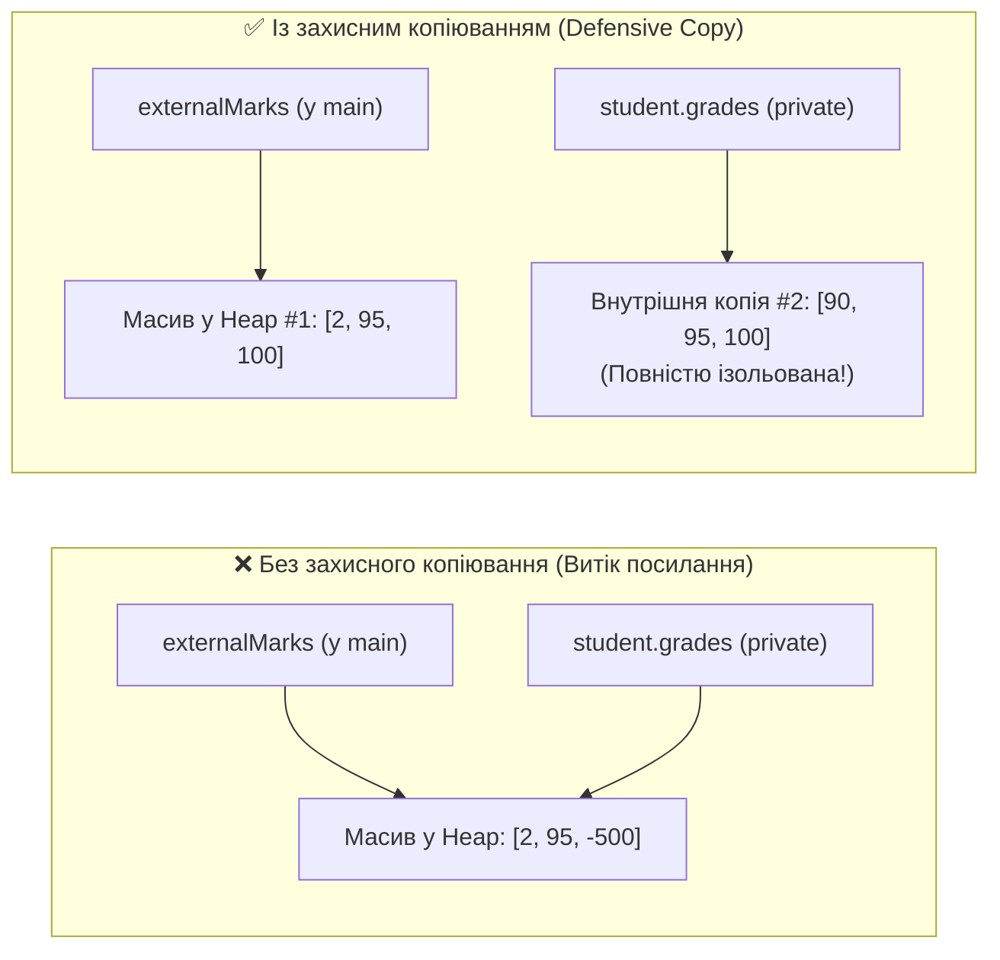
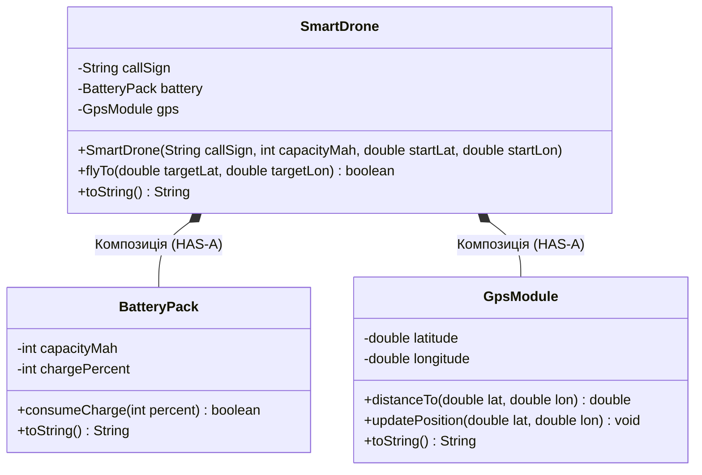
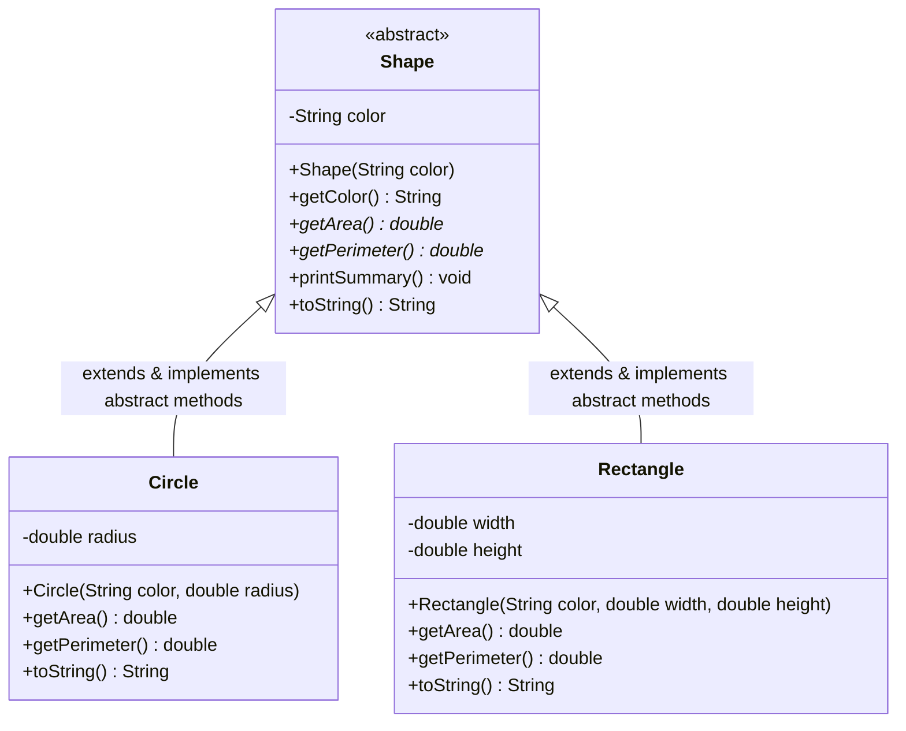
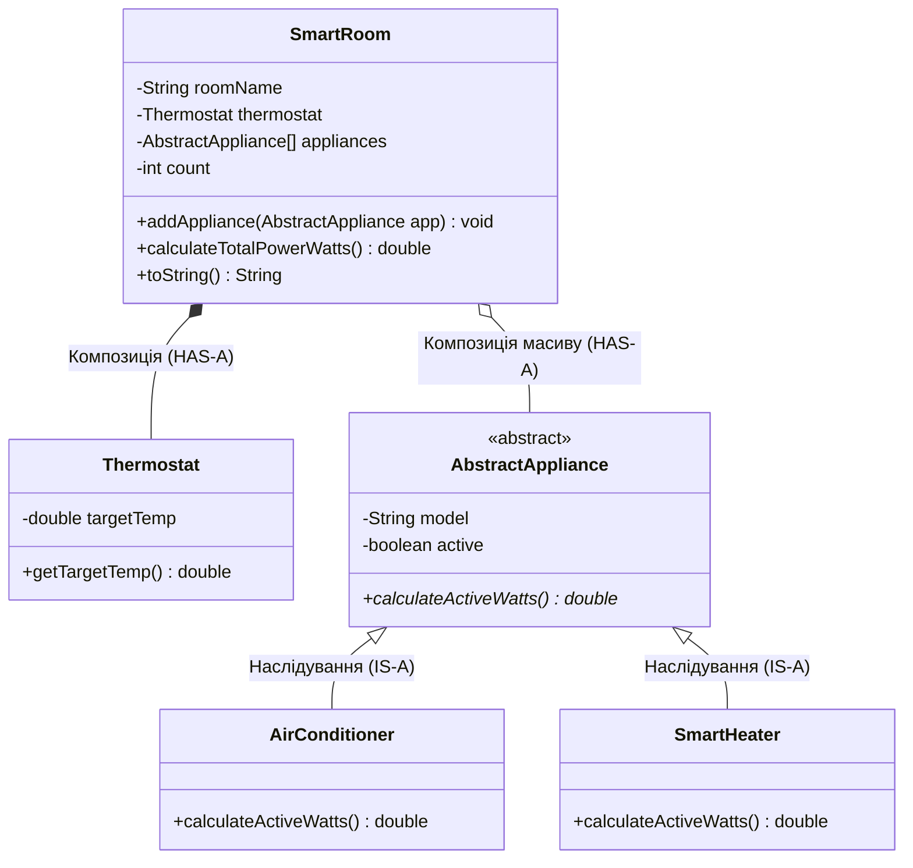

# Практична робота №9: Ключові концепції ООП (Частина 2): Поглиблена Інкапсуляція, Композиція (`HAS-A`) та Абстрактні класи (`abstract`)

## 🎯 Мета роботи
- **Поглибити майстерність Інкапсуляції (*Deep Encapsulation*):**
  - Навчитися проєктувати класи із залізобетонним захистом внутрішнього стану (`private`, `final`), де жоден зовнішній виклик не здатний порушити інваріанти об'єкта.
  - Опанувати техніку **захисного копіювання (*Defensive Copying*)** при роботі з масивами та вкладеними об'єктами в конструкторах і геттерах, щоб унеможливити несанкціоновану зміну даних через збережені посилання.
  - Зрозуміти концепцію незмінних (*Immutable*) об'єктів та заміну примітивних «відкритих сеттерів» на осмислені бізнес-методи з валідацією.
- **Досконало опанувати Композицію та Агрегацію (*Composition & Aggregation — відношення HAS-A*):**
  - Навчитися безпомилково розрізняти спадкування **IS-A** («Є різновидом») та композицію **HAS-A** («Має у своєму складі / Складається з»).
  - Зрозуміти різницю між **Композицією** (жорсткий зв'язок життєвого циклу, де частина не існує без цілого) та **Агрегацією** (слабкий зв'язок, де компонент передається ззовні й може жити незалежно).
  - Опанувати механізм **делегування (*Delegation*)**: як об'єкт-контейнер передає виконання обчислень своїм внутрішнім об'єктам-компонентам.
  - Засвоїти фундаментальний принцип промислової розробки: *«Favor Composition over Inheritance»* (Надавайте перевагу композиції над спадкуванням там, де немає чистого ієрархічного зв'язку).
- **Вивчити Абстрактні класи та Абстрактні методи (`abstract class`, `abstract method`):**
  - Усвідомити архітектурну роль абстракції: чому не повинно існувати екземплярів «просто Фігури», «просто Тварини» чи «просто Банківської Транзакції».
  - Розібратися, чому не можна створити об'єкт абстрактного класу напряму через `new`, але чому абстрактний клас **обов'язково має конструктори** (для виклику через `super(...)`), поля (`private`, `protected`) та звичайні методи.
  - Опанувати оголошення **абстрактних методів** (`public abstract double getArea();`) як суворого контракту, який зобов'язані реалізувати (`@Override`) усі конкретні класи-нащадки.
  - Познайомитися з патерном **Шаблонний метод (*Template Method*)**, коли звичайний метод абстрактного класу будує алгоритм на основі виклику абстрактних методів.
- **Об'єднати Інкапсуляцію, Композицію та Абстрактні класи в єдину архітектуру:** навчитися будувати складні інженерні та математичні системи, де клас-контейнер компонує (`HAS-A`) інкапсульовані компоненти, що є спадкоємцями абстрактних класів (`IS-A`).
- **Закріпити здачу робіт через Git та GitHub:** вчасно комітити та пушити виконані завдання у власний репозиторій (дедлайн — **до наступного четверга**).
- **Розв'язати 40 практичних завдань:** пройти шлях від захисного копіювання та глибокої інкапсуляції до складних багатошарових систем із композицією та абстрактними класами.

---

## 📚 1. Теоретичні відомості

### 1.1. Поглиблена інкапсуляція: Інваріанти, Бізнес-методи та Захисне копіювання (Defensive Copying)

У попередніх роботах ми вивчили перше правило інкапсуляції: робити поля `private` і надавати до них доступ через `public` геттери й сеттери. Проте на практиці **просто згенерувати геттери та сеттери для всіх полів — це ще НЕ справжня інкапсуляція!**

#### Проблема 1: «Сліпі» сеттери руйнують логіку об'єкта
Якщо у класі `BankAccount` є метод `public void setBalance(double balance)`, то будь-хто ззовні може переписати баланс в обхід історії транзакцій, комісій та перевірок безпеки.
- **Правильний підхід:** для чутливих полів **взагалі не створюють публічних сеттерів**! Стан змінюється виключно через **контрольовані бізнес-методи** (`deposit()`, `withdraw()`, `applyDamage()`, `calibrate()`), які перевіряють правила предметної області.

#### Проблема 2: Витік посилань на масиви та об'єкти (Reference Leak)
Подивіться уважно на цей код. Здається, що поле `grades` надійно захищене словом `private`, але насправді **інкапсуляцію тут повністю зламано**:

```java
// ❌ ПОГАНИЙ КОД: Ілюзія інкапсуляції (Витік посилання на масив!)
public class BrokenStudent {
    private String name;
    private int[] grades;

    public BrokenStudent(String name, int[] grades) {
        this.name = name;
        this.grades = grades; // НЕБЕЗПЕКА! Зберегли посилання на зовнішній масив!
    }

    public int[] getGrades() {
        return this.grades;   // НЕБЕЗПЕКА! Віддали пряме посилання на внутрішній масив!
    }
}
```
Що може статися у `main`?
```java
int[] externalMarks = {90, 95, 100};
BrokenStudent student = new BrokenStudent("Іван", externalMarks);

// 1. Злом через вхідний масив конструктора:
externalMarks[0] = 2; // Оцінка всередині student таємно змінилася на 2!

// 2. Злом через геттер:
int[] leaked = student.getGrades();
leaked[2] = -500;     // Оцінка всередині student стала -500 без жодного сеттера!
```



#### Рішення: Захисне копіювання (Defensive Copying)
Коли клас приймає у конструктор (або сеттер) масив чи змінний (*mutable*) об'єкт, або повертає його через геттер, він повинен створювати **незалежну копію**:

```java
import java.util.Arrays;

// ✅ ЧИСТИЙ ТА БЕЗПЕЧНИЙ КОД: Захисне копіювання (Defensive Copy)
public class SecureStudent {
    private final String name;
    private final int[] grades;

    public SecureStudent(String name, int[] grades) {
        this.name = (name == null || name.isBlank()) ? "Невідомий" : name;
        // 1. Захисна копія на вході (в конструкторі):
        if (grades == null || grades.length == 0) {
            this.grades = new int[0];
        } else {
            this.grades = Arrays.copyOf(grades, grades.length);
            // При одночасному копіюванні можемо ще й провалідувати кожен елемент:
            for (int i = 0; i < this.grades.length; i++) {
                this.grades[i] = Math.max(0, Math.min(100, this.grades[i]));
            }
        }
    }

    // 2. Захисна копія на виході (у геттері):
    public int[] getGrades() {
        return Arrays.copyOf(this.grades, this.grades.length);
    }

    // Або ще краще — надати точковий доступ за індексом:
    public int getGradeAt(int index) {
        if (index >= 0 && index < grades.length) {
            return grades[index];
        }
        return -1;
    }
}
```

#### Незмінні класи (Immutable Objects)
Якщо всі поля класу оголошені як **`private final`**, клас не має жодного методу, що змінює стан після створення, і виконує захисне копіювання змінюваних полів — такий об'єкт називається **незмінним (*Immutable*)**. Будь-яка операція над ним (наприклад, додавання двох векторів чи дробів) не змінює старий об'єкт, а повертає **новий екземпляр**.

---

### 1.2. Композиція та Агрегація: Відношення `HAS-A` проти Наслідування `IS-A`

У Практичній роботі №8 ми активно будували ієрархії наслідування (`extends`). Початківці часто настільки захоплюються словом `extends`, що починають використовувати його всюди:
- `class Car extends Engine` ❌ *(Хіба Автомобіль Є Двигуном?! Ні!)*
- `class SmartHouse extends Thermometer` ❌ *(Хіба Будинок Є Термометром?! Ні!)*
- `class Circle extends Point` ❌ *(Хіба Коло Є Точкою?! Ні, коло МАЄ центр у точці!)*

> **Композиція (Composition)** — це спосіб побудови складних класів, за якого один клас містить посилання на об'єкти інших класів у ролі своїх приватних полів. Це реалізує природне відношення **HAS-A** («Має у своєму складі» / «Складається з»).

#### Порівняльна таблиця: Наслідування (`IS-A`) vs Композиція (`HAS-A`)

| Критерій | Наслідування (`extends` / `IS-A`) | Композиція (`HAS-A` — поля-об'єкти) |
| :--- | :--- | :--- |
| **Логічне питання** | Чи є `B` окремим різновидом `A`? | Чи містить `B` всередині себе деталь `A`? |
| **Приклади** | `Dog` є `Animal`; `Cylinder` є фігурою з основою `Circle` | `Car` має `Engine` та 4 `Wheel`; `Circle` має центр `Point2D` |
| **Кількість зв'язків** | Тільки **один** батьківський клас (`extends A`) | **Скільки завгодно** різних компонентів-полів! |
| **Гнучкість у Runtime** | Статична (батьківський клас не можна змінити під час роботи) | Динамічна (компонент можна замінити на льоту через метод!) |
| **Інкапсуляція** | Нащадок часто залежить від внутрішніх `protected` деталей батька | Компоненти взаємодіють тільки через чіткі публічні методи |

#### Композиція проти Агрегації: у чому тонка різниця?
Обидва терміни описують зв'язок **HAS-A** («частина — ціле»), але відрізняються **життєвим циклом** компонента:

1. **Композиція (Сильна асоціація / Strong Lifecycle):**
   - Контейнер **сам створює** компонент (наприклад, у своєму конструкторі через `new`) або володіє його захисною копією.
   - Коли знищується контейнер, його внутрішня частина теж зникає і не використовується ніде більше.
   - *Приклад:* `Human` і `Heart` (Серце створюється разом з людиною), `Building` і `Room[]` (Кімната не існує окремо від будівлі).
2. **Агрегація (Слабка асоціація / Shared Lifecycle):**
   - Компонент створюється ззовні і передається у контейнер за посиланням (через конструктор або метод `add...`).
   - Якщо контейнер перестане існувати, сам компонент продовжить жити в програмі і може бути переданий в інший контейнер.
   - *Приклад:* `UniversityDepartment` і `Professor` (Професор може перейти на іншу кафедру), `Car` і `Driver` (Водій вийшов з авто).



#### Делегування (Delegation) у Композиції
Коли ми викликаємо метод у складного об'єкта-контейнера, він не виконує всю низькорівневу роботу сам — він **делегує** (доручає) частину роботи своїм внутрішнім компонентам:

```java
public class Engine {
    private final String model;
    private final int horsePower;
    private boolean running;

    public Engine(String model, int horsePower) {
        this.model = model;
        this.horsePower = Math.max(50, horsePower);
        this.running = false;
    }

    public void ignite() {
        this.running = true;
    }

    public void stop() {
        this.running = false;
    }

    public boolean isRunning() {
        return running;
    }

    public int getHorsePower() {
        return horsePower;
    }

    @Override
    public String toString() {
        return String.format("Engine[%s, %d hp, running=%s]", model, horsePower, running);
    }
}

public class Car {
    private final String brand;
    private final Engine engine; // КОМПОЗИЦІЯ: Автомобіль МАЄ двигун (private final!)

    // При суворій композиції Car сам конструює свій внутрішній Engine:
    public Car(String brand, String engineModel, int horsePower) {
        this.brand = brand;
        this.engine = new Engine(engineModel, horsePower);
    }

    // ДЕЛЕГУВАННЯ: Car доручає запуск своєму полю engine
    public void startCar() {
        if (!engine.isRunning()) {
            engine.ignite();
            System.out.println(brand + ": двигун успішно запущено!");
        }
    }

    @Override
    public String toString() {
        return String.format("Car{brand='%s', %s}", brand, engine); // автоматично викличе engine.toString()!
    }
}
```

---

### 1.3. Абстрактні класи (`abstract class`) та Абстрактні методи (`abstract method`)

Уявіть, що ми проєктуємо графічний або математичний рушій. У нас є базовий клас `Shape` (Геометрична фігура) та його нащадки: `Circle` (Коло), `Rectangle` (Прямокутник), `Triangle` (Трикутник).
Усі фігури мають колір `String color` і повинні мати метод обчислення площі `getArea()` та периметра `getPerimeter()`.

Але поставте собі два запитання:
1. **Чи має сенс у програмі створити об'єкт `new Shape("Червоний")`?** Що це за фігура? Не коло, не квадрат, не трикутник — якась «невизначена абстракція»!
2. **Яку формулу написати в тілі методу `getArea()` у самому класі `Shape`?** Площі «просто фігури» в природі не існує! Писати там `return 0.0;` - небезпечно, бо хтось забуде перевизначити метод у нащадку і отримає нульову площу без жодного попередження компілятора.

Саме для цього в Java існує ключове слово **`abstract`**!

> **Абстрактний клас (`abstract class`)** - це базовий клас-шаблон, який представляє загальне поняття для своїх спадкоємців і **не може мати власних прямих екземплярів** (заборонено писати `new AbstractClass()`).

> **Абстрактний метод (`abstract method`)** - це оголошення методу **без тіла реалізації** (замість фігурних дужок `{ ... }` ставиться крапка з комою `;`). Він задає обов'язковий **контракт**: кожен неабстрактний клас-нащадок **зобов'язаний** перевизначити (`@Override`) цей метод і надати свою конкретну формулу!



#### Приклад оголошення абстрактного класу та його спадкоємців:

```java
// 1. АБСТРАКТНИЙ БАЗОВИЙ КЛАС
public abstract class Shape {
    private String color; // Повне право мати інкапсульовані поля!

    // Конструктор абстрактного класу (викликається нащадками через super!)
    public Shape(String color) {
        this.color = (color == null || color.isBlank()) ? "Білий" : color;
    }

    public String getColor() {
        return color;
    }

    // АБСТРАКТНІ МЕТОДИ (контракт без тіла — зверніть увагу на крапку з комою!)
    public abstract double getArea();
    public abstract double getPerimeter();

    // ЗВИЧАЙНИЙ (КОНКРЕТНИЙ) МЕТОД, який використовує абстрактні методи!
    // Це класичний патерн "Шаблонний метод" (Template Method)
    public double getAreaToPerimeterRatio() {
        double p = getPerimeter();
        return (p > 0) ? getArea() / p : 0.0;
    }

    @Override
    public String toString() {
        return String.format("Shape[color='%s', S=%.2f, P=%.2f]", color, getArea(), getPerimeter());
    }
}

// 2. КОНКРЕТНИЙ КЛАС-НАЩАДОК №1
public class Circle extends Shape {
    private final double radius;

    public Circle(String color, double radius) {
        super(color); // Виклик конструктора абстрактного класу Shape!
        this.radius = (radius > 0) ? radius : 1.0;
    }

    @Override
    public double getArea() {
        return Math.PI * radius * radius; // Обов'язкова реалізація контракту!
    }

    @Override
    public double getPerimeter() {
        return 2 * Math.PI * radius;     // Обов'язкова реалізація контракту!
    }

    @Override
    public String toString() {
        return String.format("Circle{r=%.2f, %s}", radius, super.toString());
    }
}
```

#### ⚠️ 6 золотих правил роботи з `abstract` у Java:

> [!IMPORTANT]
> 1. **Заборона `new`:** Спроба написати `Shape s = new Shape("Red");` миттєво викличе помилку компіляції: *`'Shape' is abstract; cannot be instantiated`*.
> 2. **Якщо є `abstract` метод $\to$ клас теж `abstract`:** Якщо у класі оголошено хоча б один абстрактний метод, сам клас обов'язково повинен мати ключове слово `abstract` у заголовку.
> 3. **Абстрактний клас без абстрактних методів — дозволений!** Клас можна оголосити `abstract`, навіть якщо всі його методи вже мають тіло реалізації (коли ми просто хочемо заборонити створення `new BaseClass()`).
> 4. **Обов'язок нащадка:** Клас, який робить `extends AbstractClass`, **зобов'язаний реалізувати (`@Override`) абсолютно всі успадковані абстрактні методи**, або сам повинен бути оголошений як `abstract`.
> 5. **Конструктори в абстрактному класі Є і вони обов'язкові для ініціалізації полів!** Хоча їх не можна викликати через `new`, вони завжди викликаються першим рядком із конструкторів класів-нащадків через **`super(...)`**.
> 6. **Заборонені комбінації модифікаторів для `abstract` методу:**
>    - ❌ `private abstract` — приватний метод невидимий у нащадках, тому його неможливо перевизначити!
>    - ❌ `final abstract` — `final` забороняє перевизначення, а `abstract` вимагає перевизначення (пряме протиріччя!).
>    - ❌ `static abstract` — статичні методи належать класу, а не об'єкту, і не підтримують динамічного перевизначення.

---

### 1.4. Патерн «Шаблонний метод» (Template Method) в абстрактних класах

Однією з найпотужніших переваг абстрактних класів є те, що звичайний метод суперкласу може описувати **загальний незмінний алгоритм**, всередині якого викликаються **абстрактні кроки**, реалізовані в нащадках!

Наприклад, абстрактний клас `AbstractMathFunction` не знає конкретної формули функції $f(x)$, але він вже вміє **будувати таблицю значень** або **знаходити чисельну похідну чи інтеграл** для будь-якої майбутньої функції:

```java
public abstract class AbstractMathFunction {
    private final String functionName;

    public AbstractMathFunction(String functionName) {
        this.functionName = functionName;
    }

    // Абстрактний крок: кожна функція-нащадок сама задає формулу y = f(x)
    public abstract double evaluate(double x);

    // ШАБЛОННИЙ МЕТОД: рахує суму значень функції на відрізку [start; end] з кроком step
    public final double sumValuesOnInterval(double start, double end, double step) {
        if (step <= 0 || start > end) return 0.0;
        double sum = 0.0;
        for (double x = start; x <= end + 1e-9; x += step) {
            sum += evaluate(x); // Викликає реалізацію конкретного нащадка!
        }
        return sum;
    }
}
```

---

### 1.5. Синергія трьох концепцій: Інкапсуляція + Композиція + Абстрактні класи

У справжніх програмах ці три механізми працюють разом як єдиний годинниковий механізм:
1. **Інкапсуляція (`private`, `final`, захисне копіювання)** гарантує, що жодна деталь не має некоректних даних.
2. **Абстрактні класи (`abstract class`)** задають базові категорії взаємозамінних деталей (`AbstractEngine`, `AbstractSensor`, `AbstractShape`, `AbstractWeapon`).
3. **Композиція (`HAS-A`)** збирає з цих абстрактних та конкретних деталей цілісну систему (`Spacecraft`, `SmartHome`, `DrawingCanvas`, `GameHero`).



---

### 1.6. Поширені помилки та підводні камені

1. **Спроба створити об'єкт абстрактного класу через `new`:**
   ```java
   AbstractSensor s = new AbstractSensor("T-1"); // ❌ ПОМИЛКА КОМПІЛЯЦІЇ!
   // Але створити масив посилань на абстрактний клас — МОЖНА!
   AbstractSensor[] sensors = new AbstractSensor[5]; // ✅ Це лише масив комірок для майбутніх нащадків!
   ```
2. **Крапка з комою або фігурні дужки в абстрактному методі:**
   ```java
   public abstract double calc() { return 0; } // ❌ ПОМИЛКА: Abstract methods cannot have a body
   public double calc();                       // ❌ ПОМИЛКА: Missing method body, or declare abstract
   public abstract double calc();              // ✅ ПРАВИЛЬНО!
   ```
3. **Використання `extends` замість Композиції:**
   Якщо ви пишете `classRectangle extends Point2D`, ви випадково робите прямокутник точкою. Правильно: покласти `private final Point2D topLeft;` всередину `Rectangle` (Композиція)!
4. **Неперевірений `null` у полях Композиції:**
   Якщо в конструктор `Car(String brand, Engine engine)` передадуть `engine == null`, а ви без перевірки викличете `this.engine.start()`, програма впаде з `NullPointerException`. Завжди перевіряйте компоненти на `null` у конструкторі!

---

### 1.7. Q&A (Часті запитання на співбесідах)

#### Q1: Якщо об'єкт абстрактного класу не можна створити через `new`, то навіщо абстрактному класу конструктор?
**Відповідь:** Тому що абстрактний клас може мати власні `private` або `protected` поля! Коли створюється об'єкт класу-нащадка, Java зобов'язана спочатку ініціалізувати батьківську частину об'єкта. Конструктор абстрактного класу викликається з конструктора підкласу через `super(...)`.

#### Q2: Коли слід обрати Композицію (`HAS-A`), а коли Наслідування (`IS-A`)?
**Відповідь:** Наслідування використовується лише тоді, коли підклас дійсно є вужчою спеціалізацією базового класу (*Кіт є Твариною*, *Квадратна Матриця є Матрицею*) і ми хочемо перевизначити чи розширити його поведінку. Якщо один об'єкт просто використовує інший як деталь або інструмент (*Автомобіль має Двигун*, *Користувач має Адресу*) — завжди обирають Композицію.

#### Q3: Що таке «Захисне копіювання» (Defensive Copying) і як воно захищає інкапсуляцію?
**Відповідь:** У Java масиви та об'єкти передаються за посиланням. Якщо зберегти вхідний масив напряму в `private` поле або повернути його з геттера, зовнішній код матиме доступ до тієї ж області пам'яті в Heap і зможе змінити вміст масиву в обхід методів класу. Захисне копіювання (`Arrays.copyOf(...)` або створення клона об'єкта) ізолює внутрішній стан класу від зовнішнього світу.

#### Q4: Чи може абстрактний клас взагалі не містити жодного абстрактного методу?
**Відповідь:** Так, це цілком легально в Java. Так роблять, коли всі методи в базовому класі вже мають розумну реалізацію за замовчуванням, але сам базовий клас є суто концептуальним і створювати його екземпляри напряму в програмі не повинно бути дозволено.

#### Q5: Чому метод не може бути одночасно `abstract` та `private` або `abstract` та `final`?
**Відповідь:** Призначення `abstract` методу — змусити класи-нащадки перевизначити (`@Override`) його. Але `private` метод невидимий для нащадків, а `final` метод прямо забороняє будь-яке перевизначення. Тому такі комбінації логічно неможливі й заборонені компілятором.

---

### 1.8. Здача роботи через GitHub та Дедлайн

> [!IMPORTANT]
> **Умови здачі Практичної та Домашньої роботи №9:**
> - Усі виконані завдання фіксуються у вашому **Git-репозиторії** та пушаться на **GitHub**.
> - **⏰ Дедлайн здачі:** **до наступного четверга (5 листопада 2026 року, 23:59)**.
> - Коміти, зроблені після дедлайну, або код, який не компілюється, оцінюються зі штрафом або не приймаються.

```bash
git status
git add src/main/java/semester1/practice09/
git commit -m "feat(practice09): complete composition, encapsulation and abstract classes tasks"
git push origin main
```

---

## 💻 2. Практичні завдання (40 завдань)

Усі завдання виконуються у пакеті `semester1.practice09` та тестуються у методі `main` класу `Practice09.java`.
Завдання поділено на **5 логічних блоків по 8 завдань**:
- **Блок 1 (Завдання 1–8):** Поглиблена інкапсуляція, незмінність (`final`), інваріанти та захисне копіювання.
- **Блок 2 (Завдання 9–16):** Композиція та Агрегація (`HAS-A`, зв'язок `1-до-1`, делегування викликів).
- **Блок 3 (Завдання 17–24):** Композиція з інкапсульованими масивами об'єктів (`HAS-MANY`, зв'язок `1-до-багатьох`).
- **Блок 4 (Завдання 25–32):** Абстрактні класи (`abstract class`), абстрактні методи та Шаблонний метод.
- **Блок 5 (Завдання 33–40):** Комплексна синергія: Інкапсуляція + Композиція + Абстрактні класи + Фінальний `git push`.

---

### Блок 1: Поглиблена інкапсуляція, Захисне копіювання та Незмінні об'єкти (Завдання 1–8)

#### Завдання 1: Незмінна географічна координата (`ImmutableGeoPoint`)
1. Створіть незмінний клас `ImmutableGeoPoint` із полями `private final double latitude` (широта в межах $[-90.0; 90.0]$) та `private final double longitude` (довгота в межах $[-180.0; 180.0]$).
2. У конструкторі застосуйте обмежувальну валідацію (clamping): якщо значення виходить за межі, притисніть його до границі (`Math.max(-90.0, Math.min(90.0, lat))`).
3. Не створюйте жодних сеттерів! Замість зміни об'єкта реалізуйте метод `public ImmutableGeoPoint shift(double dLat, double dLon)`, який повертає **новий** екземпляр `ImmutableGeoPoint` зі зміщеними координатами.
4. Перевизначте `@Override public String toString()` та протестуйте у `main`.

#### Завдання 2: Захисне копіювання масиву результатів експерименту (`LabMeasurement`)
1. Створіть клас `LabMeasurement` із полями `private final String experimentName` та `private final double[] samples`.
2. У конструкторі виконайте **захисне копіювання** вхідного масиву через `Arrays.copyOf(...)` (якщо передано `null`, створіть `new double[0]`).
3. У геттері `public double[] getSamples()` також повертайте **копію** масиву, а не пряме посилання.
4. У `Practice09.main` спробуйте змінити елемент зовнішнього масиву до і після виклику геттера та доведіть у консолі, що внутрішній масив `LabMeasurement` залишився недоторканим!

#### Завдання 3: Криптографічний гаманець без відкритих сеттерів (`CryptoVault`)
1. Створіть клас `CryptoVault` із полями: `private final String walletAddress`, `private String secretRecoveryPhrase`, `private double btcBalance`, `private boolean locked`.
2. Забороніть будь-які геттери для `secretRecoveryPhrase` та будь-які сеттери для `btcBalance`!
3. Додайте бізнес-методи:
   - `public boolean unlock(String phrase)` — розблоковує гаманець лише при збігу секретної фрази;
   - `public void lock()` — блокує гаманець;
   - `public boolean sendBtc(double amount, String destination)` — списує кошти лише якщо `!locked`, `amount > 0` та `btcBalance >= amount`.
4. У `@Override public String toString()` виводьте адресу, статус блокування та баланс (без секретної фрази).

#### Завдання 4: Математичний інтервал із самовідновлюваним інваріантом (`ClosedInterval`)
1. Створіть клас `ClosedInterval` із полями `private double start` та `private double end` (інваріант: завжди `start <= end`).
2. Якщо у конструктор або метод `public void resize(double newStart, double newEnd)` передано значення, де `newStart > newEnd`, автоматично міняйте їх місцями.
3. Реалізуйте методи `public double getLength()`, `public double getMidpoint()`, `public boolean overlaps(ClosedInterval other)` (чи перетинаються два інтервали).
4. Перевизначте `toString()` у форматі `"[start; end] (центр: mid, довжина: len)"`.

#### Завдання 5: Інкапсульований RGB-колір (`RgbColor`) із перевіркою каналів
1. Створіть незмінний клас `RgbColor` із полями `private final int red`, `private final int green`, `private final int blue`.
2. Кожен канал повинен строго лежати в діапазоні $[0; 255]$ (застосуйте приватний допоміжний метод `private static int clamp(int val)` у конструкторі).
3. Реалізуйте метод `public String toHex()` (формат `String.format("#%02X%02X%02X", red, green, blue)`), метод інверсії `public RgbColor invert()` (повертає новий колір `255 - r, 255 - g, 255 - b`) та метод змішування `public RgbColor mixWith(RgbColor other)`.
4. Виведіть кольори та їхні HEX-коди через `toString()`.

#### Завдання 6: Банківський сейф із лічильником спроб та часовим блокуванням (`HighSecuritySafe`)
1. Створіть клас `HighSecuritySafe` із полями: `private int pinCode`, `private double storedCash`, `private int failedAttempts`, `private boolean permanentlyBlocked`.
2. Реалізуйте приватний допоміжний метод `private boolean checkAccess(int enteredPin)`:
   - Якщо `permanentlyBlocked` — одразу повертає `false`.
   - Якщо `enteredPin != pinCode` — збільшує `failedAttempts`, і при досягненні `3` вмикає `permanentlyBlocked = true`.
   - Якщо вірний — скидає `failedAttempts = 0` і повертає `true`.
3. Використайте цей приватний метод усередині публічних методів `putCash(int pin, double amount)` та `takeCash(int pin, double amount)`.

#### Завдання 7: Інкапсульований многочлен із захищеним масивом коефіцієнтів (`EncapsulatedPolynomial`)
1. Створіть клас `EncapsulatedPolynomial`, що зберігає коефіцієнти многочлена $P(x) = c_0 + c_1 x + c_2 x^2 + \dots$ у приватному масиві `private final double[] coeffs`.
2. Забезпечте захисне копіювання масиву в конструкторі.
3. Реалізуйте методи `public int getDegree()`, `public double getCoefficient(int power)` (із перевіркою меж індексу) та `public double evaluate(double x)` за схемою Горнера або через `Math.pow(x, i)`.
4. Перевизначте `toString()`, щоб він красиво формував математичний запис многочлена.

#### Завдання 8: Медична картка пацієнта із захистом персональних даних (`MedicalRecord`)
1. Створіть клас `MedicalRecord` із полями: `private final String patientId`, `private String fullName`, `private int bloodGroup` ($1..4$), `private boolean rhPositive`, `private String[] allergies`.
2. Зробіть захисне копіювання масиву `allergies` у конструкторі та геттері.
3. Додайте метод `public boolean hasAllergyTo(String substance)` (порівняння без урахування регістру `equalsIgnoreCase`).
4. Перевизначте `toString()` із відображенням групи крові у форматі `"II (A) Rh+"` та списку алергій.

---

### Блок 2: Композиція та Агрегація: Відношення `HAS-A` (1-до-1) та Делегування (Завдання 9–16)

#### Завдання 9: Коло на площині через Композицію (`Point2D` + `CompositeCircle`)
1. Замість того, щоб успадковувати коло від точки, створіть клас `Point2D` (`private double x`, `private double y`, метод `distanceTo(Point2D other)`).
2. Створіть клас `CompositeCircle`, який інкапсулює радіус `private double radius` та **компонує** центр кола: `private final Point2D center;`!
3. У конструкторі `CompositeCircle(double centerX, double centerY, double radius)` створюйте внутрішній об'єкт `this.center = new Point2D(centerX, centerY);`.
4. Реалізуйте метод `public boolean containsPoint(Point2D p)`, який делегує обчислення відстані методу `center.distanceTo(p) <= radius`, та перевизначте `toString()`.

#### Завдання 10: Автомобіль та Двигун: Делегування стану (`Engine` + `Automobile`)
1. Створіть інкапсульований клас `Engine` (`private final String fuelType`, `private final int volumeCc`, `private int rpm`, `private boolean started`). Додайте методи `start()`, `stop()`, `setRpm(int rpm)`.
2. Створіть клас `Automobile` (`private final String model`, `private double speed`, `private final Engine engine`).
3. Реалізуйте в `Automobile` метод `public void accelerate(double deltaSpeed)`:
   - Автомобіль може розганятися **тільки якщо його внутрішній двигун заведений** (`engine.isStarted()`).
   - При розгоні автомобіль автоматично підвищує оберти свого двигуна через `engine.setRpm(...)`.
4. Перевизначте `toString()` в обох класах.

#### Завдання 11: Смартфон, Акумулятор та Дисплей (`Battery` + `Display` $\to$ `SmartDevice`)
1. Створіть клас `Battery` (`private int capacityMah`, `private int chargePercent` у межах $[0; 100]$, методи `drain(int percent)` та `charge(int percent)`).
2. Створіть клас `Display` (`private double diagonalInches`, `private int brightnessPercent` у межах $[10; 100]$).
3. Створіть клас `SmartDevice`, який компонує **обидва** об'єкти: `private final Battery battery` та `private final Display display`.
4. Реалізуйте метод `public void watchVideo(int minutes)`: якщо яскравість дисплея $> 70\%$, батарея втрачає $2\%$ заряду за кожні 10 хвилин, інакше — $1\%$. Якщо заряд падає до $0$, пристрій вимикається.

#### Завдання 12: Відрізок та Вектор через дві Точки (`Point2D` $\to$ `LineSegment`)
1. Створіть клас `LineSegment`, який має два приватні поля типу `Point2D`: `private final Point2D start` та `private final Point2D end`.
2. У конструкторі приймайте `Point2D start, Point2D end`, але зберігайте їхні **захисні копії** (`new Point2D(start.getX(), start.getY())`), щоб зовнішній код не змінив кінці відрізка!
3. Реалізуйте методи `public double getLength()` (делегує до `start.distanceTo(end)`) та `public Point2D getMidpoint()` (повертає нову точку середини відрізка).
4. Перевизначте `toString()`.

#### Завдання 13: Банківська картка та Рахунок (`BankAccount` + `PlasticCard`)
1. Створіть клас `BankAccount` (`private final String iban`, `private double balance`, методи `deposit`, `withdraw`).
2. Створіть клас `PlasticCard` (`private final String cardNumber`, `private final String expiryDate`, `private boolean blocked`, `private final BankAccount linkedAccount` — **агрегація**).
3. Додайте в `PlasticCard` метод `public boolean payAtTerminal(double amount)`:
   - Перевіряє, чи картка не заблокована (`!blocked`);
   - Делегує списання коштів прив'язаному рахунку: `return linkedAccount.withdraw(amount);`.
4. Продемонструйте в `main`, як дві різні картки можуть бути прив'язані до одного спільного сімейного рахунку `BankAccount`!

#### Завдання 14: Герой RPG та Екіпірована Зброя (`WeaponItem` + `HeroCharacter`)
1. Створіть клас `WeaponItem` (`private final String name`, `private final int bonusDamage`, `private int durability` — міцність зброї від $0$ до $100$). При кожному ударі `useWeapon()` міцність падає на $10$, а коли `durability == 0`, зброя дає $0$ бонусної шкоди.
2. Створіть клас `HeroCharacter` (`private final String nickname`, `private int baseStrength`, `private WeaponItem equippedWeapon`).
3. Дозвольте змінювати зброю на льоту через метод `public void equip(WeaponItem newWeapon)` (або `unequip()`, де `equippedWeapon = null`).
4. Реалізуйте метод `public int attack()`, який враховує `baseStrength` + бонус зброї (якщо `equippedWeapon != null`).

#### Завдання 15: Замовлення та Адреса доставки (`DeliveryAddress` + `ParcelOrder`)
1. Створіть клас `DeliveryAddress` (`private String city`, `private String street`, `private int postOfficeNumber`, метод валідації та `toString()`).
2. Створіть клас `ParcelOrder` (`private final String orderId`, `private double weightKg`, `private DeliveryAddress destination`, `private boolean shipped`).
3. Реалізуйте інкапсульоване правило: змінити адресу доставки методом `changeDestination(DeliveryAddress newAddress)` можна **тільки до моменту відправки** (`!shipped`)! Після виклику `markAsShipped()` будь-яка спроба змінити адресу відхиляється.

#### Завдання 16: Розумний термостат у кімнаті (`TemperatureSensor` + `HeatingUnit` $\to$ `ClimateController`)
1. Створіть клас `TemperatureSensor` (`private double currentTemp`) та клас `HeatingUnit` (`private boolean heatingOn`, `private double powerKw`).
2. Створіть клас `ClimateController`, який компонує датчик і обігрівач та зберігає бажану температуру `private double targetTemp`.
3. Реалізуйте метод `public void regulate()`:
   - Читає температуру з датчика;
   - Якщо `currentTemp < targetTemp - 0.5`, вмикає `heatingUnit`;
   - Якщо `currentTemp >= targetTemp`, вимикає `heatingUnit`.
4. Виведіть повний звіт клімат-контролю через `toString()`.

---

### Блок 3: Композиція з масивами об'єктів: Відношення `HAS-MANY` (1-до-багатьох) (Завдання 17–24)

#### Завдання 17: Ламана лінія та Багатокутник із масиву точок (`Point2D[]` $\to$ `Polyline`)
1. Використайте клас `Point2D` $(x, y)$.
2. Створіть клас `Polyline` (Ламана лінія), який інкапсулює масив вершин `private final Point2D[] vertices` та лічильник `private int count`.
3. Додайте метод `public void addVertex(double x, double y)` та метод `public double getTotalLength()`, який у циклі сумує відстані між сусідніми точками $P_0 \to P_1 \to P_2 \dots$.
4. Додайте метод `public double getClosedPerimeter()`, який додатково додає відстань замикання від останньої точки до першої!

#### Завдання 18: Кошик інтернет-магазину (`OrderItem[]` $\to$ `ShoppingOrder`)
1. Створіть клас `OrderItem` (`private final String productName`, `private final double unitPrice`, `private int quantity`, метод `getItemTotal()`).
2. Створіть клас `ShoppingOrder`, який компонує масив `private final OrderItem[] items` (наприклад, до 10 позицій) та `private int itemCount`.
3. Реалізуйте методи:
   - `public void addItem(String name, double price, int qty)` (якщо товар з таким ім'ям вже є в масиві — просто збільшити його `quantity`!);
   - `public double calculateGrandTotal()`;
   - багаторядковий `@Override public String toString()` у вигляді фіскального чека.

#### Завдання 19: Бібліотечна полиця (`BookItem[]` $\to$ `Bookshelf`)
1. Створіть клас `BookItem` (`private final String title`, `private final String author`, `private final int pages`).
2. Створіть клас `Bookshelf` (`private final String genre`, `private final BookItem[] books`, `private int bookCount`).
3. Реалізуйте методи:
   - `public boolean putBook(BookItem book)` (перевіряє на `null` та наявність вільного місця на полиці);
   - `public BookItem findLongestBook()` (повертає книгу з максимальною кількістю сторінок);
   - `public int getTotalPagesOnShelf()`.

#### Завдання 20: Музичний плейлист з підрахунком тривалості (`AudioTrack[]` $\to$ `Playlist`)
1. Створіть клас `AudioTrack` (`private final String title`, `private final String artist`, `private final int durationSeconds`). Додайте метод форматування часу `"MM:SS"`.
2. Створіть клас `Playlist` (`private String name`, `private final AudioTrack[] tracks`, `private int trackCount`).
3. Реалізуйте методи `addTrack(AudioTrack track)`, `getTotalDurationSeconds()`, та `@Override public String toString()`, який виводить список усіх треків і загальну тривалість плейлиста у форматі `"X хв Y сек"`.

#### Завдання 21: Серверний кластер та Вузли (`ServerNode[]` $\to$ `DataCenterCluster`)
1. Створіть клас `ServerNode` (`private final String ipAddress`, `private final int totalRamGb`, `private int usedRamGb`, `private boolean online`). Додайте метод `getFreeRamGb()`.
2. Створіть клас `DataCenterCluster` (`private final String clusterLocation`, `private final ServerNode[] nodes`, `private int nodeCount`).
3. Реалізуйте метод балансування навантаження `public boolean deployContainer(int requiredRamGb)`:
   - Шукає перший `online`-сервер у масиві, у якого `getFreeRamGb() >= requiredRamGb`;
   - Займає на ньому пам'ять і повертає `true` (або `false`, якщо на жодному сервері немає ресурсів).

#### Завдання 22: Навчальний курс та Модулі (`CourseModule[]` $\to$ `UniversityCourse`)
1. Створіть клас `CourseModule` (`private final String topic`, `private final int lectureHours`, `private final int practiceHours`, `private double maxScore`).
2. Створіть клас `UniversityCourse` (`private final String courseTitle`, `private final CourseModule[] modules`, `private int moduleCount`).
3. Реалізуйте методи підрахунку загальної кількості кредитів ЄКТС ($\text{усі години} / 30.0$) та перевірки, чи сума `maxScore` усіх модулів дорівнює рівно $100.0$ балів.

#### Завдання 23: Потяг та Вагони (`TrainCarriage[]` $\to$ `PassengerTrain`)
1. Створіть клас `TrainCarriage` (`private final int carriageNumber`, `private final String type` — `"Купе"`, `"Плацкарт"`, `"Інтерсіті"`, `private final int totalSeats`, `private int occupiedSeats`).
2. Створіть клас `PassengerTrain` (`private final String route`, `private final TrainCarriage[] carriages`, `private int carriageCount`).
3. Реалізуйте методи `attachCarriage(TrainCarriage c)`, `getTotalFreeSeats()` та `bookTicketsInCarriage(int carriageNumber, int seatsToBook)`.

#### Завдання 24: Система рівнянь як Композиція лінійних рівнянь (`LinearEquation[]` $\to$ `EquationSystem`)
1. Створіть клас `LinearEquation` вигляду $a x + b y = c$ (`private final double a, b, c`, метод `boolean isSatisfiedBy(double x, double y)` з точністю $10^{-6}$).
2. Створіть клас `EquationSystem`, який компонує масив `private final LinearEquation[] equations` та `private int count`.
3. Реалізуйте метод `public boolean checkSolution(double x, double y)`, який перевіряє, чи пара $(x, y)$ одночасно задовольняє **всі** рівняння у масиві системи!

---

### Блок 4: Абстрактні класи (`abstract class`), Абстрактні методи та Шаблонний метод (Завдання 25–32)

#### Завдання 25: Абстрактна фігура (`AbstractShape`) $\to$ `CircleShape` та `RectangleShape`
1. Створіть абстрактний клас `AbstractShape` із полем `private String color`, конструктором та абстрактними методами:
   - `public abstract double getArea();`
   - `public abstract double getPerimeter();`
2. Реалізуйте конкретні класи-нащадки `CircleShape extends AbstractShape` (радіус $r$) та `RectangleShape extends AbstractShape` (ширина $w$, висота $h$).
3. Перевизначте `@Override public String toString()` у базовому абстрактному класі так, щоб він автоматично друкував колір, `getArea()` та `getPerimeter()`.
4. Протестуйте обидві фігури в `main`.

#### Завдання 26: Абстрактне джерело енергії (`AbstractPowerPlant`) $\to$ Сонячна та Вітрова станції
1. Створіть абстрактний клас `AbstractPowerPlant` (`private final String stationName`, `protected double baseCapacityMw`).
2. Оголосіть абстрактний метод `public abstract double generateMegawatts();` та звичайний метод `public double calculateDailyProfit(double tariffPerMwh)` (множить вироблену потужність на 24 години та тариф).
3. Створіть нащадок `SolarPowerPlant extends AbstractPowerPlant` (`private double sunIntensityFactor` від $0.0$ до $1.0$).
4. Створіть нащадок `WindPowerPlant extends AbstractPowerPlant` (`private double windSpeedMs` — якщо вітер $< 3$ м/с або $> 25$ м/с, турбіна стоїть і генерує $0$).

#### Завдання 27: Абстрактний співробітник (`AbstractEmployee`) $\to$ Погодинний та Ставковий
1. Створіть `abstract class AbstractEmployee` (`private final int id`, `private final String name`, `protected double taxRate` — наприклад $0.195$).
2. Оголосіть абстрактний метод `public abstract double calculateGrossSalary();` (брутто) та фінальний шаблонний метод `public final double calculateNetSalary()`, який віднімає податки: `calculateGrossSalary() * (1.0 - taxRate)`.
3. Створіть підкласи:
   - `SalariedEmployee extends AbstractEmployee` (`double monthlySalary`, `double bonus`);
   - `HourlyContractor extends AbstractEmployee` (`int hoursWorked`, `double hourlyRate`, де години понад 160 оплачуються з коефіцієнтом $1.5$).

#### Завдання 28: Абстрактна математична послідовність (`AbstractSequence`) та сума перших $N$ членів
1. Створіть `abstract class AbstractSequence` із полем `private final String title`.
2. Оголосіть абстрактний метод `public abstract double getTerm(int index);` (для $index \ge 1$).
3. Реалізуйте в абстрактному класі шаблонний метод `public double sumFirstN(int n)`, який у циклі від $1$ до $n$ викликає `getTerm(i)` і повертає суму.
4. Створіть підкласи:
   - `HarmonicSequence extends AbstractSequence` ($a_n = \frac{1}{n}$);
   - `SquareNumbersSequence extends AbstractSequence` ($a_n = n^2$).

#### Завдання 29: Абстрактний банківський переказ (`AbstractTransaction`) з перевіркою комісії
1. Створіть `abstract class AbstractTransaction` (`private final String txId`, `protected final double amount`).
2. Оголосіть абстрактний метод `public abstract double calculateCommission();` та метод `public final double getTotalDebit()`, який повертає `amount + calculateCommission()`.
3. Створіть підкласи:
   - `DomesticTransfer extends AbstractTransaction` ($0.5\%$ комісії, але не менше $5.0$ грн);
   - `CryptoTransfer extends AbstractTransaction` (фіксована комісія мережі `networkGasFee`).

#### Завдання 30: Абстрактне 3D-тіло (`Solid3D`) з обчисленням маси через густину
1. Створіть `abstract class Solid3D` (`private final String materialName`, `private final double densityKgPerM3` — густина матеріалу $\rho$).
2. Оголосіть абстрактні методи:
   - `public abstract double getVolume();`
   - `public abstract double getSurfaceArea();`
3. Реалізуйте в `Solid3D` фізичний метод `public final double getMassKg()`, який обчислює масу тіла за формулою $m = \rho \cdot V$ (`densityKgPerM3 * getVolume()`)!
4. Створіть підкласи `Sphere3D` ($V = \frac{4}{3}\pi r^3, \; S = 4\pi r^2$) та `Cylinder3D` ($V = \pi r^2 h, \; S = 2\pi r(r + h)$) зі сталі або золота і знайдіть їхню масу.

#### Завдання 31: Абстрактний датчик телеметрії (`AbstractSensor`) із тривогою
1. Створіть `abstract class AbstractSensor` (`private final String location`, `private final double minSafe`, `private final double maxSafe`).
2. Оголосіть абстрактний метод `public abstract double readValue();` та метод `public abstract String getUnit();`.
3. Реалізуйте в `AbstractSensor` метод `public final boolean isAlarmTriggered()`, який викликає `readValue()` і перевіряє, чи вийшов показник за безпечні межі $[minSafe; maxSafe]$.
4. Створіть підкласи `PressureSensor` (тиск у бар з калібрувальним множником) та `RadiationSensor` (фон у мкЗв/год).

#### Завдання 32: Абстрактний архіватор даних (`AbstractCompressor`)
1. Створіть `abstract class AbstractCompressor` (`private final String algorithmName`).
2. Оголосіть абстрактний метод `public abstract int estimateCompressedSize(int originalSizeBytes);`.
3. Реалізуйте метод `public double getCompressionRatio(int originalSizeBytes)`, який повертає відсоток стиснення.
4. Створіть підкласи `ZipCompressor` (стискає на $45\%$) та `UltraLzmaCompressor` (стискає на $70\%$, але додає 128 байтів заголовка).

---

### Блок 5: Синергія: Інкапсуляція + Композиція + Абстрактні класи (Завдання 33–40)

#### Завдання 33: Складальний цех ПК: `DesktopPC` компонує `AbstractPcPart[]`
1. Створіть `abstract class AbstractPcPart` (`private final String model`, `private final double priceUah`, абстрактний метод `public abstract int getPowerConsumptionWatts();`).
2. Створіть конкретні деталі: `ProcessorPart extends AbstractPcPart` (`int cores`, `int watts`) та `VideoCardPart extends AbstractPcPart` (`int vramGb`, `int watts`).
3. Створіть клас-контейнер `DesktopPC` (Композиція!), який має поле потужності блока живлення `private final int psuMaxWatts` та масив деталей `private final AbstractPcPart[] parts`.
4. Реалізуйте в `DesktopPC` метод перевірки стабільності системи: чи вистачає потужності БЖ (`psuMaxWatts`) із запасом $20\%$ для суми `getPowerConsumptionWatts()` усіх встановлених деталей!

#### Завдання 34: Космічний корабель та Абстрактні двигуни (`Spacecraft` + `AbstractThruster[]`)
1. Створіть `abstract class AbstractThruster` (`private final String thrusterId`, абстрактний метод `public abstract double getThrustKn();` — тяга в кілоньютонах, та `public abstract double getFuelBurnRate();`).
2. Створіть підкласи `ChemicalThruster` та `IonThruster`.
3. Створіть клас `Spacecraft` (`private final String shipName`, `private final double dryMassTons`, `private final AbstractThruster[] thrusters`, `private int count`).
4. Реалізуйте в `Spacecraft` метод обчислення сумарної тяги всіх двигунів та початкового прискорення корабля!

#### Завдання 35: Креслення ділянки: `LandPlot` компонує масив `AbstractShape[]`
1. Використайте ієрархію `AbstractShape` (`CircleShape`, `RectangleShape` із Завдання 25) для моделювання будівель і клумб на ділянці.
2. Створіть клас `LandPlot` (`private final double totalPlotAreaM2`, `private final AbstractShape[] structures`, `private int count`).
3. Реалізуйте метод `public boolean addStructure(AbstractShape s)`, який дозволяє додати споруду лише тоді, коли сумарна площа забудови не перевищить $60\%$ площі всієї ділянки `totalPlotAreaM2`.
4. Додайте метод `public double getFreeGreenArea()` (вільна площа газону).

#### Завдання 36: Портфель інвестора: `InvestmentPortfolio` + `AbstractAsset[]`
1. Створіть `abstract class AbstractAsset` (`private final String ticker`, `protected double investedAmount`, абстрактний метод `public abstract double calculateAnnualReturn();`).
2. Створіть підкласи `GovernmentBond` (фіксований купонний дохід, наприклад $15.5\%$) та `DividendStock` (очікуваний ріст ціни + дивіденди за мінусом податку).
3. Створіть клас `InvestmentPortfolio` (`private final String investorName`, масив `private final AbstractAsset[] assets`).
4. Реалізуйте розрахунок сумарної вартості портфеля та очікуваного річного прибутку за всіма активами.

#### Завдання 37: Бойовий Загін RPG: `RaidParty` компонує `AbstractHeroUnit[]`
1. Створіть `abstract class AbstractHeroUnit` (`private final String name`, `protected int hp`, абстрактний метод `public abstract int getCombatPower();` та `public abstract String getRole();`).
2. Створіть підкласи `TankWarrior` (сила залежить від HP та броні) та `ArcaneMage` (сила залежить від інтелекту та сили заклинань).
3. Створіть клас `RaidParty` (`private final String guildName`, `private final AbstractHeroUnit[] members`, `private int memberCount`).
4. Реалізуйте метод перевірки готовності загону до рейду: у масиві має бути хоча б один герой з роллю `"Tank"`, а сумарний `getCombatPower()` загону має перевищувати складність підземелля!

#### Завдання 38: Автономна лабораторія: `SmartLab` + `AbstractSensor[]` + `EmergencySiren`
1. Поєднайте ієрархію датчиків `AbstractSensor` (із Завдання 31) та окремий клас `EmergencySiren` (`private boolean sounding`, метод `activate()`).
2. Створіть клас `SmartLab`, який компонує сирену `private final EmergencySiren siren` та масив датчиків `private final AbstractSensor[] sensors`.
3. Реалізуйте метод `public void runDiagnostics()`: опитує кожен датчик у масиві, і якщо хоча б у одного `isAlarmTriggered() == true`, автоматично вмикає `siren.activate()` та виводить звіт!

#### Завдання 39: Математичний конвеєр обробки сигналів: `SignalProcessor` + `AbstractFilter[]`
1. Створіть `abstract class AbstractFilter` (`private final String filterName`, абстрактний метод `public abstract double processSample(double x);`).
2. Створіть підкласи:
   - `AmplifierFilter` (множить сигнал на коефіцієнт підсилення `gain`);
   - `ClippingFilter` (обрізає амплітуду сигналу в межах $[-threshold; +threshold]$).
3. Створіть клас `SignalProcessor`, який компонує масив фільтрів `private final AbstractFilter[] pipeline` та пропускає вхідний масив відліків `double[] signal` (із захисним копіюванням!) послідовно крізь кожен фільтр конвеєра.

#### Завдання 40: Фінальне завдання практики: Коміт та Push у GitHub (Дедлайн до четверга!)
1. Перевірте, що всі створені вами класи у `Practice09.java` компілюються без помилок та коректно виводять результати у консоль.
2. Відкрийте термінал у корені проєкту та перевірте стан файлів:
   ```bash
   git status
   ```
3. Додайте файли практичної роботи №9 в індекс, зробіть осмислений коміт та відправте код у свій GitHub-репозиторій:
   ```bash
   git add src/main/java/semester1/practice09/
   git commit -m "feat(practice09): complete 40 tasks on encapsulation, composition and abstract classes"
   git push origin main
   ```
4. Переконайтеся у браузері, що ваш код опубліковано на GitHub до дедлайну (наступного четверга)!
