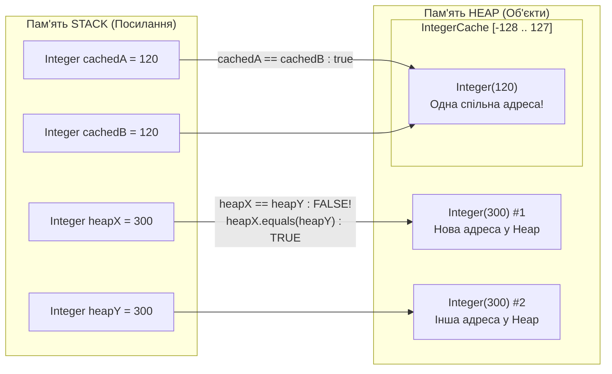
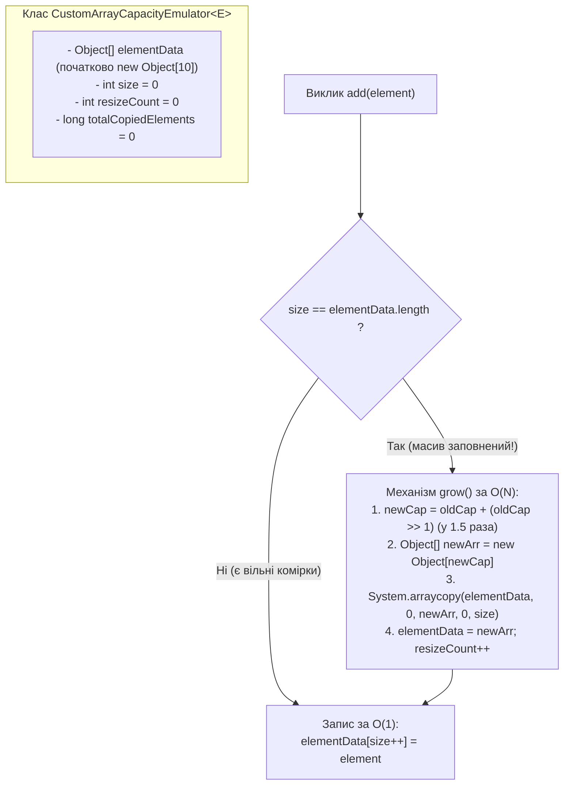
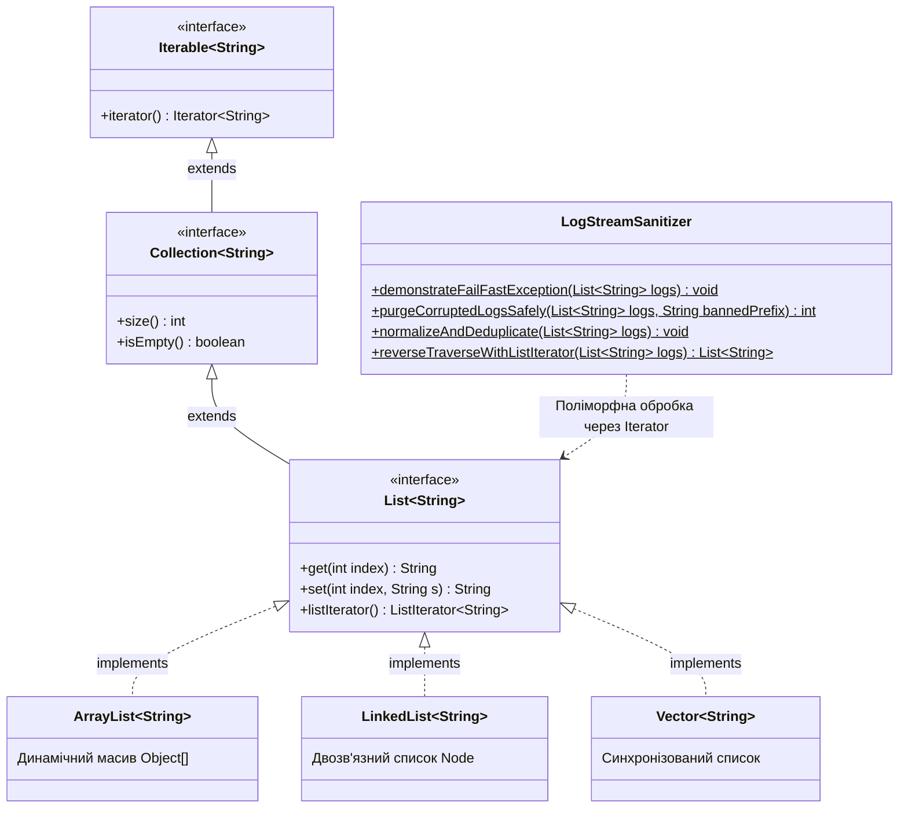
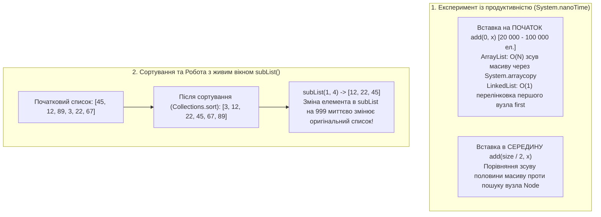

# Домашнє завдання до Практичної роботи №11
## Тема: Списки в Java (`ArrayList`, `LinkedList`, складність алгоритмів та структура `List`)

---

## 📌 Загальна інформація та правила виконання

### 🎯 Мета завдання
Закріпити на практичних інженерних і алгоритмічних задачах роботу зі списками та колекціями в Java (*Java Collections Framework*):
- **Типи-обгортки (`Wrapper Classes`) та механізми автопакування/розпакування (`Autoboxing / Unboxing`):** зв'язок примітивів із класами-близнюками (`Integer`, `Double`, `Boolean`, `Character`), робота компілятора «під капотом» (`Integer.valueOf()`, `.intValue()`), пастка кешування `IntegerCache` (`[-128; 127]`) при порівнянні через `==` проти `.equals()`, парсинг рядків через `Integer.parseInt()` та використання констант `Integer.MAX_VALUE` / `Integer.MIN_VALUE`.
- **Клас `ArrayList` та його внутрішнє влаштування:** анатомія динамічного масиву (`Object[] elementData`, лічильник `size` проти поточної ємності `capacity`), початкова ємність (`10` елементів), алгоритм динамічного розширення буфера у $1.5$ раза ($newCapacity = oldCapacity + (oldCapacity \gg 1)$) із копіюванням через `System.arraycopy(...)` та асимптотична складність базових операцій.
- **Синтаксичний цукор та виведення типів компілятором (*Type Inference*):** грамотне використання ромбовидного оператора (`Diamond Operator <>`) та локального виведення типів (`var list = new ArrayList<Integer>()`), а також запобігання втраті типобезпеки (`var list = new ArrayList<>()` $\to$ `ArrayList<Object>`).
- **Ієрархія колекцій Java (`Iterable -> Collection -> List`) та безпечний `Iterator`:** поліморфне програмування на рівні інтерфейсу `List<E>`, природа винятку `ConcurrentModificationException` (*Fail-Fast* ітератори та лічильник `modCount`) і безпечне видалення елементів під час обходу через `Iterator.remove()` та `ListIterator`.
- **Порівняння `ArrayList` та `LinkedList`, сортування та зрізи:** експериментальне порівняння неперервного блоку пам'яті `Object[]` у `ArrayList` із двобічно зв'язаними вузлами `Node<E>` у `LinkedList` ($O(1)$ проти $O(N)$), сортування елементів списку (`Collections.sort()` / `.sort()`) та робота з живими представленнями `subList(from, to)`.

---

### ⏰ Дедлайн та обов'язкова здача через GitHub-репозиторій

> [!IMPORTANT]
> - **Спосіб здачі:** Робота здається **виключно через ваш GitHub-репозиторій** (`git add`, `git commit`, `git push`).
> - **Кінцевий термін (Дедлайн):** **до наступного четверга (19 листопада 2026 року, до 23:59)**.
> - Переконайтеся, що всі файли ваших завдань закомічені, запушені на GitHub та компілюються без жодної помилки (`mvn clean test-compile` або через засоби збірки IntelliJ IDEA).

#### Покроковий алгоритм відправки ДЗ на GitHub:
1. Реалізуйте обрані завдання у пакеті `semester1.practice10.homework` (або `semester1.practice11.homework` / `practice11`).
2. Запустіть метод `main` кожного виконаного завдання і перевірте коректність виведення у консоль.
3. Відкрийте термінал в IntelliJ IDEA (`Alt + F12` / `Option + F12`) та виконайте команди:
   ```bash
   git status
   git add src/
   git commit -m "feat(hw): implement Java Lists, Wrapper classes, Iterator and ArrayList vs LinkedList homework"
   git push origin main
   ```
4. Перевірте у браузері на GitHub, що ваші файли з'явилися у репозиторії, і надішліть посилання викладачу до настання дедлайну (четверга, 23:59).

---

### ⚖️ Правила оцінювання та вибору завдань

1. **Максимальна оцінка за домашню роботу — 5 балів.**
2. **Обов'язковий мінімум:** виконати **хоча б 1 завдання** на власний вибір та завантажити його у свій GitHub-репозиторій до четверга.
3. **Гнучке сумування балів:**
   - Кожне завдання має свою фіксовану «вартість» у балах (від 2 до 5).
   - Якщо ви розв'язуєте декілька завдань, **бали сумуються** (максимальна підсумкова оцінка в журнал — **5 балів**; додаткові бали слугують «подушкою безпеки» на випадок дрібних недоліків).
4. **Варіанти стратегій виконання:**
   - 🥉 **Базовий рівень (оцінка 2–3):** тільки **Завдання 1** (2 бали) або тільки **Завдання 2** (3 бали).
   - 🥈 **Рівень «Добре» (оцінка 4):** тільки **Завдання 3** (4 бали).
   - 🥇 **Рівень «Відмінно» (оцінка 5):**
     - *Шлях 1 (Експертний):* розв'язати **Завдання 4** (5 балів, Бенчмарк швидкодії `ArrayList` і `LinkedList`, сортування та робота з `subList`) **АБО** креативне **Завдання 5** (5 балів, S.T.A.L.K.E.R. 2: Рюкзак сталкера, чистка пустушок через `Iterator` та здача хабару Сидоровичу).
     - *Шлях 2 (Комбінація базових):* **Завдання 1 + Завдання 2** ($2 + 3 = 5$ балів).
     - *Шлях 3 (Комбінація з запасом):* **Завдання 1 + Завдання 3** ($2 + 4 = 6 \to 5$ балів) або **Завдання 2 + Завдання 3** ($3 + 4 = 7 \to 5$ балів).

---

### 📂 Організація класів та пакетів

- **Пакет:** розміщуйте класи у пакеті `semester1.practice10.homework` (або `semester1.practice10` / `semester1.practice11.homework`).
- **Окремий клас запуску для кожного завдання:** створіть `.java` файл із назвою з таблиці нижче та власним методом `public static void main(String[] args)`. Допоміжні класи та моделі даних можна розміщувати у тому самому файлі поруч із класом запуску (без модифікатора `public`) або в окремих `.java` файлах пакету.

**Закріплені назви класів для завдань:**
| Завдання | Вартість | Назва класу | Напрямок | Короткий зміст |
|:---:|:---:|:---|:---|:---|
| **Завдання 1** | **2 бали** | `Task1WrapperAndAutoboxingMemory` | 🔢 Обгортки та Пам'ять | `Integer`, `Double`, `Boolean`, кеш `IntegerCache` (`==` vs `.equals()`), `parseInt()`, `MAX_VALUE` / `MIN_VALUE` |
| **Завдання 2** | **3 бали** | `Task2ArrayListCapacityAndDynamicGrowth` | ⚙️ Внутрішня будова `ArrayList` | Власний емулятор `CustomArrayCapacityEmulator`, масив `Object[10]`, `size`, ріст у $1.5$ раза, `System.arraycopy`, `var` та `<>` |
| **Завдання 3** | **4 бали** | `Task3ListHierarchyAndSafeIterator` | 🔄 Ієрархія `List` та `Iterator` | Поліморфні методи `List<String>`, пастка `ConcurrentModificationException`, безпечне видалення через `Iterator.remove()` |
| **Завдання 4** | **5 балів** | `Task4ArrayListVsLinkedListPerformance` | 🚀 Бенчмарк та Алгоритми `List` | Заміри `System.nanoTime()` (`ArrayList` vs `LinkedList`), сортування елементів у списку та робота з `subList()` |
| **Завдання 5** | **5 балів** | `Task5StalkerBackpackAndSidorovichLoot` | ☢️ **Творче (S.T.A.L.K.E.R. 2)** | Рюкзак `ArrayList<Artifact>`, свинцеві контейнери, відсіювання радіоактивних пустушок через `Iterator.remove()` та здача хабару Сидоровичу |

---

## 🧠 5 домашніх завдань на вибір (4 інженерно-алгоритмічні + 1 творче)

---

### Рівень 1: Базовий (2 бали) — Типи-обгортки та модель пам'яті
#### 📝 Завдання 1: Типи-обгортки, кешування `IntegerCache` та ручне керування числами

- **Клас для виконання:** `Task1WrapperAndAutoboxingMemory` (файл `Task1WrapperAndAutoboxingMemory.java`)
- **Рекомендований пакет:** `semester1.practice10.homework` (або `semester1.practice10`)
- **Бали за завдання:** **2 бали**
- **Ключові теми:** класи-близнюки (`Integer`, `Double`, `Boolean`, `Character`), явний та неявний `Autoboxing / Unboxing` (`Integer.valueOf()`, `.intValue()`), дослідження пулу кешування `IntegerCache` (`[-128; 127]`), поведінка `==` проти `.equals()`, безпечний парсинг рядків через `Integer.parseInt()` та пошук екстремумів через `Integer.MAX_VALUE` / `Integer.MIN_VALUE`.

**Контекст:** У телеметричному модулі обробки даних із датчиків усі числові показники потрапляють у динамічні списки `ArrayList<Integer>` та `ArrayList<Double>`, оскільки колекції Java не можуть зберігати примітивні типи. Неправильне порівняння об'єктів-обгорток оператором `==` або спроба розпакувати `null` у примітивну змінну часто призводить до прихованих багів та падіння системи з `NullPointerException`. Ваше завдання — побудувати діагностичний модуль, який досліджує поведінку обгорток у пам'яті та безпечно парсить потік сирих телеметричних рядків.



**Що необхідно зробити:**
1. **Дослідіть роботу `IntegerCache` (`[-128; 127]`) та різницю між `==` і `.equals()`:**
   - Реалізуйте статичний метод `public static void inspectIntegerCache(int[] testValues)`, який для кожного числа з масиву (наприклад, `{-128, -50, 0, 127, 128, 500, 2026}`) створює дві обгортки через `Integer first = Integer.valueOf(val);` та `Integer second = Integer.valueOf(val);`.
   - Виведіть у консоль таблицю результатів порівняння `first == second` (порівняння адрес посилань) та `first.equals(second)` (порівняння внутрішніх значень).
2. **Продемонструйте Autoboxing та Unboxing «під капотом» компілятора:**
   - Напишіть метод `public static void demonstrateAutoboxingUnderTheHood()`, який на прикладі `Integer`, `Double` та `Boolean` показує еквівалентність неявного автопакування/розпакування та явних викликів `Integer.valueOf(int)` / `.intValue()`, `Double.valueOf(double)` / `.doubleValue()`, `Boolean.valueOf(boolean)` / `.booleanValue()`.
   - Продемонструйте захист від `NullPointerException` при розпакуванні списку `List<Integer>`, що містить `null`-елементи (наприклад, `[45, null, -12, 88, null, 102]`).
3. **Реалізуйте парсер сирих даних та пошук екстремумів через `MAX_VALUE` / `MIN_VALUE`:**
   - Напишіть метод `public static List<Integer> parseTelemetryStream(String[] rawPackets)`, який приймає масив рядків (наприклад, `{"  145 ", "-30", "ERR_404", "980", "", null, "2147483647", "-85"}`), очищує пробіли через `.trim()`, парсить валідні цілі числа за допомогою **`Integer.parseInt(...)`** (перехоплюючи `NumberFormatException` для пошкоджених пакетів) і повертає `ArrayList<Integer>`.
   - Напишіть метод `public static void printExtremesAndStats(List<Integer> validData)`, який ініціалізує початкові змінні **`int min = Integer.MAX_VALUE;`** та **`int max = Integer.MIN_VALUE;`**, за один прохід знаходить реальний мінімум, максимум і суму елементів, а також перевіряє капкан видалення: різницю між `list.remove(0)` (за індексом) та `list.remove(Integer.valueOf(val))` (за об'єктом).

**Очікуваний результат у консолі:**
```text
================ ДОСЛІДЖЕННЯ WRAPPER CLASSES ТА INTEGER CACHE ================
[1. ЕКСПЕРИМЕНТ: INTEGER CACHE [-128..127] (== проти .equals())]:
  Значення:  -128 | (a == b): true  | a.equals(b): true  | Джерело: IntegerCache
  Значення:   127 | (a == b): true  | a.equals(b): true  | Джерело: IntegerCache
  Значення:   128 | (a == b): false | a.equals(b): true  | Джерело: Новий об'єкт у Heap!
  Значення:   500 | (a == b): false | a.equals(b): true  | Джерело: Новий об'єкт у Heap!

[2. AUTOBOXING / UNBOXING ПІД КАПОТОМ ТА ЗАХИСТ ВІД NULL]:
  Явне пакування: Integer.valueOf(42) -> 42 | Розпакування: .intValue() -> 42
  Вхідний список із датчиків (з null): [45, null, -12, 88, null, 102]
  ⚠️ Пропущено null-елемент на індексі 1 та 4 (запобігання NullPointerException при intValue()!)
  Сума валідних розпакованих елементів: 223

[3. ПАРСИНГ РЯДКІВ (Integer.parseInt) ТА ЕКСТРЕМУМИ (MAX_VALUE / MIN_VALUE)]:
  Початкові межі пошуку: min = 2147483647 (MAX_VALUE), max = -2147483648 (MIN_VALUE)
  ❌ Пакет 'ERR_404' відхилено (NumberFormatException)
  ❌ Порожній або null-пакет відхилено
  Успішно розпізнаний список Integer: [145, -30, 980, 2147483647, -85]
  Знайдений мінімум: -85 | Знайдений максимум: 2147483647
  Після remove(Integer.valueOf(-30)) (за значенням): [145, 980, 2147483647, -85]
==============================================================================
```

---

### Рівень 2: Середній (3 бали) — Анатомія та внутрішня будова колекції `ArrayList`
#### 📝 Завдання 2: Емулятор ємності та динамічного розширення `ArrayList` під капотом

- **Клас для виконання:** `Task2ArrayListCapacityAndDynamicGrowth` (файл `Task2ArrayListCapacityAndDynamicGrowth.java`)
- **Рекомендований пакет:** `semester1.practice10.homework` (або `semester1.practice10`)
- **Бали за завдання:** **3 бали**
- **Ключові теми:** внутрішнє влаштування `ArrayList` (буферний масив `Object[] elementData`, лічильник елементів `size` проти фізичної ємності масиву `capacity`), початкова ємність `10`, формула росту в $1.5$ раза ($newCapacity = oldCapacity + (oldCapacity \gg 1)$), нативне копіювання пам'яті через `System.arraycopy`, а також виведення типів (`var` та ромбовидний оператор `<>`).

**Контекст:** Стандартний клас `java.util.ArrayList` приховує від програміста свій внутрішній масив `transient Object[] elementData` (індекс його довжини неможливо прочитати напряму без рефлексії). Щоб досконало зрозуміти, як саме «гумовий» список працює у пам'яті Heap, ми розробимо власний параметризований клас-емулятор **`CustomArrayCapacityEmulator<E>`**, який у точності відтворює механіку розширення `ArrayList` у $1.5$ раза, копіювання через `System.arraycopy` та зсув елементів під час вставки і видалення, і при цьому веде детальну телеметрію кожної алокації пам'яті!



**Що необхідно зробити:**
1. **Спроєктуйте узагальнений клас `CustomArrayCapacityEmulator<E>`:**
   - Приватні поля:
     - `private static final int DEFAULT_CAPACITY = 10;`
     - `private Object[] elementData;` (ініціалізується у конструкторі масивом `new Object[DEFAULT_CAPACITY]`)
     - `private int size = 0;` (фактична кількість доданих елементів)
     - Лічильники діагностики: `private int resizeCount = 0;` (скільки разів масив розширювався) та `private int totalElementsCopied = 0;` (скільки елементів було перенесено через `System.arraycopy`).
2. **Реалізуйте ключові методи динамічного списку з використанням `System.arraycopy`:**
   - **`private void ensureCapacityInternal()`**: якщо `size == elementData.length`, обчислює нову ємність у **$1.5$ раза більшу**:
     ```java
     int oldCapacity = elementData.length;
     int newCapacity = oldCapacity + (oldCapacity >> 1); // 10 -> 15 -> 22 -> 33 -> 49 ...
     Object[] newBuffer = new Object[newCapacity];
     System.arraycopy(elementData, 0, newBuffer, 0, size);
     elementData = newBuffer;
     resizeCount++;
     totalElementsCopied += size;
     ```
   - **`public void add(E element)`**: перевіряє ємність і додає елемент у кінець (`elementData[size++] = element`).
   - **`public void add(int index, E element)`**: перевіряє індекс (`0 <= index <= size`), викликає `ensureCapacityInternal()`, зсуває всі елементи праворуч від `index` на 1 позицію за допомогою **`System.arraycopy(elementData, index, elementData, index + 1, size - index)`**, записує `elementData[index] = element` і збільшує `size++`.
   - **`public E remove(int index)`**: перевіряє індекс (`0 <= index < size`), запам'ятовує старий елемент, обчислює кількість елементів для зсуву `int numMoved = size - index - 1;`, якщо `numMoved > 0` — зсуває хвіст ліворуч через **`System.arraycopy(elementData, index + 1, elementData, index, numMoved)`**, очищує останню комірку **`elementData[--size] = null;`** (щоб не було витоку пам'яті для Garbage Collector!) і повертає видалений елемент.
   - **`public E get(int index)`**, **`public E set(int index, E element)`**, **`public int size()`**, **`public int getCapacity()`** (повертає `elementData.length`) та **`public void trimToSize()`** (стискає масив `elementData` рівно до поточного `size` через `System.arraycopy`).
3. **У `Task2ArrayListCapacityAndDynamicGrowth.main` проведіть дослідження:**
   - Створіть екземпляр емулятора за допомогою локального виведення типів **`var emulator = new CustomArrayCapacityEmulator<String>();`** (і поруч покажіть у коментарі/коді небезпеку `var raw = new ArrayList<>();`, що втрачає тип до `Object`).
   - У циклі додайте 35 елементів `"Block-1" .. "Block-35"`, виводячи повідомлення щоразу, коли `capacity` зростає (`10 -> 15 -> 22 -> 33 -> 49`).
   - Виконайте вставку на початок `add(0, "HEADER")` та видалення з середини `remove(5)`, виведіть підсумкову статистику (`size`, `capacity`, `resizeCount`, `totalElementsCopied`), а потім викличте `trimToSize()` і покажіть, як вільний резерв масиву звільнився (`capacity == size`).

**Очікуваний результат у консолі:**
```text
================ ЕМУЛЯТОР ВНУТРІШНЬОЇ БУДОВИ ARRAYLIST (ПІД КАПОТОМ) ================
[ІНІЦІАЛІЗАЦІЯ]: Створено CustomArrayCapacityEmulator<String> | size = 0 | capacity = 10

--- Додавання 35 елементів у список ---
  ⚡ [GROW #1] Переповнення при додаванні 11-го елемента! Ємність: 10 -> 15 (System.arraycopy скопіював 10 ел.)
  ⚡ [GROW #2] Переповнення при додаванні 16-го елемента! Ємність: 15 -> 22 (System.arraycopy скопіював 15 ел.)
  ⚡ [GROW #3] Переповнення при додаванні 23-го елемента! Ємність: 22 -> 33 (System.arraycopy скопіював 22 ел.)
  ⚡ [GROW #4] Переповнення при додаванні 34-го елемента! Ємність: 33 -> 49 (System.arraycopy скопіював 33 ел.)
Стан після додавання 35 елементів: size = 35 | capacity = 49 (Вільний резерв: 14 комірок null)

--- Тестування вставки add(0, 'HEADER') та видалення remove(5) ---
  -> Вставлено 'HEADER' на індекс 0 (зсунуто праворуч 35 елементів через System.arraycopy)
  -> Видалено елемент 'Block-5' з індексу 5 (зсунуто ліворуч 30 елементів, хвіст занулено для GC)
  Поточний стан: size = 35 | capacity = 49 | Перший: 'HEADER' | Останній: 'Block-35'

--- Оптимізація пам'яті trimToSize() ---
  -> Викликано trimToSize(): буфер Object[49] стиснуто рівно до Object[35]!
  Фінальна телеметрія: size = 35 | capacity = 35 | Кількість розширень: 4
=====================================================================================
```

---

### Рівень 3: Поглиблений (4 бали) — Ієрархія колекцій, Поліморфізм `List` та Безпечний `Iterator`
#### 📝 Завдання 3: Ієрархія колекцій, поліморфізм через інтерфейс `List` та безпечний `Iterator`

- **Клас для виконання:** `Task3ListHierarchyAndSafeIterator` (файл `Task3ListHierarchyAndSafeIterator.java`)
- **Рекомендований пакет:** `semester1.practice10.homework` (або `semester1.practice10`)
- **Бали за завдання:** **4 бали**
- **Ключові теми:** ієрархія `Iterable<E> -> Collection<E> -> List<E>`, поліморфні утилітарні методи, які приймають інтерфейс `List<String>` і однаково працюють з `ArrayList`, `LinkedList`, `Vector` та `Stack`, демонстрація та перехоплення `ConcurrentModificationException` у циклі `for-each`, безпечна фільтрація та модифікація через `Iterator.remove()` і двосторонній `ListIterator`.

**Контекст:** У корпоративних системах логування та моніторингу мережевого трафіку події можуть надходити у різних реалізаціях списків: одні сервіси формують `ArrayList<String>`, інші — чергу подій у `LinkedList<String>`, а застарілі модулі повертають `Vector<String>`. Якщо писати методи жорстко під `ArrayList<String>`, система втратить гнучкість. Водночас під час очищення потоку логів від дублікатів і спам-пакетів прямий виклик `list.remove(...)` усередині циклу `for-each` ламає ітератор і викликає `ConcurrentModificationException`.



**Що необхідно зробити:**
1. **Продемонструйте небезпеку `ConcurrentModificationException` (*Fail-Fast Iterator*):**
   - Напишіть статичний метод `public static void demonstrateFailFastCrash(List<String> logs)`, який запускає цикл `for (String log : logs)` і при знаходженні рядка зі словом `"CORRUPTED"` викликає напряму `logs.remove(log)`.
   - Обгорніть цикл у блок `try-catch (ConcurrentModificationException e)` та виведіть наочне діагностичне повідомлення, чому виникла помилка (`modCount != expectedModCount`).
2. **Реалізуйте поліморфні методи очищення та трансформації на рівні інтерфейсу `List<String>`:**
   - **`public static int purgeLogsByKeywordSafely(List<String> logs, String keyword)`**:
     - Приймає **будь-яку** реалізацію інтерфейсу `List<String>` (`ArrayList`, `LinkedList`, `Vector`);
     - Отримує явний ітератор **`Iterator<String> it = logs.iterator();`**;
     - За допомогою циклу `while (it.hasNext())` перевіряє кожен рядок (якщо рядок дорівнює `null`, порожній або містить `keyword`) і безпечно видаляє його викликом **`it.remove()`**, повертаючи кількість видалених записів.
   - **`public static void enrichCriticalLogsWithListIterator(List<String> logs)`**:
     - Використовує розширений списковий ітератор **`ListIterator<String> listIt = logs.listIterator();`**;
     - Під час прямого проходу (`hasNext()` / `next()`):
       - кожен рядок обрізає від зайвих пробілів (`.trim()`) і оновлює на місці через **`listIt.set(trimmed)`**;
       - якщо рядок починається з `"ERROR:"`, одразу після нього вставляє в список автоматичний маркер тривоги `"[ALERT-TRIGGERED]"` за допомогою методу **`listIt.add("[ALERT-TRIGGERED]")`** (без жодного `ConcurrentModificationException`!).
   - **`public static List<String> collectReverseOrder(List<String> logs)`**:
     - Відкриває `ListIterator<String>` у самому кінці списку викликом **`logs.listIterator(logs.size())`**, проходить список у зворотному напрямку через **`while (listIt.hasPrevious())`** та **`listIt.previous()`** і повертає список у зворотному порядку.
3. **У `Task3ListHierarchyAndSafeIterator.main` доведіть поліморфізм ієрархії колекцій:**
   - Створіть два різні списки з однаковим набором сирих логів:
     1) `List<String> arrayLogs = new ArrayList<>(rawLogs);`
     2) `List<String> linkedLogs = new LinkedList<>(rawLogs);`
   - Спочатку викличте `demonstrateFailFastCrash`, а потім пропустіть **обидва** списки (`ArrayList` та `LinkedList`) крізь одні й ті самі методи `purgeLogsByKeywordSafely`, `enrichCriticalLogsWithListIterator` та `collectReverseOrder`, підтвердивши ідентичний результат роботи!

**Очікуваний результат у консолі:**
```text
================ ІЄРАРХІЯ LIST ТА БЕЗПЕЧНИЙ ITERATOR ================
Початковий потік логів (8 записів):
  [INFO: Auth OK, CORRUPTED_PACKET_01,   ERROR: DB Timeout  , DEBUG: Ping, CORRUPTED_PACKET_02, null, ERROR: Disk Full, INFO: Logout]

[1. ДЕМОНСТРАЦІЯ ПАСТКИ FAIL-FAST У ЦИКЛІ FOR-EACH]:
  ❌ Спроба викликати logs.remove() всередині for-each...
  ⚡ Перехоплено ConcurrentModificationException! Причина: пряма зміна списку порушила expectedModCount ітератора.

[2. ПОЛІМОРФНА ОБРОБКА ARRAYLIST<STRING> ЧЕРЕЗ ITERATOR]:
  -> Безпечно видалено пошкоджених/null записів через it.remove(): 3 шт.
  -> Залишилося чистих логів: [INFO: Auth OK,   ERROR: DB Timeout  , DEBUG: Ping, ERROR: Disk Full, INFO: Logout]
  -> Модифікація через ListIterator (set + add після ERROR):
     [INFO: Auth OK, ERROR: DB Timeout, [ALERT-TRIGGERED], DEBUG: Ping, ERROR: Disk Full, [ALERT-TRIGGERED], INFO: Logout]

[3. ПОЛІМОРФНА ОБРОБКА LINKEDLIST<STRING> ТИМИ САМИМИ МЕТОДАМИ]:
  -> Передано LinkedList у ті самі методи List<String>...
  -> Результат LinkedList повністю збігається з ArrayList: true (Розмір: 7)
  -> Зворотний обхід через ListIterator (hasPrevious / previous):
     [INFO: Logout, [ALERT-TRIGGERED], ERROR: Disk Full, DEBUG: Ping, [ALERT-TRIGGERED], ERROR: DB Timeout, INFO: Auth OK]
=====================================================================
```

---

### Рівень 4: Експертний (5 балів) — Аналіз складності алгоритмів та Бенчмаркінг
#### ⚡ Завдання 4: Бенчмарк швидкодії `ArrayList` і `LinkedList`, сортування та робота з `subList` (5 балів)

* **Клас для виконання:** `Task4ArrayListVsLinkedListPerformance` (файл `Task4ArrayListVsLinkedListPerformance.java`)
* **Рекомендований пакет:** `semester1.practice11.homework` (або `semester1.practice11` / `semester1.practice10.homework`)
* **Бали за завдання:** **5 балів**
* **Ключові теми:** порівняння часу виконання операцій для `ArrayList` та `LinkedList` за допомогою `System.nanoTime()`, сортування елементів у списку, створення відображень за допомогою `subList()` та маніпуляції з підсписками/діапазонами списків.

---

##### 📌 Контекст
Під час розробки високонавантажених застосунків критично важливо розуміти, яку саме структуру даних обрати для зберігання інформації. У цьому завданні ми на практиці перевіримо різницю в швидкодії між динамічним масивом (`ArrayList`) та зв'язним списком (`LinkedList`), проведемо сортування значень та протестуємо роботу з підсписками (`subList`).



---

##### 🛠️ Що необхідно зробити:

1. **Експеримент із продуктивністю (Бенчмарк через `System.nanoTime()`):**
   * Створіть по одному об'єкту `ArrayList<Integer>` та `LinkedList<Integer>`.
   * Заповніть їх однаковою великою кількістю елементів (наприклад, $20\,000$, $50\,000$ або $100\,000$ чисел).
   * Виміряйте за допомогою `System.nanoTime()` час, який витрачається на масове додавання або вставку елементів **на початок** та **в середину** кожного зі списків.
   * Виведіть у консоль результати вимірювань у мілісекундах і порівняйте, яка зі структур впоралася із завданням швидше.

2. **Сортування списку:**
   * Наповніть список випадковими числовими значеннями або рядками.
   * Здійсніть сортування елементів колекції у порядку зростання (використовуючи стандартні методи для колекцій або списків, такі як `Collections.sort()` або вбудований метод `.sort()`).
   * Виведіть список у консоль до та після сортування.

3. **Робота з підсписком (`subList`):**
   * Виділіть діапазон елементів за допомогою методу `list.subList(fromIndex, toIndex)`.
   * Продемонструйте зв'язок між оригінальним списком та його підтримуваним представленням (`subList`): змініть елемент у підсписку та перевірте, чи відобразилася ця зміна в базовому списку.

---

##### 🖥️ Очікуваний результат у консолі:

```text
================ БЕНЧМАРК ТА РОБОТА ЗІ СПИСКАМИ ================
1. БЕНЧМАРК ВСТАВКИ У ПОЧАТОК СПИСКУ (на 20 000 елементів):
  - Час для ArrayList:  485.20 мс
  - Час для LinkedList:   2.45 мс
   (Висновок: LinkedList суттєво виграє при частих вставках на початку).

2. СОРТУВАННЯ СПИСКУ:
   До сортування: [45, 12, 89, 3, 22, 67]
   Після сортування: [3, 12, 22, 45, 67, 89]

3. РОБОТА З subList():
   Оригінальний список: [3, 12, 22, 45, 67, 89]
   Виділений subList (від індексу 1 до 4): [12, 22, 45]
   Змінюємо елемент у subList на 999...
   Оновлений оригінальний список: [3, 999, 22, 45, 67, 89]
================================================================
```

---

### Рівень 5: Креативний / Творчий (5 балів) — На ваш вибір!
#### ☢️ Завдання 5: «S.T.A.L.K.E.R. 2: Рюкзак сталкера з контейнерами артефактів, відсіювання радіоактивних пустушок через `Iterator` та здача хабару Сидоровичу»

- **Клас для виконання:** `Task5StalkerBackpackAndSidorovichLoot` (файл `Task5StalkerBackpackAndSidorovichLoot.java`)
- **Рекомендований пакет:** `semester1.practice10.homework` (або `semester1.practice10` / `semester1.practice11.homework`)
- **Бали за завдання:** **5 балів**
- **Ключові теми:** робота з динамічними списками `ArrayList<Artifact>`, моделювання рюкзака сталкера та свинцевих контейнерів для артефактів, використання `var` і ромбовидного оператора `<>`, константи `Integer.MIN_VALUE` / `Integer.MAX_VALUE`, безпечний обхід колекції за допомогою `Iterator<Artifact>` та видалення радіоактивних «пустушок» методом `iterator.remove()` (щоб уникнути `ConcurrentModificationException`), а також розподіл знахідок по контейнерах та підрахунок фінального виторгу в Сидоровича виключно базовими методами списків (`add`, `get`, `set`, `remove`, `size`).

**Контекст та сюжетна атмосфера (S.T.A.L.K.E.R. 2: Серце Чорнобиля):**
Після важкого рейду **Диким Сходом Зони** сталкер на прізвисько Скіф повертається до бункера торговця Сидоровича з переповненим рюкзаком артефактів (`ArrayList<Artifact>`). Під час вилазки у гравітаційні та електра-аномалії детектор «Велес» засік чимало об'єктів: серед них є як дорогі робочі артефакти (**«Крівник»**, **«Бенгальський вогонь»**, **«Виверт»**, **«Граві»**, **«Компас»**), так і підступні аномальні **«пустушки»** та уламки породи, чий радіаційний фон перевищує допустиму норму безпеки (`50.0` мкЗв/год) або які не мають жодної аномальної цінності.

Сидорович не приймає фонячий мотлох і «пустушки», а спроба викинути їх із рюкзака напряму через `backpack.remove(...)` просто під час циклу `for-each` призведе до аварійного збою КПК (`ConcurrentModificationException`). Тому перед входом у бункер сталкер має:
1. Провести ревізію рюкзака (`ArrayList<Artifact>`) та **безпечно відсіяти всі радіоактивні «пустушки» за допомогою `Iterator<Artifact>` та методу `iterator.remove()`**.
2. Розподілити чисті робочі артефакти по захисних контейнерах (свинцевий контейнер для рідкісних знахідок і стандартний поясний підсумок) та сформувати ранжований список знахідок для прилавка Сидоровича за допомогою базових операцій `ArrayList`.
3. Визначити найдорожчу перлину рейду й отримати фінальний чек від Сидоровича у карбованцях (`крб`).

```mermaid
classDiagram
    class Artifact {
        -String name
        -int costKarbovanets
        -double radiationLevel
        +Artifact(String name, int costKarbovanets, double radiationLevel)
        +getName() String
        +getCostKarbovanets() int
        +getRadiationLevel() double
        +isRadioactiveDud(double maxSafeRadiation) boolean
        +toString() String
    }
    class Task5StalkerBackpackAndSidorovichLoot {
        +MAX_SAFE_RADIATION : double = 50.0
        +demonstrateFailFastOnBackpack(List~Artifact~ backpack)$ void
        +purgeRadioactiveDudsWithIterator(List~Artifact~ backpack, double maxRadiation)$ int
        +distributeAndRankForSidorovich(List~Artifact~ cleanLoot, List~Artifact~ leadContainer, List~Artifact~ standardPouch)$ void
        +findTopArtifactAndPrintReceipt(List~Artifact~ cleanLoot)$ void
    }

    Task5StalkerBackpackAndSidorovichLoot *-- "*" Artifact : ArrayList&lt;Artifact&gt;
```

**Технічні вимоги до коду (що необхідно зробити):**
1. **Створіть клас `Artifact` для опису аномальної знахідки:**
   - Оголосіть приватні поля класу:
     - `private String name;` — назва артефакту (наприклад, `"Крівник"`, `"Бенгальський вогонь"`, `"Граві"`, `"Виверт"`, `"Компас"`, `"Іржава Пустушка"`, `"Фоняча Пустушка"`, `"Аномальний Шлак"`);
     - `private int costKarbovanets;` — вартість артефакту у Сидоровича в карбованцях (`крб`);
     - `private double radiationLevel;` — рівень радіаційного випромінювання артефакту (у мкЗв/год).
   - Додайте конструктор, геттери (`getName()`, `getCostKarbovanets()`, `getRadiationLevel()`), допоміжний метод перевірки на «пустушку» / перевищення радіації `public boolean isRadioactiveDud(double maxSafeRadiation)` (повертає `true`, якщо `radiationLevel > maxSafeRadiation` або `costKarbovanets <= 0`), а також інформативний метод `@Override public String toString()`.
2. **Наповніть рюкзак сталкера (`ArrayList<Artifact>`) знахідками з Дикого Сходу Зони:**
   - Створіть динамічний список **`var backpack = new ArrayList<Artifact>();`** (або `List<Artifact> backpack = new ArrayList<>();`).
   - Додайте до рюкзака щонайменше **7–8 артефактів** за допомогою `backpack.add(...)`:
     - робочі цінні артефакти з безпечним фоном ($\le 50.0$ мкЗв/год): **«Крівник»**, **«Бенгальський вогонь»**, **«Виверт»**, **«Граві»**, **«Компас»**;
     - небезпечні «пустушки» з перевищенням норми радіації ($> 50.0$ мкЗв/год) або нульовою цінністю.
   - Виведіть у консоль початковий стан рюкзака до чистки: перелік усіх знахідок, загальну кількість елементів (`backpack.size()`) та сумарний радіаційний фон рюкзака.
3. **Реалізуйте безпечну дезактивацію та відсіювання «пустушок» через `Iterator<Artifact>`:**
   - Спочатку в окремому блоці `try-catch (ConcurrentModificationException e)` наочно продемонструйте, чому не можна викликати `backpack.remove(artifact)` безпосередньо всередині циклу `for-each`.
   - Потім реалізуйте метод `public static int purgeRadioactiveDudsWithIterator(List<Artifact> backpack, double maxSafeRadiation)`, який здійснює обхід списку виключно через **`Iterator<Artifact>`** та безпечно видаляє небезпечні елементи викликом **`iterator.remove()`**:
     ```java
     Iterator<Artifact> iterator = backpack.iterator();
     int removedDuds = 0;
     while (iterator.hasNext()) {
         Artifact current = iterator.next();
         if (current.getRadiationLevel() > maxSafeRadiation || current.getCostKarbovanets() <= 0) {
             System.out.println("  ☢️ [Iterator.remove] Викинуто небезпечну пустушку: "
                     + current.getName() + " (Радіація: " + current.getRadiationLevel() + " мкЗв/год)");
             iterator.remove(); // Безпечне видалення зі списку під час обходу!
             removedDuds++;
         }
     }
     ```
4. **Розподіліть чистий хабар по контейнерах та виконайте ранжування й підрахунок виторгу для Сидоровича:**
   - Створіть два окремі списки-контейнери на базі `ArrayList<Artifact>`:
     - `ArrayList<Artifact> leadSpecialContainer = new ArrayList<>();` — свинцевий спецконтейнер для рідкісних і дорогих артефактів (вартістю $\ge 15\,000$ крб);
     - `ArrayList<Artifact> standardBeltContainer = new ArrayList<>();` — стандартний контейнер для базових артефактів ($< 15\,000$ крб).
   - За допомогою методів роботи зі списком `ArrayList` (`get`, `set`, `add`) впорядкуйте (проранжуйте) список чистих артефактів від найдорожчого до найдешевшого для викладки на стіл Сидоровича (наприклад, переставляючи елементи через `get(i)` та `set(i, element)` або формуючи ранжований список послідовним пошуком найдорожчого елемента).
   - Знайдіть найцінніший артефакт вилазки (використовуючи `int maxCost = Integer.MIN_VALUE;`), підрахуйте **загальну вартість чистого хабару в карбованцях** та виведіть фінальний чек від Сидоровича.

**Очікуваний результат у консолі:**
```text
================ ☢️ S.T.A.L.K.E.R. 2: РЕЙД ДИКИМ СХОДОМ ЗОНИ ТА ЛАВКА СИДОРОВИЧА ☢️ ================
Сталкер: Скіф | Маршрут: Дикий Схід Зони -> Бункер Сидоровича | Допустима норма радіації: 50.0 мкЗв/год

[1. ВМІСТ РЮКЗАКА ПІСЛЯ ВИЛАЗКИ (ДО ЧИСТКИ — 7 об'єктів у ArrayList)]:
  1. [Артефакт: 'Бенгальський вогонь' | Ціна:  9 500 крб | Радіація:  14.5 мкЗв/год]
  2. [Артефакт: 'Фоняча Пустушка'     | Ціна:      0 крб | Радіація:  92.0 мкЗв/год]
  3. [Артефакт: 'Крівник'             | Ціна: 18 500 крб | Радіація:  26.0 мкЗв/год]
  4. [Артефакт: 'Аномальний Шлак'     | Ціна:  1 200 крб | Радіація: 135.4 мкЗв/год]
  5. [Артефакт: 'Виверт'              | Ціна: 11 000 крб | Радіація:  18.0 мкЗв/год]
  6. [Артефакт: 'Іржава Пустушка'     | Ціна:    500 крб | Радіація:  78.5 мкЗв/год]
  7. [Артефакт: 'Компас'              | Ціна: 45 000 крб | Радіація:  32.0 мкЗв/год]
---------------------------------------------------------------------------------------------------
Всього знахідок у рюкзаку: 7 шт. | Сумарний фон рюкзака: 396.4 мкЗв/год (⚠️ НЕБЕЗПЕЧНИЙ РІВЕНЬ!)

[2. ДЕЗАКТИВАЦІЯ ТА ВІДСІЮВАННЯ ПУСТУШОК ЧЕРЕЗ ITERATOR]:
  ⚡ [Перевірка КПК]: Спроба прямого backpack.remove() у циклі for-each перехоплена -> ConcurrentModificationException!
  -> Запускаємо безпечне очищення рюкзака через Iterator<Artifact> та iterator.remove()...
  ☢️ [Iterator.remove] Викинуто небезпечну пустушку: 'Фоняча Пустушка' (Радіація: 92.0 мкЗв/год > 50.0)
  ☢️ [Iterator.remove] Викинуто небезпечну пустушку: 'Аномальний Шлак' (Радіація: 135.4 мкЗв/год > 50.0)
  ☢️ [Iterator.remove] Викинуто небезпечну пустушку: 'Іржава Пустушка' (Радіація: 78.5 мкЗв/год > 50.0)
  ✅ Очищення завершено! Вилучено радіоактивних пустушок: 3 шт.
  Залишилося чистих артефактів у рюкзаку: 4 шт. | Безпечний фон: 90.5 мкЗв/год

[3. КОНТЕЙНЕРИ АРТЕФАКТІВ ТА РАНЖУВАННЯ ЗНАХІДОК ДЛЯ СИДОРОВИЧА]:
  🛡️ Свинцевий спецконтейнер (>= 15 000 крб, 2 шт.): ['Компас' (45 000 крб), 'Крівник' (18 500 крб)]
  🎒 Стандартний контейнер   (<  15 000 крб, 2 шт.): ['Виверт' (11 000 крб), 'Бенгальський вогонь' (9 500 крб)]

  📋 Фінальний чек та ранжований список хабару у Сидоровича:
    🥇 #1. 'Компас'              — 45 000 крб (Фон: 32.0 мкЗв/год)
    🥈 #2. 'Крівник'             — 18 500 крб (Фон: 26.0 мкЗв/год)
    🥉 #3. 'Виверт'              — 11 000 крб (Фон: 18.0 мкЗв/год)
       #4. 'Бенгальський вогонь' —  9 500 крб (Фон: 14.5 мкЗв/год)
---------------------------------------------------------------------------------------------------
  👑 Найдорожчий артефакт рейду: 'Компас' (45 000 крб)
  💰 ПІДСУМКОВА ВАРТІСТЬ ЧИСТОГО ХАБАРУ: 84 000 крб
  💬 Сидорович: «Непоганий улов із Дикого Сходу, Скіфе! Добре, що радіоактивні пустушки відсіяв — тримай свої 84 000 карбованців!»
===================================================================================================
```

---

## 📊 Інструкція для викладача: Методика оцінювання

### 1. Зведена таблиця балів та охоплення компетенцій

| Завдання | Клас для перевірки | Макс. бал | Напрям | Які компетенції теми «Списки в Java» перевіряються |
|:---|:---|:---:|:---|:---|
| **Завдання 1** | `Task1WrapperAndAutoboxingMemory` | **2** | 🔢 Обгортки | `IntegerCache` (`==` vs `.equals()`), `valueOf()` / `intValue()`, захист від NPE при Unboxing, `parseInt()`, `MAX_VALUE` / `MIN_VALUE` |
| **Завдання 2** | `Task2ArrayListCapacityAndDynamicGrowth` | **3** | ⚙️ Будова `ArrayList` | Власний буфер `Object[10]`, `size` vs `capacity`, ріст у $1.5$ раза, `System.arraycopy`, `trimToSize()`, `var` та `<>` |
| **Завдання 3** | `Task3ListHierarchyAndSafeIterator` | **4** | 🔄 Ієрархія та `Iterator` | Поліморфізм `List<String>` (`ArrayList`, `LinkedList`), `ConcurrentModificationException`, `Iterator.remove()`, `ListIterator` |
| **Завдання 4** | `Task4ArrayListVsLinkedListPerformance` | **5** | 🚀 Бенчмарк та `List` | Бенчмарк `System.nanoTime()` (`ArrayList` vs `LinkedList`), сортування `Collections.sort()` / `.sort()`, живе представлення `subList(from, to)` |
| **Завдання 5** | `Task5StalkerBackpackAndSidorovichLoot` | **5** | ☢️ **Творче (S.T.A.L.K.E.R. 2)** | Рюкзак `ArrayList<Artifact>`, відсіювання радіоактивних пустушок через `Iterator.remove()`, розподіл по контейнерах та чек Сидоровича |

---

### 2. Формула підсумкової оцінки та приклади розрахунку

$$\text{Підсумкова оцінка} = \min\left(5,\; \sum \text{Бали за виконані завдання} - \text{Штрафи}\right)$$

- **Приклад А:** Студент виконав **Завдання 4** (`Task4ArrayListVsLinkedListPerformance`, 5 балів) або **Завдання 5** (`Task5StalkerBackpackAndSidorovichLoot`, 5 балів) без зауважень $\implies \mathbf{5.0\text{ балів}}$.
- **Приклад Б:** Студент виконав **Завдання 1** (2 бали) + **Завдання 2** (3 бали) $= \mathbf{5.0\text{ балів}}$.
- **Приклад В:** Студент виконав **Завдання 2** (3 бали) + **Завдання 3** (4 бали), але не занулив останній елемент масиву при `remove` (штраф $-0.5$) $\implies \min(5, 3 + 4 - 0.5) = \mathbf{5.0\text{ балів}}$ («подушка безпеки» спрацювала!).

---

### 3. Експрес-алгоритм перевірки GitHub-репозиторію (1–2 хвилини)

1. **Крок 1. Перевірка GitHub та компіляції:**
   - Відкрийте репозиторій студента на GitHub, перевірте наявність комітів до дедлайну (четвер, 23:59) та переконайтеся, що код компілюється без помилок.
2. **Крок 2. Перевірка типобезпеки та обгорток:**
   - Перевірте, що списки параметризовані коректно (`List<Integer>`, `var list = new ArrayList<String>()`), ніде немає сирих типів (`ArrayList list = new ArrayList()`) чи пастки `var x = new ArrayList<>()`, а обгортки порівнюються через `.equals()`.
3. **Крок 3. Перевірка безпечної ітерації та поліморфізму:**
   - Переконайтеся, що видалення елементів під час обходу виконується через `iterator.remove()`, а методи приймають інтерфейс `List<T>`, а не прив'язані без потреби до конкретного класу.
4. **Крок 4. Запуск `main` та звірка консольного виводу:**
   - Запустіть метод `main` обраного класу і звірте результати з контрольними тест-кейсами.

---

### 4. Чек-поінти: На що звертати увагу в кожному завданні

#### 🔍 Завдання 1 (`Task1WrapperAndAutoboxingMemory`):
- [ ] Чи продемонстровано різницю між `==` та `.equals()` на числах у межах `[-128; 127]` (наприклад, `100` чи `127`) та поза межами (наприклад, `128`, `500`).
- [ ] Чи показано явні виклики `Integer.valueOf()` та `.intValue()` і захист від `NullPointerException` при читанні `null` зі списку.
- [ ] Чи використано `Integer.parseInt()` з обробкою `NumberFormatException` та константи `Integer.MAX_VALUE` / `Integer.MIN_VALUE`.

#### 🔍 Завдання 2 (`Task2ArrayListCapacityAndDynamicGrowth`):
- [ ] Чи має клас `CustomArrayCapacityEmulator<E>` внутрішній масив `Object[]` з початковою ємністю `10` та окреме поле `int size`.
- [ ] Чи реалізовано розширення масиву за формулою $1.5\times$ (`oldCapacity + (oldCapacity >> 1)`) із копіюванням через `System.arraycopy`.
- [ ] Чи використовується `System.arraycopy` при вставці за індексом `add(index, e)` та видаленні `remove(index)` із зануленням останньої комірки (`elementData[--size] = null`).

#### 🔍 Завдання 3 (`Task3ListHierarchyAndSafeIterator`):
- [ ] Чи оголошено параметри методів через інтерфейс `List<String>`, і чи протестовано їх одночасно на `ArrayList` та `LinkedList`.
- [ ] Чи продемонстровано та перехоплено у `try-catch` виняток `ConcurrentModificationException` при прямому виклику `list.remove()` у циклі `for-each`.
- [ ] Чи використано `Iterator.remove()` для безпечного видалення та `ListIterator` для модифікації (`set`/`add`) і зворотного обходу (`hasPrevious`/`previous`).

#### 🔍 Завдання 4 (`Task4ArrayListVsLinkedListPerformance`):
- [ ] Чи виконано заміри часу через `System.nanoTime()` для `ArrayList` та `LinkedList` при масовому додаванні/вставці на початок та в середину списку.
- [ ] Чи виконано сортування елементів списку у порядку зростання (`Collections.sort()` або `.sort()`) із виведенням стану до та після сортування.
- [ ] Чи продемонстровано роботу `subList(fromIndex, toIndex)` як живого представлення (зміна елемента у `subList` відображається в оригінальному списку).

#### 🔍 Завдання 5 (`Task5StalkerBackpackAndSidorovichLoot`):
- [ ] Чи створено клас `Artifact` (з полями `String name`, `int costKarbovanets`, `double radiationLevel`) і чи організовано зберігання рюкзака сталкера у колекції `ArrayList<Artifact>`.
- [ ] Чи використано `Iterator<Artifact>` та метод `iterator.remove()` для безпечного відсіювання радіоактивних «пустушок» під час обходу списку (без виникнення `ConcurrentModificationException`).
- [ ] Чи виконано розподіл чистих артефактів по контейнерах, ранжування знахідок методами `ArrayList` (`get`/`set`/`add`) та підрахунок підсумкової вартості хабару для Сидоровича.

---

### 5. Штрафна шкала (Penalty Guide)

| Порушення | Штраф | Причина застосування |
|:---|:---:|:---|
| **Код не компілюється або не завантажений на GitHub до дедлайну** | **0 за роботу** | Базова вимога здачі ДЗ |
| **Порівняння об'єктів `Integer` / `Double` через `==` замість `.equals()` у бізнес-логіці** | **-1.0** | Помилка роботи з посилальними типами поза `IntegerCache` |
| **Видалення елементів через `list.remove()` всередині `for-each` без перехоплення (падіння з CME)** | **-1.5** | Невиконання вимоги безпечної ітерації через `Iterator` |
| **Відсутність використання `Iterator.remove()` у Завданні 5 під час чистки радіоактивних пустушок** | **-1.0** | Порушення ключової технічної вимоги Завдання 5 |
| **Використання сирих типів (`Raw Types`: `List list = new ArrayList()`) або втрата типу `var list = new ArrayList<>()`** | **-1.0** | Порушення типобезпеки Generics |
| **Обхід великого `LinkedList` у циклі через `linkedList.get(i)` замість `Iterator` / `for-each` (крім тесту бенчмарку)** | **-1.0** | Деградація складності алгоритму з $O(N)$ до $O(N^2)$ |
| **Поля класів залишені відкритими (`public` замість `private`)** | **-1.0** | Порушення інкапсуляції |

---

### 6. Контрольні тестові випадки (Test Cases) для швидкої перевірки

1. **Завдання 1 (`Task1WrapperAndAutoboxingMemory`):**
   - Для `val = 127`: `(a == b)` $\implies \mathbf{true}$, `a.equals(b)` $\implies \mathbf{true}$.
   - Для `val = 128`: `(a == b)` $\implies \mathbf{false}$, `a.equals(b)` $\implies \mathbf{true}$.
   - При видаленні числа `-30` зі списку `List<Integer>` виклик `list.remove(Integer.valueOf(-30))` коректно видаляє об'єкт зі значенням `-30`, не викликаючи `IndexOutOfBoundsException`.
2. **Завдання 2 (`Task2ArrayListCapacityAndDynamicGrowth`):**
   - Ланцюжок росту ємності від `10` при додаванні 35 елементів: **`10 -> 15 -> 22 -> 33 -> 49`** (рівно **4 розширення**).
   - Кількість скопійованих елементів при розширеннях: $10 + 15 + 22 + 33 = \mathbf{80\text{ елементів}}$.
   - Після виклику `trimToSize()` при `size == 35` значення `getCapacity()` стає рівним **`35`**.
3. **Завдання 3 (`Task3ListHierarchyAndSafeIterator`):**
   - Пряме видалення у `for-each` гарантовано кидає `ConcurrentModificationException`.
   - Після `purgeLogsByKeywordSafely` та `enrichCriticalLogsWithListIterator` результати для `ArrayList<String>` та `LinkedList<String>` повністю ідентичні (`arrayList.equals(linkedList) == true`).
4. **Завдання 4 (`Task4ArrayListVsLinkedListPerformance`):**
   - У тесті вставки на початок `add(0, i)` (на $20\,000 - 100\,000$ елементів) `LinkedList` працює у десятки/сотні разів швидше за `ArrayList`.
   - Після виклику `Collections.sort(list)` (або `list.sort(...)`) елементи розташовані у порядку зростання (наприклад, `[3, 12, 22, 45, 67, 89]`).
   - Модифікація елемента всередині `subList(1, 4)` (наприклад, `sub.set(0, 999)`) миттєво змінює відповідний елемент в оригінальному списку (`[3, 999, 22, 45, 67, 89]`).
5. **Завдання 5 (`Task5StalkerBackpackAndSidorovichLoot`):**
   - Із початкових 7 артефактів після обходу `Iterator<Artifact>` та виклику `iterator.remove()` видаляються всі «пустушки» з перевищенням радіації ($> 50.0$ мкЗв/год) або нульовою ціною без виникнення `ConcurrentModificationException`.
   - У чистому залишку залишаються робочі артефакти («Компас», «Крівник», «Виверт», «Бенгальський вогонь»), які коректно розподіляються по контейнерах і дають точну суму виторгу у Сидоровича (`84 000 крб`).

---

### 7. Шаблони швидкого зворотного зв'язку (Feedback Snippets)

- 🌟 **Відмінно (5/5):** *«Чудова інженерна робота! Ви продемонстрували глибоке розуміння внутрішньої будови `ArrayList` та `LinkedList`, асимптотичної складності операцій $O(1)$ проти $O(N)$, нюансів роботи з класами-обгортками та `IntegerCache`, а також бездоганно застосували `Iterator`, сортування списків і `subList()`. Код чистий, типобезпечний і вчасно завантажений на GitHub. Оцінка: 5/5!»*
- 👍 **Добре (з незначними зауваженнями):** *«Завдання виконано добре, робота зі списками та ітераторами реалізована коректно. Зверніть увагу на практику програмування на рівні інтерфейсів: у сигнатурах методів та при оголошенні змінних краще використовувати інтерфейс `List<T>` замість конкретного класу `ArrayList<T>`, а при видаленні чисел зі списку `List<Integer>` за значенням — передавати `Integer.valueOf(x)`.»*
- ⚠️ **Потребує доопрацювання:** *«У роботі виявлено типові помилки роботи зі списками: модифікацію колекції напряму через `list.remove()` під час циклу `for-each` (що призводить до `ConcurrentModificationException`) або порівняння обгорток `Integer` через `==` замість `.equals()`. Будь ласка, виправте обхід через `Iterator.remove()` та оновіть коміт у GitHub.»*
