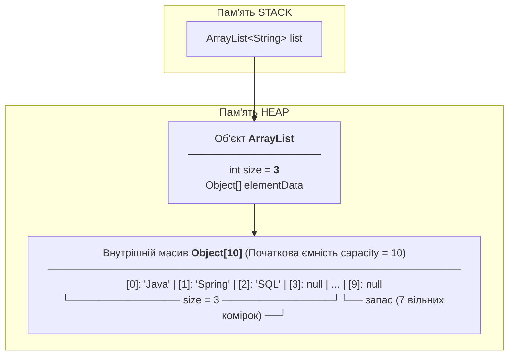
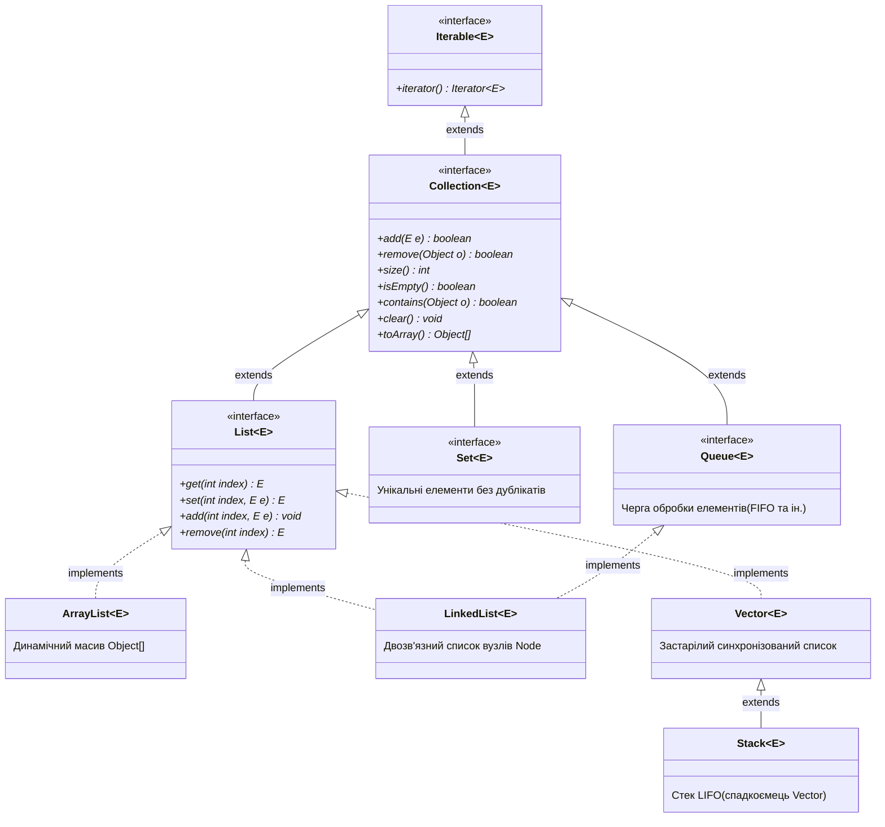

# Практична робота №11: Списки в Java: `ArrayList`, типи-обгортки, ієрархія колекцій та ітератори (`Wrapper Classes`, `Autoboxing`, `ArrayList`, `var` / `<>`, `Collection Hierarchy`, `Iterator`)

## 🎯 Мета роботи
- **Досконало вивчити типи-обгортки (`Wrapper Classes`) та механізми `Autoboxing` і `Unboxing`:**
  - Зрозуміти зв'язок усіх 8 примітивних типів із їхніми **класами-близнюками** (`Byte`, `Short`, `Integer`, `Long`, `Float`, `Double`, `Character`, `Boolean`) та головну причину їх появи: колекції Java працюють виключно з посилальними типами (`Object`), а не з примітивами.
  - Розібратися, як працює автоматичне пакування (**Autoboxing**) та розпакування (**Unboxing**) і що саме бачить та генерує компілятор `javac` «під капотом» (`Integer.valueOf(...)`, `.intValue()`).
  - Опанувати практичне використання методів класів-обгорток (`Integer.valueOf()`, `Integer.parseInt()`, `Double.parseDouble()`, `Character.isDigit()`) та граничних констант (`Integer.MAX_VALUE`, `Integer.MIN_VALUE`), а також особливості кешування `IntegerCache` (`[-128; 127]`).
- **Освоїти колекцію `ArrayList` та її внутрішнє влаштування:**
  - Усвідомити походження назви **`ArrayList`** (`Array` + `List` — поєднання масиву та списку) і ключові переваги над звичайними масивами: динамічний розмір, автоматичне масштабування та зручні методи додавання, вставки й видалення елементів.
  - Дослідити внутрішню анатомію `ArrayList` у пам'яті: буферний масив **`Object[] elementData`**, лічильник реальних елементів **`size`**, початкову ємність за замовчуванням (**`10` елементів**) та алгоритм розширення масиву в **$1.5$ раза** з копіюванням елементів через нативний метод **`System.arraycopy`**.
  - Довести до автоматизму використання основних методів `ArrayList`: `add`, `get`, `set`, `remove` (за індексом та за значенням), `clear`, `contains`, `isEmpty`, `size` та перетворення списку у звичайний масив (`toArray`).
- **Засвоїти механізм виведення типів компілятором (*Type Inference*):**
  - Навчитися грамотно застосовувати синтаксичний цукор сучасних версій Java: ромбовидний оператор (**Diamond Operator `<>`**) та локальне виведення типів (**`var list = new ArrayList<Integer>()`**), розуміючи небезпеку втрати конкретного типу при їх одночасному поєднанні (`var list = new ArrayList<>()` $\to$ `ArrayList<Object>`).
- **Вивчити ієрархію колекцій (*Java Collections Framework*):**
  - Побудувати цілісну картину зв'язків від кореневого інтерфейсу **`Iterable`** через базовий інтерфейс **`Collection`** до гілки списків **`List`** (`ArrayList`, `LinkedList`, `Vector`, `Stack`), а також сусідніх гілок множин (**`Set`**) та черг (**`Queue`**).
- **Опанувати патерн Ітератор (`Iterator`):**
  - Навчитися виконувати безпечний обхід колекцій за допомогою `Iterator<E>` (`hasNext()`, `next()`, `remove()`), розуміти причину виникнення винятку **`ConcurrentModificationException`** при зміні списку під час циклу `for-each` та вміти його уникати.
- **Закріпити культуру роботи з Git та GitHub:** розв'язати 40 практичних завдань (5 блоків по 8 завдань) і вчасно відправити код у власний репозиторій (дедлайн — **до наступного четверга, 19 листопада 2026 року, 23:59**).

---

## 📚 1. Теоретичні відомості

### 1.1. Типи-обгортки (`Wrapper Classes`): Класи-близнюки примітивів та причини їх появи

У попередніх роботах ми зберігали набори даних у звичайних масивах (`int[]`, `double[]`, `String[]`). Звичайний масив уміє напряму зберігати як примітиви, так і посилання на об'єкти, проте має жорстке обмеження — його довжина фіксується один раз у момент створення (`new int[10]`) і ніколи не може змінитися.

Коли ми переходимо до стандартних колекцій Java (`ArrayList`, `LinkedList`, `HashSet` тощо), ми стикаємося з фундаментальним правилом архітектури мови Java:
> **Колекції в Java можуть зберігати ЛИШЕ посилальні типи даних (об'єкти, що є спадкоємцями `java.lang.Object`) і НЕ можуть напряму зберігати примітивні типи (`int`, `double`, `boolean` тощо).**

```java
// ❌ ПОМИЛКА КОМПІЛЯЦІЇ: Type argument cannot be of primitive type
// ArrayList<int> numbers = new ArrayList<int>();

// ✅ ПРАВИЛЬНО: Використовуємо клас-обгортку (клас-близнюк) Integer!
ArrayList<Integer> numbers = new ArrayList<Integer>();
```

#### Чому колекції не працюють із примітивами та навіщо потрібні класи-близнюки?
Усі колекції Java побудовані на механізмі узагальнень (*Generics*) і всередині оперують посиланнями типу `Object`. Примітивні типи (`int`, `double`, `char` тощо) не є об'єктами: вони не успадковують `Object`, не мають методів і не можуть бути приведені до типу `Object`.

Саме тому для кожного з **8 примітивних типів** у стандартному пакеті `java.lang` було створено спеціальний **клас-близнюк — тип-обгортку (*Wrapper Class*)**. Об'єкт такого класу просто «обгортає» одне примітивне значення у незмінну (`immutable` та `final`) об'єктну оболонку в пам'яті **Heap**:

| Примітивний тип | Клас-обгортка (`java.lang`) | Розмір примітиву | Базовий суперклас | Приклад створення та граничні константи |
| :--- | :--- | :--- | :--- | :--- |
| **`byte`** | **`Byte`** | 8 біт (1 байт) | `Number` | `Byte.valueOf((byte) 10)`, `Byte.MIN_VALUE` ($-128$), `Byte.MAX_VALUE` ($127$) |
| **`short`** | **`Short`** | 16 біт (2 байти) | `Number` | `Short.valueOf((short) 500)`, `Short.MIN_VALUE` ($-32768$), `Short.MAX_VALUE` ($32767$) |
| **`int`** | **`Integer`** | 32 біти (4 байти) | `Number` | `Integer.valueOf(42)`, `Integer.MIN_VALUE` ($-2^{31}$), `Integer.MAX_VALUE` ($2^{31}-1$) |
| **`long`** | **`Long`** | 64 біти (8 байтів) | `Number` | `Long.valueOf(100L)`, `Long.MIN_VALUE` ($-2^{63}$), `Long.MAX_VALUE` ($2^{63}-1$) |
| **`float`** | **`Float`** | 32 біти (IEEE 754) | `Number` | `Float.valueOf(3.14f)`, `Float.MIN_VALUE`, `Float.MAX_VALUE` |
| **`double`** | **`Double`** | 64 біти (IEEE 754) | `Number` | `Double.valueOf(2.718)`, `Double.NaN`, `Double.POSITIVE_INFINITY` |
| **`char`** | **`Character`** | 16 біт (UTF-16) | `Object` | `Character.valueOf('A')`, `Character.isDigit('5')`, `Character.isLetter('Я')` |
| **`boolean`** | **`Boolean`** | ~1 байт (залежить від JVM) | `Object` | `Boolean.valueOf(true)`, `Boolean.TRUE`, `Boolean.FALSE` |

> [!NOTE]
> Зверніть увагу на назви: **6 із 8 класів-близнюків** називаються так само, як і примітиви, лише з великої літери (`Byte`, `Short`, `Long`, `Float`, `Double`, `Boolean`), і лише **два класи** мають повні форми слів: **`int` $\to$ `Integer`** та **`char` $\to$ `Character`**. Усі шість числових обгорток успадковують спільний абстрактний клас **`java.lang.Number`**.

---

### 1.2. Autoboxing і Unboxing: Що бачить компілятор «під капотом»

Щоб програмістам не доводилося щоразу вручну створювати об'єкти-обгортки для кожного числа і вручну діставати з них примітиви для арифметичних операцій, у Java працюють два автоматичні механізми компілятора:

- **Autoboxing (Автопакування)** — автоматичне перетворення примітивного типу (`int`, `double`, `boolean`) на об'єкт відповідного класу-обгортки (`Integer`, `Double`, `Boolean`).
- **Unboxing (Авторозпакування)** — зворотне автоматичне вилучення примітивного значення з об'єкта класу-обгортки.

#### Що бачить і генерує компілятор `javac` «під капотом»?
Для віртуальної машини (JVM) ніякої «магії» не існує — **Autoboxing та Unboxing є чистим синтаксичним цукром компілятора**. Під час компіляції у байт-код (`.class`) компілятор автоматично підставляє виклики статичного методу **`Integer.valueOf(...)`** (для пакування) та методу екземпляра **`.intValue()`** (для розпакування):

```java
// 🔹 1. Як пише код розробник (Autoboxing та Unboxing):
Integer objNumber = 150;                 // Autoboxing: примітив int -> об'єкт Integer
int primitiveNumber = objNumber;         // Unboxing: об'єкт Integer -> примітив int
Integer result = objNumber + 50;         // Unboxing (objNumber) -> додавання int -> Autoboxing у Integer

ArrayList<Integer> list = new ArrayList<>();
list.add(25);                            // Autoboxing при додаванні у список
int first = list.get(0);                 // Unboxing при читанні зі списку

// 🔹 2. Що НАСПРАВДІ бачить і записує у байт-код компілятор javac:
Integer objNumber = Integer.valueOf(150);            // Пакування через фабричний метод!
int primitiveNumber = objNumber.intValue();          // Розпакування через метод екземпляра!
Integer result = Integer.valueOf(objNumber.intValue() + 50);

ArrayList<Integer> list = new ArrayList<>();
list.add(Integer.valueOf(25));
int first = list.get(0).intValue();
```

*(Аналогічно для інших типів компілятор підставляє `Double.valueOf(d)` / `d.doubleValue()`, `Boolean.valueOf(b)` / `b.booleanValue()`, `Character.valueOf(c)` / `c.charValue()` тощо).*

#### ⚠️ Дві головні інженерні пастки обгорток та автобоксингу

1. **Пастка кешування `IntegerCache` (`[-128; 127]`) та порівняння через `==`:**
   Метод `Integer.valueOf(int)` (а отже, і Autoboxing) не створює новий об'єкт щоразу, якщо число лежить у діапазоні **від `-128` до `127`**. Ці 256 найпопулярніших об'єктів заздалегідь створені і зберігаються у внутрішньому кеші `IntegerCache`.
   ```java
   Integer a = 100; // Integer.valueOf(100) -> бере готовий об'єкт із кешу IntegerCache
   Integer b = 100; // Integer.valueOf(100) -> повертає ТОЙ САМИЙ об'єкт із кешу!
   System.out.println(a == b);      // true! (Адреси в пам'яті випадково збіглися через кеш)

   Integer x = 500; // 500 поза межами [-128; 127] -> створюється НОВИЙ об'єкт у Heap
   Integer y = 500; // Створюється ЩЕ ОДИН окремий об'єкт у Heap
   System.out.println(x == y);      // ❌ FALSE! Оператор == порівнює посилання (адреси), а не значення!
   System.out.println(x.equals(y)); // ✅ TRUE! Метод .equals() коректно порівнює числові значення!
   ```
   > **Правило:** Порівнюйте об'єкти-обгортки на рівність **виключно через `.equals()`** (або `Objects.equals(a, b)`).

2. **`NullPointerException` при розпакуванні `null`:**
   Оскільки `Integer` — це посилальний тип, змінна або елемент списку `ArrayList<Integer>` може містити `null`. Якщо ви спробуєте розпакувати `null` у примітив `int`, компілятор викличе `null.intValue()`, що призведе до падіння програми з `NullPointerException`:
   ```java
   Integer emptyBox = null;
   // int val = emptyBox; // 💥 Runtime Error: NullPointerException! (під капотом: emptyBox.intValue())
   ```

---

### 1.3. Корисні методи та константи класів-обгорток

Окрім зберігання значень у колекціях, класи-обгортки містять потужний набір статичних утилітарних методів та констант:

```java
// 1. Integer.parseInt(String s) — перетворює текстовий рядок у ПРИМІТИВ int:
int parsedPrimitive = Integer.parseInt("4096"); // повертає примітив int (4096)

// 2. Integer.valueOf(...) — перетворює примітив int або рядок String в ОБ'ЄКТ Integer:
Integer fromInt = Integer.valueOf(4096);        // повертає об'єкт Integer
Integer fromStr = Integer.valueOf("4096");      // парсить рядок і повертає об'єкт Integer

// 3. Граничні константи Integer.MAX_VALUE та Integer.MIN_VALUE:
int maxInt = Integer.MAX_VALUE; //  2147483647 (найбільше можливе 32-бітне знакове ціле число: 2^31 - 1)
int minInt = Integer.MIN_VALUE; // -2147483648 (найменше можливе 32-бітне знакове ціле число: -2^31)

// 4. Переведення в інші системи числення та корисні методи інших обгорток:
String binary = Integer.toBinaryString(42);     // "101010"
String hex    = Integer.toHexString(255);       // "ff"
double price  = Double.parseDouble("199.95");   // парсинг дробового числа у примітив double
boolean isNum = Character.isDigit('7');         // true (перевірка, чи є символ цифрою)
boolean isLet = Character.isLetter('Ї');        // true (перевірка, чи є символ літерою)
```

> [!TIP]
> **У чому різниця між `Integer.parseInt("123")` та `Integer.valueOf("123")`?**
> - **`Integer.parseInt("123")`** повертає **примітив `int`**. Використовуйте його, коли результат потрібно записати у змінну `int` або використати в арифметиці (не створює зайвих об'єктів).
> - **`Integer.valueOf("123")`** повертає **об'єкт-обгортку `Integer`** (викликаючи всередині `Integer.valueOf(parseInt(s))`). Використовуйте його, коли потрібен саме об'єкт `Integer`.
> - Якщо передати у будь-який із цих методів некоректний рядок (наприклад, `"12a"` або `""`), виникне виняток **`NumberFormatException`**.

---

### 1.4. Колекція `ArrayList`: Походження назви та переваги над звичайними масивами

**`java.util.ArrayList<E>`** — це найуживаніша колекція в мові Java, призначена для зберігання динамічних списків елементів.

#### Походження назви `ArrayList` (`Array` + `List`)
Назва класу складається з двох слів, які ідеально описують його природу:
- **`Array` (Масив)** — вказує на те, як ця колекція влаштована **всередині** (в основі лежить звичайний масив `Object[]`, що забезпечує миттєвий доступ до будь-якого елемента за його індексом).
- **`List` (Список)** — вказує на те, чим вона є **ззовні для програміста** (реалізує інтерфейс `List<E>`: גнучкий динамічний список, який сам росте в міру додавання елементів і вміє вставляти та видаляти дані у будь-якій позиції).

#### Чим `ArrayList` кращий за звичайний масив (`T[]`)?

| Критерій порівняння | Звичайний масив (`String[]`, `int[]`) | Колекція `ArrayList<E>` |
| :--- | :--- | :--- |
| **Розмір структури** | **Фіксований** (задається один раз при створенні `new String[10]`, змінити неможливо). | **Динамічний (гумовий)** — автоматично розширюється при додаванні нових елементів. |
| **Додавання в кінець** | Потрібно самому відстежувати індекс вільної комірки та вручну перестворювати масив при переповненні. | Один виклик методу **`list.add(element)`** — список сам подбає про пам'ять та індекси. |
| **Вставка в середину** | Доводиться вручну писати цикл або викликати `System.arraycopy`, щоб зсунути всі праві елементи. | Метод **`list.add(index, element)`** автоматично розсуває елементи і вставляє нове значення. |
| **Видалення елемента** | Неможливо зменшити масив; при зануленні `arr[i] = null` у масиві залишається «дірка». | Метод **`list.remove(index)`** або **`list.remove(obj)`** видаляє елемент і автоматично зсуває хвіст списку ліворуч без «дірок». |
| **Пошук та перевірка** | Немає готових методів (потрібен цикл або `Arrays`). | Готові методи **`contains(o)`**, **`indexOf(o)`**, **`isEmpty()`**, **`clear()`**. |
| **Виведення у консоль** | `System.out.println(arr)` виводить нечитабельний хеш `[Ljava.lang.String;@...` (потрібен `Arrays.toString(arr)`). | Має перевизначений `toString()` — одразу гарно друкує `[Елемент1, Елемент2, ...]`. |

---

### 1.5. Внутрішнє влаштування `ArrayList`: `Object[]`, `size`, ємність `10` та розширення в $1.5$ раза

Як саме `ArrayList` примудряється бути «гумовим», якщо всередині нього лежить звичайний масив фіксованої довжини? Заглянемо під капот класу `java.util.ArrayList`:

```java
public class ArrayList<E> extends AbstractList<E> implements List<E>, RandomAccess {
    // 1. Стандартна початкова ємність буферного масиву за замовчуванням:
    private static final int DEFAULT_CAPACITY = 10;

    // 2. Внутрішній масив Object[], у якому фактично зберігаються елементи списку:
    transient Object[] elementData;

    // 3. Лічильник реально доданих елементів у списку на поточний момент:
    private int size;
}
```

#### Різниця між `capacity` (ємністю масиву `Object[]`) та `size` (кількістю елементів)
Всередині кожного об'єкта `ArrayList` працюють дві головні змінні:
1. **`Object[] elementData` (його довжина — це `capacity`, ємність)** — внутрішній масив із запасом комірок. За замовчуванням при першому додаванні елемента створюється масив на **`10` комірок** (`DEFAULT_CAPACITY = 10`).
2. **`int size` (розмір списку, повертається методом `list.size()`)** — лічильник того, скільки елементів ми **реально поклали** у список. При створенні списку `size = 0`. Коли ми додаємо 3 елементи, `size` стає рівним `3`, а ще `7` комірок внутрішнього масиву `Object[10]` залишаються заповненими `null` про запас!



#### Алгоритм динамічного розширення в $1.5$ раза та копіювання через `System.arraycopy`
Що відбувається, коли внутрішній масив `Object[10]` повністю заповнився (`size == 10`) і ми викликаємо `list.add( одинадцятийЕлемент )`?
1. `ArrayList` бачить, що вільних комірок у поточному масиві `elementData` більше немає (`size == elementData.length`).
2. Запускається внутрішній механізм розширення (**`grow()`**), який обчислює нову ємність масиву — **у $1.5$ раза більшу за попередню**:
   $$\text{newCapacity} = \text{oldCapacity} + (\text{oldCapacity} \gg 1) \approx \text{oldCapacity} \times 1.5$$
   *(де `oldCapacity >> 1` — побітовий зсув праворуч на 1 біт, тобто швидке ділення на $2$. Отже, ємність росте за ланцюжком: **$10 \to 15 \to 22 \to 33 \to 49 \to 73 \to 109 \dots$**)*.
3. У пам'яті Heap виділяється **новий, більший масив** `new Object[15]`.
4. Усі 10 елементів зі старого масиву швидко копіюються на початок нового масиву за допомогою системного нативного методу **`System.arraycopy(oldArray, 0, newArray, 0, size)`** (який також використовується під час зсуву елементів при вставці `add(index, e)` та видаленні `remove(index)`).
5. Посилання `elementData` перемикається на новий масив `Object[15]`, старий масив `Object[10]` стає доступним для очищення *Garbage Collector*-ом, а 11-й елемент записується в комірку `[10]` (`size` стає `11`).

```mermaid
sequenceDiagram
    participant Dev as Програміст
    participant AL as ArrayList (size=10, capacity=10)
    participant Sys as System.arraycopy
    participant Heap as Пам'ять Heap

    Dev->>AL: list.add(11-й елемент)
    Note over AL: Масив Object[10] заповнений (size == 10)!<br/>Потрібне розширення в 1.5 раза
    AL->>AL: newCapacity = 10 + (10 / 2) = 15
    AL->>Heap: Створення нового масиву Object[15]
    AL->>Sys: System.arraycopy(oldData, 0, newData, 0, 10)
    Sys-->>AL: Старі 10 елементів скопійовано в Object[15]
    AL->>AL: elementData[10] = 11-й елемент; size = 11
    Note over AL,Heap: Старий масив Object[10] видаляється Garbage Collector-ом
```

---

### 1.6. Основні методи `ArrayList`

Усі базові операції для роботи зі списком `ArrayList<E>` зведені у зручну довідкову таблицю:

| Метод | Сигнатура та що повертає | Опис дії та важливі особливості |
| :--- | :--- | :--- |
| **`add`** | `boolean add(E e)` | Додає елемент `e` у **кінець списку** (на позицію `size`), збільшуючи `size` на `1`. Повертає `true`. |
| **`add` (за індексом)** | `void add(int index, E element)` | Вставляє елемент на вказану позицію `index`. Усі елементи праворуч (від `index` до кінця) автоматично зсуваються на 1 позицію вправо через `System.arraycopy`. |
| **`get`** | `E get(int index)` | Миттєво ($O(1)$) повертає елемент, що стоїть під індексом `index` (`0 <= index < size`). При виході за межі кидає `IndexOutOfBoundsException`. |
| **`set`** | `E set(int index, E element)` | Замінює (перезаписує) елемент на позиції `index` новим значенням `element` і **повертає старий елемент**, який там зберігався раніше. |
| **`remove` (за індексом)** | `E remove(int index)` | Видаляє елемент під індексом `index`, зсуває всі наступні елементи на 1 позицію ліворуч через `System.arraycopy` і **повертає видалений елемент**. |
| **`remove` (за об'єктом)** | `boolean remove(Object o)` | Знаходить **перше входження** об'єкта `o` (порівнюючи через `.equals()`), видаляє його зі зсувом і повертає `true` (або `false`, якщо елемент не знайдено). |
| **`clear`** | `void clear()` | Повністю очищує список: зануляє всі комірки масиву (`null`) і скидає лічильник **`size = 0`**. |
| **`contains`** | `boolean contains(Object o)` | Перевіряє, чи міститься елемент `o` у списку (використовує `.equals()`). Повертає `true` або `false`. |
| **`isEmpty`** | `boolean isEmpty()` | Повертає `true`, якщо у списку немає жодного елемента (`size == 0`), і `false`, якщо є хоча б один. |
| **`size`** | `int size()` | Повертає поточну кількість реально доданих елементів у списку (аналог `.length` у масивах). |
| **Перетворення у масив (`toArray`)** | `Object[] toArray()` або `<T> T[] toArray(T[] a)` | Копіює всі елементи списку у звичайний масив фіксованої довжини `size`. Типізований варіант: `String[] arr = list.toArray(new String[0]);`. |

> [!CAUTION]
> **Важливий нюанс методу `remove` для списку чисел `ArrayList<Integer>`:**
> У класі `ArrayList` є два перевантажені методи: `remove(int index)` та `remove(Object o)`.
> Якщо у вас є список `ArrayList<Integer> list` і ви напишете **`list.remove(5)`**, компілятор сприйме `5` як примітив `int` і видалить елемент **під індексом `5`**, а не саме число `5`!
> Щоб видалити зі списку `ArrayList<Integer>` елемент за **значенням**, потрібно явно передати об'єкт-обгортку:
> ```java
> list.remove(5);                  // Видаляє елемент за ІНДЕКСОМ 5
> list.remove(Integer.valueOf(5)); // ✅ Видаляє сам ОБ'ЄКТ зі значенням 5!
> ```

---

### 1.7. Виведення типів компілятором: `Diamond Operator <>` та ключове слово `var`

У процесі розвитку мови Java розробники компілятора додали зручний **синтаксичний цукор** для автоматичного виведення типів (*Type Inference*), щоб позбавити код зайвого дублювання, зберігаючи сувору статичну типізацію:

1. **Ромбовидний оператор (`<>` / Diamond Operator, з Java 7):**
   Дозволяє не дублювати назву типу праворуч у конструкторі `new ArrayList<>()`, оскільки компілятор сам бачить тип у лівій частині оголошення змінної:
   ```java
   // Замість старого багатослівного запису:
   ArrayList<Integer> oldStyle = new ArrayList<Integer>();

   // Використовуємо ромбовидний оператор <> (компілятор сам підставляє <Integer> праворуч):
   ArrayList<Integer> numbers = new ArrayList<>();
   ```

2. **Локальне виведення типу через ключове слово `var` (з Java 10+):**
   Дозволяє написати `var` замість типу локальної змінної ліворуч — тоді компілятор виведе тип змінної з правої частини виразу (з типу конструктора):
   ```java
   // Компілятор бачить праворуч new ArrayList<Integer>() і автоматично робить змінну list типом ArrayList<Integer>:
   var list = new ArrayList<Integer>();
   list.add(42); // ✅ Повна типобезпека: можна додавати лише Integer!
   ```

> [!WARNING]
> **Небезпека втрати типу при одночасному поєднанні `var` та порожнього ромба `<>`!**
> Що станеться, якщо одночасно приховати тип і ліворуч (через `var`), і праворуч (через порожній `<>`)?
> ```java
> // ⚠️ НЕБЕЗПЕКА ВТРАТИ ТИПУ:
> var brokenList = new ArrayList<>(); // Компілятор виводить тип ArrayList<Object>!
>
> brokenList.add(100);       // Додається Integer як Object
> brokenList.add("Привіт");  // Додається String як Object
> brokenList.add(true);      // Додається Boolean як Object
> ```
> Оскільки компілятору нізвідки дізнатися бажаний тип елементів, він виводить найзагальніший тип **`ArrayList<Object>`**! У такий список можна випадково покласти будь-які різнорідні дані, що призведе до помилок `ClassCastException` під час подальшої обробки.
>
> **Правило:** Ніколи не поєднуйте `var` із порожнім `<>`! Або пишіть тип ліворуч (`List<Integer> list = new ArrayList<>();`), або пишіть тип у кутових дужках праворуч (`var list = new ArrayList<Integer>();`).

---

### 1.8. Ієрархія колекцій (*Java Collections Framework*)

Усі колекції в Java об'єднані в єдину струнку ієрархію інтерфейсів та класів. На вершині цієї ієрархії стоїть інтерфейс **`Iterable`**, від якого успадковується **`Collection`**, що далі розгалужується на три основні гілки: **`List` (Списки)**, **`Set` (Множини)** та **`Queue` (Черги)**.



#### Опис ключових ланок ієрархії:
1. **`Iterable<E>` (`java.lang.Iterable`)** — кореневий інтерфейс усієї ієрархії. Оголошує метод `Iterator<E> iterator()`, який дозволяє послідовно обходити елементи колекції (і дає змогу використовувати цикл `for-each`).
2. **`Collection<E>` (`java.util.Collection`)** — базовий інтерфейс для будь-якої колекції об'єктів. Визначає спільні методи для всіх колекцій: `add(e)`, `remove(o)`, `clear()`, `size()`, `isEmpty()`, `contains(o)`, `toArray()`.
3. **Три головні гілки, що розширюють `Collection<E>`:**
   - **`List<E>` (Список)** — впорядкована послідовність елементів, де кожен елемент має свій **індекс** (`0, 1, 2, ...`) і **дозволені дублікати**. Основні класи-реалізації:
     - **`ArrayList`** — швидкий список на базі динамічного масиву `Object[]` (миттєвий доступ за індексом `get(i)` за $O(1)$).
     - **`LinkedList`** — список на базі двобічно зв'язаних вузлів (`Node` з посиланнями `prev` та `next`). Одночасно реалізує інтерфейси `List` та `Queue` (`Deque`), швидко додає/видаляє елементи на кінцях списку.
     - **`Vector`** — історичний (застарілий з Java 1.0) синхронізований аналог `ArrayList`, який працює повільніше через блокування потоків на кожному методі.
     - **`Stack`** — спадкоємець класу `Vector`, що реалізує структуру даних Стек за принципом **LIFO** (*Last-In-First-Out*: останнім прийшов — першим вийшов, методи `push`, `pop`, `peek`).
   - **`Set<E>` (Множина)** — колекція, яка зберігає **лише унікальні елементи** (категорично не допускає дублікатів, наприклад `HashSet`, `TreeSet`).
   - **`Queue<E>` (Черга)** — колекція, призначена для утримання елементів перед обробкою, зазвичай за принципом черги **FIFO** (*First-In-First-Out*: першим прийшов — першим вийшов, наприклад `LinkedList`, `PriorityQueue`, `ArrayDeque`).

---

### 1.9. Ітератор (`Iterator`): Безпечний обхід колекцій та уникнення `ConcurrentModificationException`

**Ітератор (`java.util.Iterator<E>`)** — це спеціальний об'єкт-курсор, який дозволяє послідовно перебирати елементи будь-якої колекції (незалежно від того, чи є в неї індекси, як у `List`, чи їх немає, як у `Set`) і **безпечно видаляти елементи під час обходу**.

Отримати ітератор можна викликом методу **`collection.iterator()`**. Інтерфейс `Iterator<E>` має три основні методи:
- **`boolean hasNext()`** — перевіряє, чи є в колекції наступний ще не пройдений елемент (`true` / `false`).
- **`E next()`** — пересуває курсор ітератора на наступний елемент і повертає його.
- **`void remove()`** — безпечно видаляє з колекції останній елемент, який щойно був повернутий методом `next()`.

#### Чому виникає `ConcurrentModificationException` і як його уникнути?
Якщо під час перебору колекції у циклі `for-each` (який під капотом використовує `Iterator`) ви спробуєте видалити або додати елемент напряму через метод самого списку **`list.remove(...)`**, програма аварійно завершиться з винятком **`java.util.ConcurrentModificationException`**:

```java
ArrayList<Integer> numbers = new ArrayList<>(List.of(10, -5, 20, -8, 30));

// ❌ ПОМИЛКА (викличе ConcurrentModificationException під час виконання!):
for (Integer num : numbers) {
    if (num < 0) {
        numbers.remove(num); // Заборонено змінювати список напряму в обхід активного ітератора!
    }
}
```

**Причина:** Колекція веде внутрішній лічильник структурних змін (`modCount`). Коли `numbers.remove(num)` змінює список напряму, `modCount` списку збільшується, а ітератор циклу `for-each` про це не знає і при наступному виклику `next()` виявляє розсинхронізацію та кидає `ConcurrentModificationException`.

#### ✅ Правильний спосіб: Безпечне видалення через `Iterator.remove()`
Щоб безпечно видаляти елементи під час обходу колекції, потрібно явно створити `Iterator`, обходити список циклом `while (it.hasNext())` і викликати метод **`it.remove()`** самого ітератора:

```java
ArrayList<Integer> numbers = new ArrayList<>(List.of(10, -5, 20, -8, 30));

// ✅ ПРАВИЛЬНО ТА БЕЗПЕЧНО: Використовуємо Iterator та його власний метод it.remove()
Iterator<Integer> it = numbers.iterator();
while (it.hasNext()) {
    Integer current = it.next(); // 1. Отримуємо поточний елемент і зсуваємо курсор
    if (current < 0) {
        it.remove();             // 2. Безпечно видаляємо поточний елемент через ітератор!
    }
}
System.out.println(numbers); // Виведе: [10, 20, 30] — жодного ConcurrentModificationException!
```

*(У сучасній Java 8+ також можна скористатися скороченим записом `numbers.removeIf(n -> n < 0);`, який усередині так само безпечно використовує ітератор).*

---

### 1.10. Робота з Git та GitHub (Алгоритм здачі та Дедлайн)

> [!IMPORTANT]
> **Правила здачі Практичної роботи №11:**
> - Увесь код фіксується у вашому Git-репозиторії та відправляється на **GitHub**.
> - **⏰ Дедлайн здачі:** **до наступного четверга (19 листопада 2026 року, до 23:59)**.
> - Перед відправкою обов'язково переконайтеся, що проєкт компілюється без жодної помилки.

```bash
git status
git add src/practice11/
git commit -m "feat(practice11): complete 40 tasks on Wrapper classes, ArrayList, Collection hierarchy and Iterator"
git push origin main
```

---

## 💻 2. Практичні завдання (40 завдань)

Усі завдання виконуються у пакеті `practice11` (або `semester1.practice11`) та тестуються у методі `main` класу `Practice11.java`.
Завдання структуровано у **5 логічних блоків по 8 завдань**, що повністю охоплюють усі теми лекції:
- **Блок 1 (Завдання 1–8):** Типи-обгортки (`Wrapper Classes` — класи-близнюки), `Autoboxing` і `Unboxing` («під капотом»: `Integer.valueOf()`, `intValue()`), методи `Integer.parseInt()`, `Integer.valueOf()` та константи `Integer.MAX_VALUE` / `Integer.MIN_VALUE`.
- **Блок 2 (Завдання 9–16):** Колекція `ArrayList` (переваги над звичайними масивами, динамічний розмір), внутрішнє влаштування (`Object[]`, `size`, початкова ємність `10`, розширення в $1.5$ раза через `System.arraycopy`) та базові методи додавання і доступу (`add`, `get`, `set`, `size`).
- **Блок 3 (Завдання 17–24):** Основні методи `ArrayList` у дії: видалення за індексом та за об'єктом (`remove`), очищення (`clear`), перевірка наявності (`contains`), перевірка порожнечі (`isEmpty`), пошук (`indexOf`) та перетворення у звичайний масив (`toArray`).
- **Блок 4 (Завдання 25–32):** Виведення типів компілятором (ромбовидний оператор `<>`, ключове слово `var`, небезпека втрати типу `var` + `<>`), ієрархія колекцій (`Iterable` $\to$ `Collection` $\to$ `List` / `Set` / `Queue`, класи `ArrayList`, `LinkedList`, `Vector`, `Stack`) та безпечний обхід через `Iterator` без `ConcurrentModificationException`.
- **Блок 5 (Завдання 33–40):** Практичні маніпуляції зі списками, алгоритмічні задачі на обробку даних в `ArrayList` за допомогою ітераторів та обгорток + Фінальний `git push`.

---

### Блок 1: Типи-обгортки (`Wrapper Classes`), Autoboxing / Unboxing та Методи обгорток (Завдання 1–8)

#### Завдання 1: Усі 8 класів-близнюків (`Wrapper Classes`) та причина їх появи для колекцій
1. Створіть метод `public static void demonstrateWrapperTwins()`, у якому для кожного з 8 примітивних типів (`byte`, `short`, `int`, `long`, `float`, `double`, `char`, `boolean`) оголосіть відповідний об'єкт класу-близнюка (`Byte`, `Short`, `Integer`, `Long`, `Float`, `Double`, `Character`, `Boolean`) через фабричний метод `valueOf(...)`.
2. Створіть список `ArrayList<Integer>` та у коментарі й коді покажіть, чому `ArrayList<int>` не компілюється (колекції зберігають лише посилальні типи), а `ArrayList<Integer>` успішно зберігає цілі числа як об'єкти.
3. Виведіть значення всіх 8 створених обгорток та їхні класи (`obj.getClass().getSimpleName()`) у консоль.

#### Завдання 2: Autoboxing та Unboxing: Що бачить компілятор «під капотом» (`Integer.valueOf()` та `intValue()`)
1. Напишіть метод `public static void showCompilerUnderTheHood()`, у якому продемонструйте дві ідентичні за результатом ділянки коду:
   - **Неявний синтаксичний цукор (Autoboxing / Unboxing):** запис примітива `int a = 42;` в обгортку `Integer boxed = a;`, додавання у список `list.add(100);` та читання назад у примітив `int unboxed = list.get(0);`.
   - **Явний код компілятора:** перепишіть ті самі рядки так, як їх перетворює компілятор у байт-коді — з явним викликом **`Integer.valueOf(a)`**, **`list.add(Integer.valueOf(100))`** та **`list.get(0).intValue()`**.
2. Аналогічно покажіть явне пакування та розпакування для `Double` (`Double.valueOf(3.14)` та `.doubleValue()`) і `Boolean` (`Boolean.valueOf(true)` та `.booleanValue()`).

#### Завдання 3: Методи `Integer.parseInt()` проти `Integer.valueOf()` при роботі з рядками
1. Напишіть метод `public static List<Integer> parseNumbersFromStrings(String[] inputs)`, який приймає масив рядків `{"120", "-45", "300", "abc", "1024", ""}`.
2. Для кожного коректного числового рядка продемонструйте:
   - отримання примітива `int` за допомогою **`Integer.parseInt(str)`** для підрахунку загальної суми у примітивній змінній `int sum`;
   - отримання об'єкта `Integer` за допомогою **`Integer.valueOf(str)`** для додавання у результуючий список `ArrayList<Integer>`.
3. Некоректні рядки (`"abc"`, `""`) безпечно обробіть через `try-catch (NumberFormatException e)` із виведенням попередження у консоль.

#### Завдання 4: Використання констант `Integer.MAX_VALUE` та `Integer.MIN_VALUE` для пошуку екстремумів
1. Виведіть у консоль точні значення констант **`Integer.MAX_VALUE`** ($2\,147\,483\,647$) та **`Integer.MIN_VALUE`** ($-2\,147\,483\,648$), а також аналогічні константи для `Byte`, `Short` та `Long`.
2. Напишіть метод `public static void findMinAndMax(List<Integer> numbers)`, який знаходить найменше та найбільше число у списку, ініціалізуючи початкові змінні класичним інженерним прийомом:
   - `int min = Integer.MAX_VALUE;`
   - `int max = Integer.MIN_VALUE;`
3. Продемонструйте ефект переповнення `Integer.MAX_VALUE + 1 == Integer.MIN_VALUE` і покажіть, як безпечно перевірити межу перед додаванням.

#### Завдання 5: Кешування обгорток `IntegerCache` (`[-128; 127]`) та порівняння `==` проти `.equals()`
1. Напишіть метод `public static void testIntegerPool()`, у якому порівняйте через `==` та через `.equals()` дві пари об'єктів `Integer`, створених через автопакування (тобто `Integer.valueOf()`):
   - `Integer a = 100; Integer b = 100;` (значення в діапазоні кешу `[-128; 127]`);
   - `Integer x = 250; Integer y = 250;` (значення поза межами кешу).
2. Виведіть результати у консоль і поясніть, чому для `250` оператор `==` повертає `false`, а метод **`x.equals(y)`** — `true`.

#### Завдання 6: Безпечний Unboxing та захист від `NullPointerException` у списках обгорток
1. Створіть список `ArrayList<Integer> temperatures = new ArrayList<>()`, у який додайте значення `18`, `22`, `null`, `15`, `null`, `20`.
2. Покажіть у блоці `try-catch (NullPointerException e)`, що пряме авторозпакування `int t = temperatures.get(2);` призводить до помилки, бо компілятор намагається викликати `null.intValue()`.
3. Напишіть метод `public static int sumIgnoringNulls(List<Integer> list)`, який перед розпакуванням кожного елемента перевіряє `if (element != null)` і коректно обчислює суму всіх наявних чисел.

#### Завдання 7: Методи класів-обгорток `Character` та `Double` для аналізу даних
1. Напишіть метод `public static List<Integer> extractDigitsFromText(String text)`, який перебирає всі символи рядка (наприклад, `"Server-04: CPU 85%, RAM 16GB"`), перевіряє кожен символ методом обгортки **`Character.isDigit(ch)`** і перетворює знайдені цифри у список `ArrayList<Integer>` через `Character.getNumericValue(ch)` або `Integer.valueOf(String.valueOf(ch))`.
2. Продемонструйте парсинг дробових чисел через **`Double.parseDouble("36.6")`** та **`Double.valueOf("99.95")`**, а також перевірку на скінченність числа через `Double.isNaN(d)` та `Double.isInfinite(d)`.

#### Завдання 8: Робота з системами числення та бітовими методами класу `Integer`
1. Напишіть метод `public static void convertNumberSystems(int number)`, який за допомогою статичних методів класу-обгортки `Integer` виводить число у двійковій (`Integer.toBinaryString`), вісімковій (`Integer.toOctalString`) та шістнадцятковій (`Integer.toHexString`) системах числення.
2. Переведіть двійковий рядок `"101010"` у десятковий `int` за допомогою перевантаженого методу **`Integer.parseInt("101010", 2)`** та шістнадцятковий `"FF"` через **`Integer.parseInt("FF", 16)`**.

---

### Блок 2: Колекція `ArrayList` та її внутрішнє влаштування (Завдання 9–16)

#### Завдання 9: Звичайний масив проти `ArrayList` (`Array` + `List`): Порівняння на практиці
1. Створіть звичайний масив `String[] fixedArray = new String[3]` із трьома містами та покажіть, що додати 4-те місто без створення нового масиву неможливо (спроба `fixedArray[3] = "..."` кидає `ArrayIndexOutOfBoundsException`).
2. Створіть `ArrayList<String> dynamicList = new ArrayList<>()`, додайте ті самі 3 міста, а потім легко додайте 4-те й 5-те міста через `add(...)`, вставте елемент у середину через `add(1, "...")` та видаліть перший елемент через `remove(0)`.
3. Виведіть обидві структури у консоль, продемонструвавши переваги динамічного списку `ArrayList`.

#### Завдання 10: Внутрішнє влаштування `ArrayList`: Початкова ємність (`10`) та формула розширення в $1.5$ раза
1. Напишіть метод-симулятор `public static List<Integer> traceArrayListCapacity(int elementsCount)`, який моделює роботу внутрішнього масиву `Object[]` у `ArrayList`:
   - початкова ємність при першому додаванні дорівнює **`10`**;
   - щоразу, коли лічильник `size` перевищує поточну ємність `capacity`, нова ємність обчислюється в **$1.5$ раза більшою** (`newCapacity = oldCapacity + (oldCapacity >> 1)`).
2. Виведіть покроковий протокол у консоль: при додаванні якого саме за рахунком елемента (від `1` до `100`) відбувається розширення масиву та як змінюється його довжина (`10 -> 15 -> 22 -> 33 -> 49 -> 73 -> 109`).

#### Завдання 11: Демонстрація роботи `System.arraycopy` під капотом `ArrayList`
1. Щоб наочно побачити, як `ArrayList` розширює внутрішній масив `Object[]` та зсуває елементи при вставці, напишіть метод `public static Object[] growArrayManually(Object[] oldData)`:
   - створіть масив `Object[] oldData` довжиною `10`, заповнений числами від `1` до `10`;
   - обчисліть нову довжину в $1.5$ раза більшу (`15`), створіть `Object[] newData = new Object[15]` і скопіюйте всі старі елементи одним викликом **`System.arraycopy(oldData, 0, newData, 0, oldData.length)`**;
   - додайте 11-й елемент у `newData[10]` та виведіть обидва масиви.
2. Покажіть за допомогою `System.arraycopy`, як при вставці елемента на індекс `2` усі елементи правіше зсуваються на одну позицію вправо.

#### Завдання 12: Додавання елементів у кінець (`add(e)`) та вставка за індексом (`add(index, e)`)
1. Створіть список етапів збірки проєкту `ArrayList<String> pipeline = new ArrayList<>()`.
2. Додайте у кінець списку етапи `"Compile"`, `"Package"`, `"Deploy"` за допомогою `add(String)`.
3. За допомогою перевантаженого методу **`add(int index, String element)`**:
   - вставте `"Checkout Git"` на самий початок списку (індекс `0`);
   - вставте `"Run Unit Tests"` між `"Compile"` та `"Package"`.
4. Виведіть список після кожної вставки разом із поточним значенням лічильника **`pipeline.size()`**.

#### Завдання 13: Читання (`get`) та заміна (`set`) елементів за індексом
1. Створіть `ArrayList<Integer> speeds = new ArrayList<>(List.of(60, 85, 110, 95, 130))`.
2. За допомогою методу **`get(int index)`** прочитайте та виведіть перший, центральний (`speeds.size() / 2`) та останній (`speeds.size() - 1`) елементи списку.
3. Виявіть усі перевищення швидкості понад `100` км/год: пройдіться циклом за індексами і за допомогою методу **`set(int index, Integer element)`** обмежте кожне таке значення до `100`, виводячи старе значення, яке повернув метод `set`.

#### Завдання 14: Власна міні-модель `SimpleArrayList` на базі `Object[]`, `size` та `System.arraycopy`
1. Створіть невеликий навчальний клас `SimpleArrayList`, який відтворює внутрішню будову `ArrayList` із лекції:
   - приватне поле `private Object[] data = new Object[10];` (початкова ємність 10);
   - приватний лічильник `private int size = 0;`;
   - метод `public void add(Object element)`, який при `size == data.length` розширює масив `data` у $1.5$ раза через **`System.arraycopy`**, записує елемент у `data[size++]`;
   - методи `public Object get(int index)`, `public int size()` та `public int getCapacity()` (повертає `data.length`).
2. У `main` додайте у `SimpleArrayList` 12 елементів і виведіть, як `size` став `12`, а `capacity` автоматично зросла з `10` до `15`!

#### Завдання 15: Управління початковою ємністю: конструктор `new ArrayList<>(initialCapacity)` та `ensureCapacity`
1. Продемонструйте створення списку з наперед відомою ємністю **`ArrayList<String> logs = new ArrayList<>(500);`** і поясніть, чому це рятує від зайвих викликів `System.arraycopy`, коли кількість елементів відома заздалегідь.
2. Покажіть роботу методів `logs.ensureCapacity(1000)` (гарантує місце під 1000 елементів) та `logs.trimToSize()` (обрізає невикористаний хвіст внутрішнього масиву `Object[]` рівно до поточного `size`).

#### Завдання 16: Динамічне формування списку результатів із фільтрацією та підрахунком `size()`
1. Створіть список балів студентів `ArrayList<Integer> scores = new ArrayList<>(List.of(45, 88, 92, 59, 74, 100, 38, 65))`.
2. Напишіть метод `public static ArrayList<Integer> extractPassedScores(List<Integer> allScores, int minPassScore)`, який створює новий `ArrayList<Integer>`, перебирає оцінки через `get(i)` і додає через `add(...)` лише ті бали, що `>= minPassScore` (`60`).
3. Виведіть початковий `size()`, кількість відрахованих та новий список зарахованих студентів.

---

### Блок 3: Основні методи `ArrayList` та Перетворення у масив (Завдання 17–24)

#### Завдання 17: Видалення з `ArrayList<Integer>`: `remove(int index)` проти `remove(Object o)`
1. Створіть список чисел `ArrayList<Integer> numbers = new ArrayList<>(List.of(10, 20, 30, 1, 40, 2));`.
2. Викличте **`numbers.remove(1)`** і виведіть список: поясніть, чому зі списку зникло число `20` (елемент під індексом `1`), а число `1` залишилося на місці.
3. Тепер викличте **`numbers.remove(Integer.valueOf(1))`** та **`numbers.remove(Integer.valueOf(2))`** і покажіть, що при передачі об'єкта-обгортки `ArrayList` видаляє саме елементи зі значеннями `1` та `2`.

#### Завдання 18: Перевірка наявності (`contains`) та пошук індексу (`indexOf`, `lastIndexOf`)
1. Створіть список мов програмування `ArrayList<String> langs = new ArrayList<>(List.of("Java", "Python", "C++", "Java", "Kotlin", "Java"))`.
2. Перевірте за допомогою методу **`contains(Object o)`**, чи є у списку `"Kotlin"` та чи є `"Rust"`.
3. Знайдіть індекс першого входження `"Java"` через `langs.indexOf("Java")` та останнього через `langs.lastIndexOf("Java")`.
4. Напишіть метод `public static int countOccurrences(List<String> list, String target)`, який підраховує, скільки разів елемент зустрічається у списку.

#### Завдання 19: Перевірка на порожнечу (`isEmpty`), розмір (`size`) та повне очищення (`clear`)
1. Створіть список кошика покупок `ArrayList<String> cart = new ArrayList<>()`.
2. Перевірте перед початком роботи, що `cart.isEmpty()` повертає `true`, а `cart.size()` дорівнює `0`.
3. Додайте 4 товари у кошик, виведіть `cart.isEmpty()` (`false`) та `cart.size()` (`4`).
4. Оформіть замовлення, викликавши метод **`cart.clear()`**, і знову перевірте `cart.isEmpty()` та `cart.size()`, пояснивши, що відбулося з масивом `Object[]` та лічильником `size` всередині `ArrayList`.

#### Завдання 20: Перетворення `ArrayList` у звичайний масив (`toArray`) та зворотне перетворення
1. Створіть `ArrayList<String> cities = new ArrayList<>(List.of("Київ", "Львів", "Одеса", "Харків", "Дніпро"))`.
2. Перетворіть `ArrayList` у звичайний масив двома способами з таблиці методів:
   - у масив об'єктів: `Object[] objArray = cities.toArray();`;
   - у типізований масив рядків: `String[] strArray = cities.toArray(new String[0]);` (або `new String[cities.size()]`).
3. Виведіть отриманий масив через `Arrays.toString(strArray)`, а потім виконайте зворотне перетворення масиву у новий динамічний `ArrayList<String>` за допомогою `new ArrayList<>(Arrays.asList(strArray))`.

#### Завдання 21: Комплексна ревізія методів таблиці `ArrayList` в одному сценарії
1. Напишіть метод `public static void manageTaskList()`, який моделює роботу менеджера задач і послідовно застосовує **всі основні методи з лекційної таблиці**:
   - створення списку та перевірка `isEmpty()`;
   - додавання 5 задач через `add(e)` та вставка термінової задачі через `add(0, e)`;
   - читання задачі через `get(i)` та оновлення її тексту через `set(i, newText)`;
   - перевірка наявності задачі через `contains(o)`;
   - видалення виконаної задачі за назвою `remove(Object)` та за номером `remove(int)`;
   - виведення фінального `size()`, експорт у масив `toArray()` та очищення `clear()`.

#### Завдання 22: Видалення всіх дублікатів зі списку за допомогою `contains`
1. Напишіть узагальнений метод `public static <T> ArrayList<T> deduplicate(List<T> source)`, який приймає список із повторюваними елементами (наприклад, `[5, 12, 5, 8, 12, 20, 5]`).
2. Створіть новий `ArrayList<T> unique = new ArrayList<>()` і додавайте в нього елементи з `source` лише тоді, коли **`!unique.contains(item)`**.
3. Перевірте роботу методу на списку `ArrayList<Integer>` та `ArrayList<String>`.

#### Завдання 23: Пошук перетину та різниці двох списків (`contains`, `removeAll`, `retainAll`)
1. Створіть два списки студентів: ті, хто склав іспит з Java (`listA`), та ті, хто склав іспит з Баз даних (`listB`).
2. Напишіть методи, які повертають:
   - список студентів, які склали **обидва** іспити (використовуючи перевірку `listB.contains(student)` або `retainAll`);
   - список студентів, які склали **лише перший** іспит (`removeAll`).

#### Завдання 24: Заміна всіх входжень старого значення на нове за допомогою `get` та `set`
1. Напишіть метод `public static void replaceAllValues(List<String> list, String oldValue, String newValue)`, який проходить по списку за індексами від `0` до `list.size() - 1`, перевіряє кожен елемент через `Objects.equals(list.get(i), oldValue)` і замінює збіги викликом **`list.set(i, newValue)`**.
2. Підрахуйте та поверніть кількість виконаних замін.

---

### Блок 4: Виведення типів (`var`, `<>`), Ієрархія колекцій та Ітератор (`Iterator`) (Завдання 25–32)

#### Завдання 25: Синтаксичний цукор: Ромбовидний оператор `<>` та ключове слово `var`
1. Створіть метод `public static void demonstrateTypeInference()`, у якому оголосіть три типізовані списки різними способами:
   - класичний запис із ромбовидним оператором (`Diamond Operator <>`): `List<Integer> list1 = new ArrayList<>();`;
   - запис із локальним виведенням типу через **`var`**: `var list2 = new ArrayList<Integer>();`;
   - запис для списку рядків через `var`: `var names = new ArrayList<String>(List.of("Анна", "Богдан"));`.
2. Додайте елементи у кожен список і доведіть, що компілятор строго контролює тип `Integer` для `list1`/`list2` та `String` для `names`.

#### Завдання 26: Небезпека втрати типу при поєднанні `var` та `<>` (`var list = new ArrayList<>()`)
1. Створіть метод `public static void demonstrateVarDiamondDanger()`, у якому оголосіть список з одночасним використанням `var` ліворуч та порожнього ромба `<>` праворуч:
   ```java
   var unsafeList = new ArrayList<>(); // Компілятор виводить ArrayList<Object>!
   ```
2. Додайте у `unsafeList` число `42`, рядок `"Java"` та логічне значення `true`.
3. Покажіть у блоці `try-catch (ClassCastException e)`, що при спробі прочитати елементи з `unsafeList` і привести їх до `(Integer)` виникає `ClassCastException` під час виконання програми, а потім покажіть правильне виправлення: `var safeList = new ArrayList<Integer>();`.

#### Завдання 27: Дослідження ієрархії колекцій: від `Iterable` через `Collection` до `List`, `Set`, `Queue`
1. Створіть метод `public static void exploreCollectionHierarchy()`, у якому створіть представників усіх основних гілок ієрархії з лекції:
   - гілка `List`: `ArrayList<String>`, `LinkedList<String>`, `Vector<String>`, `Stack<String>`;
   - гілка `Set`: `HashSet<String>`;
   - гілка `Queue`: `ArrayDeque<String>` (або `PriorityQueue<String>`).
2. За допомогою оператора `instanceof` перевірте та виведіть у консоль, що кожен із цих класів одночасно є екземпляром і свого інтерфейсу (`List` / `Set` / `Queue`), і базового інтерфейсу **`Collection`**, і кореневого інтерфейсу **`Iterable`**.

#### Завдання 28: Універсальні поліморфні методи на рівні `Iterable<E>`, `Collection<E>` та `List<E>`
1. Напишіть три методи, що приймають різні рівні ієрархії:
   - `public static <E> void printElements(Iterable<E> iterable)` — обходить будь-який `Iterable` за допомогою `Iterator<E>`;
   - `public static <E> void printSummary(Collection<E> collection)` — виводить `collection.size()` та `collection.isEmpty()`;
   - `public static <E> E getFirstAndLast(List<E> list)` — використовує специфічний для `List` метод індексного доступу `get(0)` та `get(list.size() - 1)`.
2. Передайте в ці методи по черзі `ArrayList`, `LinkedList`, `Vector` та `Stack`, продемонструвавши єдність контрактів ієрархії.

#### Завдання 29: Гілка `List`: Практичне знайомство з `ArrayList`, `LinkedList`, `Vector` та `Stack`
1. Продемонструйте специфічні особливості всіх 4 класів гілки `List`, розглянутих на лекції:
   - **`ArrayList<String>`** — швидкий доступ за індексом `get(i)`;
   - **`LinkedList<String>`** — швидка вставка на початок і в кінець (`addFirst`, `addLast`);
   - **`Vector<String>`** — синхронізований список (`addElement`, `elementAt`);
   - **`Stack<String>`** — робота за принципом LIFO: покладіть 3 книги на стек через `push(...)`, подивіться верхню через `peek()` і дістаньте їх у зворотному порядку через `pop()`.

#### Завдання 30: Обхід колекції за допомогою `Iterator<E>` (`hasNext()`, `next()`)
1. Створіть список `ArrayList<String> modules = new ArrayList<>(List.of("Core Java", "OOP", "Collections", "Streams", "Multithreading"))`.
2. Отримайте ітератор викликом **`Iterator<String> it = modules.iterator();`**.
3. За допомогою циклу **`while (it.hasNext())`** та виклику **`it.next()`** виведіть кожен модуль на екран і підрахуйте сумарну кількість символів у назвах усіх модулів.

#### Завдання 31: Виникнення `ConcurrentModificationException` та його уникнення через `Iterator.remove()`
1. Створіть список чисел `ArrayList<Integer> data = new ArrayList<>(List.of(15, -3, 42, -10, 8, -1, 25))`.
2. **Частина 1 (Демонстрація помилки):** у блоці `try-catch (ConcurrentModificationException e)` спробуйте видалити від'ємні числа у циклі `for (Integer x : data)` прямим викликом `data.remove(x)` і перехопіть виняток, вивівши пояснення його причини.
3. **Частина 2 (Правильне рішення):** напишіть метод `public static void removeNegativesWithIterator(List<Integer> list)`, який обходить список через `Iterator<Integer>` і безпечно видаляє всі елементи `< 0` за допомогою методу **`it.remove()`**. Виведіть очищений список.

#### Завдання 32: Фільтрація рядків за допомогою `Iterator` та `ListIterator`
1. Створіть список логів `ArrayList<String> logs = new ArrayList<>(List.of("INFO: Start", "DEBUG: Init", "ERROR: Timeout", "DEBUG: Retry", "INFO: Done"))`.
2. Використовуючи `Iterator<String>`, безпечно видаліть зі списку всі повідомлення, які починаються з `"DEBUG:"` (`it.remove()`).
3. Використовуючи розширений списковий ітератор `ListIterator<String> listIt = logs.listIterator()`, пройдіться по залишку списку вперед і назад (`hasPrevious()`, `previous()`), замінивши рядок з `"ERROR"` на `"CRITICAL ERROR: Timeout"` через `listIt.set(...)`.

---

### Блок 5: Комплексні маніпуляції зі списками та Алгоритмічні задачі + Git (Завдання 33–40)

#### Завдання 33: Розділення списку чисел на парні та непарні за допомогою Autoboxing та `ArrayList`
1. Напишіть метод `public static void splitEvenAndOdd(List<Integer> source, List<Integer> evens, List<Integer> odds)`, який перебирає вхідний список через `Iterator<Integer>` і розподіляє числа у два окремі списки `ArrayList<Integer>`: парні (`n % 2 == 0`) та непарні (`n % 2 != 0`).
2. Виведіть обидва результуючі списки, їхні розміри (`size()`) та максимальний елемент кожного списку (з використанням `Integer.MIN_VALUE`).

#### Завдання 34: Видалення елементів у заданому діапазоні за допомогою `Iterator`
1. Напишіть метод `public static int removeInRange(List<Integer> list, int min, int max)`, який за допомогою `Iterator<Integer>` та його методу **`it.remove()`** безпечно видаляє зі списку всі числа, що потрапляють у діапазон `[min; max]` включно.
2. Метод має повертати кількість видалених елементів. Протестуйте його на списку з 10 чисел.

#### Завдання 35: Розворот списку на місці (*In-Place Reverse*) через методи `get` та `set`
1. Напишіть метод `public static <T> void reverseInPlace(List<T> list)`, який розвертає порядок елементів у `ArrayList` задом наперед **без створення нового списку** і без використання `Collections.reverse`.
2. Використайте цикл до середини списку (`i < list.size() / 2`) та обмін симетричних елементів місцями за допомогою методів **`get(i)`**, **`get(list.size() - 1 - i)`** та **`set(...)`**.

#### Завдання 36: Злиття двох списків без дублікатів із перетворенням у масив
1. Напишіть метод `public static String[] mergeUniqueToArray(List<String> first, List<String> second)`, який:
   - створює `var merged = new ArrayList<String>();` (із коректним виведенням типу!);
   - додає всі унікальні елементи з першого та другого списків (перевіряючи наявність через `contains`);
   - перетворює фінальний список у масив `String[]` через метод **`toArray(new String[0])`** і повертає його.

#### Завдання 37: Циклічний зсув елементів `ArrayList` праворуч на $K$ позицій
1. Напишіть метод `public static <T> void rotateRight(List<T> list, int k)`, який зсуває елементи списку праворуч на `k` позицій (наприклад, `[1, 2, 3, 4, 5]` при `k = 2` перетворюється на `[4, 5, 1, 2, 3]`).
2. Реалізуйте це через послідовне вилучення останнього елемента `T last = list.remove(list.size() - 1)` та вставку його на початок `list.add(0, last)` (перевіривши перед цим `!list.isEmpty()`).

#### Завдання 38: Аналізатор текстового звіту: Парсинг цін із рядків у `ArrayList<Integer>` та фільтрація ітератором
1. Дано список рядків чека: `List<String> receiptLines = List.of("Хліб: 35", "Молоко: 48", "Помилка сканера: N/A", "Кава: 240", "Пакет: 5", "Сир: 185")`.
2. Напишіть метод, який витягує число після двокрапки у кожному рядку за допомогою **`Integer.parseInt(...)`** і складає валідні ціни в `var prices = new ArrayList<Integer>()`.
3. За допомогою **`Iterator<Integer>`** видаліть із `prices` усі дрібні покупки дешевші за `40` грн (`it.remove()`), а для решти обчисліть підсумкову суму до сплати.

#### Завдання 39: Порівняння швидкодії `ArrayList` та `LinkedList` при доступі за індексом (`get`) і вставці на початок (`add(0, e)`)
1. Створіть `List<Integer> arrayList = new ArrayList<>()` та `List<Integer> linkedList = new LinkedList<>()`.
2. За допомогою `System.nanoTime()` заміряйте та порівняйте:
   - час вставки `20_000` елементів на початок списку (`add(0, i)`) — поясніть, чому `ArrayList` витрачає більше часу через постійне копіювання масиву в `System.arraycopy`;
   - час читання `20_000` елементів із середини списку за індексом (`get(size / 2)`) — поясніть, чому `ArrayList` виконує це миттєво завдяки внутрішньому масиву `Object[]`.

#### Завдання 40: Фінальне завдання практики: Контрольний Коміт та Push у GitHub (Дедлайн до четверга!)
1. Перевірте, що весь код у `Practice11.java` компілюється без жодної помилки і виводить структуровані результати всіх 5 блоків (40 завдань) у консоль.
2. Відкрийте термінал та перевірте статус репозиторію:
   ```bash
   git status
   ```
3. Додайте всі файли практичної роботи №11, зробіть коміт та відправте зміни на свій GitHub:
   ```bash
   git add src/practice11/
   git commit -m "feat(practice11): complete 40 tasks on Wrapper classes, ArrayList, Collection hierarchy and Iterator"
   git push origin main
   ```
4. Переконайтеся у веб-браузері, що ваш код успішно з'явився у репозиторії на GitHub до дедлайну!

---

## 📋 3. Чек-лист самоперевірки студента перед здачею

- [ ] **Типи-обгортки (`Wrapper Classes`):** Я знаю всі 8 класів-близнюків (`Byte`, `Short`, `Integer`, `Long`, `Float`, `Double`, `Character`, `Boolean`), розумію, чому колекції не можуть зберігати примітиви, і завжди порівнюю обгортки через `.equals()`, а не `==`.
- [ ] **Autoboxing / Unboxing та методи обгорток:** Я розумію, що під капотом компілятор викликає `Integer.valueOf()` та `.intValue()`, вмію користуватися `Integer.parseInt()`, `Integer.MAX_VALUE` і `Integer.MIN_VALUE`.
- [ ] **Внутрішня будова `ArrayList`:** Я можу пояснити походження назви `Array` + `List`, роль масиву `Object[]` та лічильника `size`, початкову ємність `10` і алгоритм розширення в $1.5$ раза через `System.arraycopy`.
- [ ] **Основні методи `ArrayList`:** Я вільно володію методами `add`, `get`, `set`, `remove` (і пам'ятаю різницю між `remove(int index)` та `remove(Integer.valueOf(val))`), `clear`, `contains`, `isEmpty`, `size` та `toArray`.
- [ ] **Виведення типів (`var` та `<>`):** Я вмію використовувати `var list = new ArrayList<Integer>()` та ромбовидний оператор `<>`, і ніколи не поєдную `var` із порожнім `<>`, щоб не втратити тип до `ArrayList<Object>`.
- [ ] **Ієрархія колекцій та `Iterator`:** Я знаю ієрархію від `Iterable` через `Collection` до `List` (`ArrayList`, `LinkedList`, `Vector`, `Stack`), `Set` і `Queue`, та вмію безпечно видаляти елементи під час обходу через `iterator.remove()`, уникаючи `ConcurrentModificationException`.
- [ ] **Git та GitHub:** Мій код компілюється без помилок, закомічений і запушений у власний GitHub-репозиторій до настання дедлайну (четверга).
